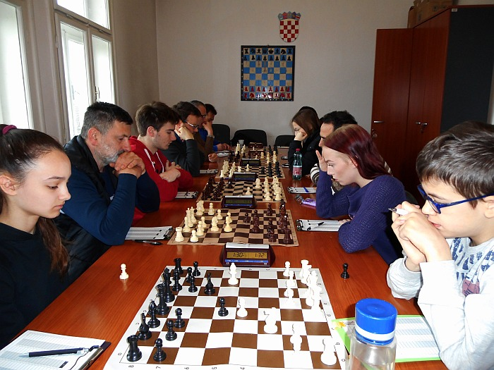

**Seniori, 5. kolo  
**

Jura pobijedio, ekipa remizirala, Monika odigrala svoju prvu, ali vrlo dobru partiju za seniorsku ekipu Kluba. To je sažetak današnjeg, [petog kola](http://chess-results.com/tnr414083.aspx?lan=13&art=3&rd=5) seniorske lige u kojoj smo ugostili ŠK Podsused. Vrlo rano poveli smo 2:0. Cvetko je uspio u rokadnom napadu osvojivši figuru, dok je Jura jednostavnom taktikom  također osvojio cijelu figuru. Zvjezdan je odigrao pomalo neozbiljno te na kraju izgubio matom. Mladi Ivan je ostao bez kvalitete, ali je imao solidnu poziciju koju je remizirao ponavljanjem poteza. Najdulje je igrao Stipe. Ušao je u topovsku s pješakom više, ali nije pronašao dobitnički plan. Vjerojatno najveći dobitak ovog kola je Monikina igra. Pomalo neprecizno igrala je otvaranje te ostala bez pješaka, a kasnije i bez kvalitete. Ipak, ostao joj je pješački majoritet na daminu krilu te je uspjela vratiti materijal i lijepom igrom ući u remi topovsku završnicu s pješakom manje. Iako je cijelu partiju, a igrala je nešto više od četiri sata, pravilno koristila vrijeme, na kraju je ipak upala u cajtnot i gubitnički potez povukla sa samo jednom sekundom na satu. Monika je druga kadetkinja, poslije Samante, koja je zaigrala za seniorsku ekipu i također pokazala da može igrati u ovoj konkurenciji. Vraneša je danas dao prednost nogometu. Sljedeće kolo igra se 5. svibnja kada gostujemo u Buševcu.

<table><tbody><tr><td></td><td></td><td>&nbsp;&nbsp;<strong>ŠK Odra</strong></td><td>–</td><td></td><td>&nbsp;&nbsp;<strong>ŠK Podsused</strong></td><td><strong>3 : 3</strong></td></tr><tr><td>1.</td><td>MK</td><td><table><tbody><tr><td></td><td>Bačurin, Juraj 2034</td></tr></tbody></table></td><td>–</td><td>MK</td><td><table><tbody><tr><td></td><td>Marković, Vjeran 2153</td></tr></tbody></table></td><td>1 – 0</td></tr><tr><td>2.</td><td>MK</td><td><table><tbody><tr><td></td><td>Maravić, Stjepan 2114</td></tr></tbody></table></td><td>–</td><td>WFM</td><td><table><tbody><tr><td></td><td>Iveković, Tihana 2086</td></tr></tbody></table></td><td>½ – ½</td></tr><tr><td>3.</td><td>MK</td><td><table><tbody><tr><td></td><td>Karlić, Zvjezdan 2110</td></tr></tbody></table></td><td>–</td><td>WFM</td><td><table><tbody><tr><td></td><td>Iveković, Ana 2061</td></tr></tbody></table></td><td>0 – 1</td></tr><tr><td>4.</td><td>I</td><td><table><tbody><tr><td></td><td>Maravić, Ivan 1836</td></tr></tbody></table></td><td>–</td><td>I</td><td><table><tbody><tr><td></td><td>Čolakić, Tomislav 1968</td></tr></tbody></table></td><td>½ – ½</td></tr><tr><td>5.</td><td>MK</td><td><table><tbody><tr><td></td><td>Cvetković, Ivan 1937</td></tr></tbody></table></td><td>–</td><td>MK</td><td><table><tbody><tr><td></td><td>Iveković, Zvjezdana 1747</td></tr></tbody></table></td><td>1 – 0</td></tr><tr><td>6.</td><td>II</td><td><table><tbody><tr><td></td><td>Kolovrat, Monika 1016</td></tr></tbody></table></td><td>–</td><td>II</td><td><table><tbody><tr><td></td><td>Duplančić, Luka 1561</td></tr></tbody></table></td><td>0 – 1</td></tr></tbody></table>

**

```pgn
[Event "J. Bačurin vs V. Marković"]
[SetUp "3"]
[FEN "4r3/ppp1q1kp/3p1np1/3P2Q1/4P2P/6N1/PPP5/5RK1 b - - 0 25"]
25.  Qe5 26. Rxf6 Qd4+ 27. Rf2 1-0
```

**
