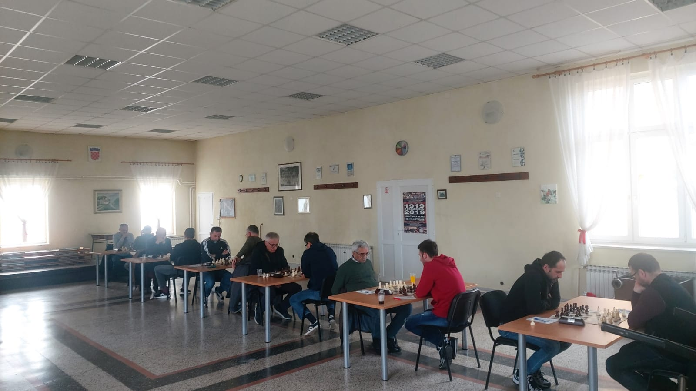

**Seniori, 3. kolo**  

<table><tbody><tr><td>Pl.</td><td></td><td><strong>ŠK Odra</strong></td><td>–</td><td></td><td><strong>ŠK Polet</strong></td><td><strong>4,5-1,5</strong></td></tr><tr><td>1.</td><td>MK</td><td>Karlić, Zvjezdan 2096</td><td>–</td><td>MK</td><td>Barlović, Tomislav 2086</td><td>½–½</td></tr><tr><td>2.</td><td>MK</td><td>Maravić, Ivan 2091</td><td>–</td><td>MK</td><td>Janković, Mirko 2076</td><td>½–½</td></tr><tr><td>3.</td><td>MK</td><td>Sliepčević, Mladen 2081</td><td>–</td><td>II</td><td>Bočkaj, Ivan 1964</td><td>1-0</td></tr><tr><td>4.</td><td>MK</td><td>Vidaković, Darko 2116</td><td>–</td><td>II</td><td>Tretinjak, Dario 1946</td><td>1-0</td></tr><tr><td>5.</td><td>MK</td><td>Kovač, Hrvoje 2124</td><td>–</td><td>III</td><td>Hržina, Boris 1815</td><td>1-0</td></tr><tr><td>6.</td><td>II</td><td>Šutić, Darko 1926</td><td>–</td><td>II</td><td>Kanjković, Antun 1873</td><td>½–½</td></tr></tbody></table>

Jučer smo odigrali 3. kolo [seniorske lige.](https://chess-results.com/tnr730961.aspx?lan=13&art=3&rd=3) Uspjeli smo upisati prvu pobjedu. Darkov protivnik je zapao u probleme nakon otvaranja te je Darko ubrzo osvojio materijal. Zvjezdan je izašao nešto bolji iz otvaranja, ali protivnik mu nije dopustio da to pretoči u nešto značajnije te je ubrzo sklopljen remi. Hrvoje je školski izveo rokadni napad, žrtvovao figuru za inicijativu koja je bila dobitnička. Na drugoj ploči Ivan je remizirao nakon otvaranja iz kojeg je proizašla jednaka pozicija. Idući je završio Mladen na trećoj ploči. Stajao je nešto bolje kad je suparnik nepotrebno oslabio rokadni položaj svog kralja, a ubrzo nakon tog i previdio damu. Najdulje se igrala partija na zadnjem stolu gdje je pozicija bila blokirana te na kraju završila podjelom boda. Božo je imao sudački debi te je bio neprimjetan, kako i priliči sucu. Sretni smo da smo uspjeli osvojiti prve bodove. Idući vikend igramo u Zaprešiću gdje nas ugošćuje ŠK Ban Jelačić.
