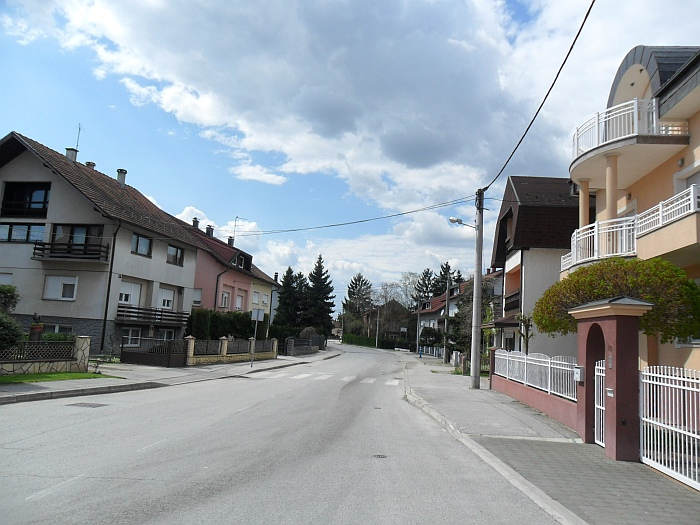
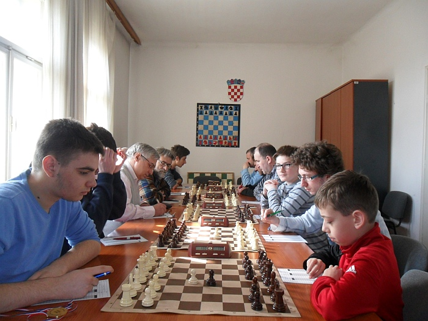

**Seniori, 3. kolo  
  
**

Po lijepu i sunčanu proljetnom  danu, u trećem kolu seniorske lige ekipa Šahovskoga kluba Prigorje Markuševac pregazila je domaću ekipu.  Znatno pomlađeni i ujedno pobjednici  V. lige u prošloj godini, lijepom igrom i s velikim ambicijama, Prigorje je zasluženo odnijelo bodove s  ovoga  gostovanja. Jedina olakotna okolnost za  ŠK Odra jest nastup s  pomlađenom  ekipom. Današnji dan treba pamtiti po prvom nastupu našega  kadeta Bože u  seniorskoj konkurenciji. Dobro se držao desetak poteza, ali je  onda podcijenio  napad protivnika. U svakom slučaju, Boži sve čestitke na  hrabroj igri i gotovo  dostojnoj zamjeni za svog strica! Vjerujem da je za  ubuduće dobro naučio da  manevrom Kh8,Tg8 može lako spriječiti mat po    otvorenoj G liniji. Drugi naš  kadet u seniorskoj konkurenciji, Ivan, odigrao je pogrešan redoslijed poteza u otvaranju, što je njegov iskusni protivnik brzo kaznio i zarobio mu damu još u fazi otvaranja. Boris i Tin lavovski su se borili, ali su nakon mnogo sati i sati igre na kraju ipak bili nadigrani. Bodove domaćinu donijela su danas jedina dva člana prve postave, Jura i Stipe. Jurin je protivnik previdio taktički udar, a Jura je zatim malu materijalnu prednost maestralnom igrom pretvorio u jedinu domaću pobjedu. Stipe je igrao prilično agresivno protiv svoga mnogo mlađeg protivnika i uspio steći materijalnu prednost, ali je onda u završnici previdio jednostavan plan za realizaciju te je uprkos višku materijala topovska završnica otišla u remi. Susret je sudio Darko.

ŠK Odra – ŠK Prigorje Markuševec  1,5:4,5

1\. Maravić, Stjepan – Balen, Teo 1/2  
2\. Bačurin, Juraj – Klement, Dubravko 1:0  
3\. Kobali, Boris – Bačić, Mile 0:1  
4\. Maravić, Ivan – Tušek, Milan 0:1  
5\. Furčić, Tin – Šelendić, Matija 0:1  
6\. Cvetković, Božo – Putak, Karlo 0:1

darko
