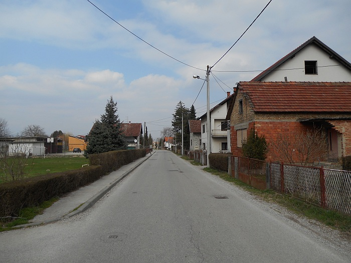
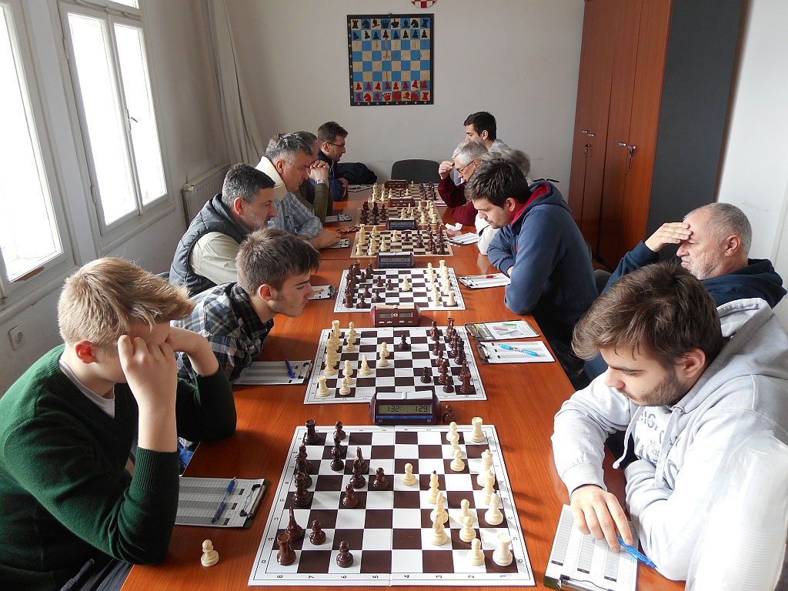

**Seniori, 1. kolo**  
  
Danas je počela [IV seniorska liga](http://chess-results.com/tnr332243.aspx?lan=13), a prvo kolo ugostili smo ŠK Prigorje Markuševec. Prošle godine plasirali smo se u ligu više prvenstveno zahvaljujući kadetima Ivanu i Vraneši. Dečki su, iako još uvijek osnovnoškolci, sazreli u vrlo dobre igrače koji se ravnopravno nose sa seniorima. A današnji cijeli meč je odigran na vrlo visokoj razini, bez većih previda ili grubih grešaka. Jura je dobro započeo partiju, ali je na prelazu u završnicu ostao sa udvojenim pješacima. Zahvaljujući neopreznosti protivnika koji se sam svezao, Jura je lako priveo partiju u remi. Stipe je na drugoj ploči cijelu partiju pokušavao ostvariti značajniju prednost, ali bez uspjeha. Darko i Cvetko su uspjeli doći u dobivene pozicije, ali u vremenskom tjesnacu nisu vidjeli dobitne varijante te su i oni remizirali. Ivan je imao par manjih previda i njegov protivnik je na kraju uspio realizirati ostvarenu materijalnu prednost. Ipak, kao i svim partijama u posljednje vrijeme, mladi Ivan je iskazao veliku borbenost. Vraneša je pak iskoristio pogrešku protivnika te osvojio pješaka i vrlo koncentriranom i strpljivom igrom iščupao cijeli bod. Čestitke protivnicima na dobroj igri, a posebno čestitke Vraneši na važnoj pobjedi kojom je osigurao ekipni meč bod.

**ŠK Odra – ŠK Prigorje Markuševec 3:3**

1.   MK Juraj Bačurin – MK Ivan Šelendić 1/2
2.   MK Stjepan Maravić – MK Milan Tušek 1/2
3.   MK Darko Vidaković – I Mile Bačić 1/2
4.   MK Ivan Cvetković – II Matija Šelendić 1/2
5.   II Ivan Maravić –  I Dubravko Klement 0:1
6.   III Ivan Vraneša – II Karlo Putak 1:0
