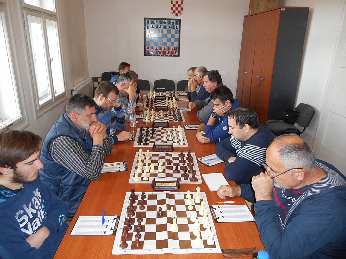

**Seniori, 9. kolo  
  
**Drugom ovogodišnjom pobjedom, popeli smo se za još jedno mjesto na ljestvici i sada su šanse za ostanak u ligi znatno veće. Prvi je završio Stipe, pravocrtnim napadom na protivničku rokadu. Na isti način partiju je priveo kraju i Maravić junior na šestoj ploči. Dolazio je par puta u napast polukorektno žrtvovati materijal, ali se uspio suzdržati. Darko je korektno žrtvovao materijal za rokadni napad, ali je onda neprecizno nastavio i na kraju dobio efektan mat. Cvetko je imao dva neprecizna poteza, njegov protivnik je to iskoristio i ušao u dobivenu završnicu. Zvjezdan je malo lutao s planom igre, ali nije propustio lijep taktički udar nakon kojeg je protivnik odmah predao. Najdulje je igrao Jura, koji je u nadmoćnoj poziciji previdio taktički udar te ostao s pješakom manje. Nasreću, ušao je u završnicu raznobojaca i donio ekipi presudnih pola boda.

<table><tbody><tr><td></td><td></td><td>&nbsp;&nbsp;&nbsp;&nbsp;&nbsp; <strong>ŠK Odra</strong></td><td><strong>–</strong></td><td><strong>&nbsp;</strong></td><td><strong>&nbsp;&nbsp;ŠK Rugvica-Vrbani</strong></td><td><strong>3,5 : 2,5</strong></td></tr><tr><td>1.</td><td>MK</td><td><table><tbody><tr><td></td><td>Bačurin, Juraj</td></tr></tbody></table></td><td>–</td><td>I</td><td><table><tbody><tr><td></td><td>Vukalović, Željko</td></tr></tbody></table></td><td>½ – ½</td></tr><tr><td>2.</td><td>MK</td><td><table><tbody><tr><td></td><td>Maravić, Stjepan</td></tr></tbody></table></td><td>–</td><td>MK</td><td><table><tbody><tr><td></td><td>Mišković, Stevo</td></tr></tbody></table></td><td>1 – 0</td></tr><tr><td>3.</td><td>MK</td><td><table><tbody><tr><td></td><td>Vidaković, Darko</td></tr></tbody></table></td><td>–</td><td>II</td><td><table><tbody><tr><td></td><td>Babaja, Mladen</td></tr></tbody></table></td><td>0 – 1</td></tr><tr><td>4.</td><td>MK</td><td><table><tbody><tr><td></td><td>Karlić, Zvjezdan</td></tr></tbody></table></td><td>–</td><td>III</td><td><table><tbody><tr><td></td><td>Tomaško, Miljenko</td></tr></tbody></table></td><td>1 – 0</td></tr><tr><td>5.</td><td>MK</td><td><table><tbody><tr><td></td><td>Cvetković, Ivan</td></tr></tbody></table></td><td>–</td><td>III</td><td><table><tbody><tr><td></td><td>Kovačević, Željko</td></tr></tbody></table></td><td>0 – 1</td></tr><tr><td>6.</td><td>II</td><td><table><tbody><tr><td></td><td>Maravić, Ivan</td></tr></tbody></table></td><td>–</td><td>VK</td><td><table><tbody><tr><td></td><td>Đonović, Marijan</td></tr></tbody></table></td><td>1 – 0</td></tr></tbody></table>

Tablica nakon 9. kola:

<table><tbody><tr><td><strong>Mj.</strong></td><td><strong>Momčad</strong></td><td><strong>1</strong></td><td><strong>2</strong></td><td><strong>3</strong></td><td><strong>4</strong></td><td><strong>5</strong></td><td><strong>6</strong></td><td><strong>7</strong></td><td><strong>8</strong></td><td><strong>9</strong></td><td><strong>10</strong></td><td><strong>11</strong></td><td><strong>12</strong></td><td><strong>&nbsp;TB1&nbsp;</strong></td><td><strong>&nbsp;TB2</strong></td></tr><tr><td>1</td><td>ŠK Dugo Selo</td><td>&nbsp;*</td><td>4</td><td>5</td><td>3</td><td>4</td><td></td><td>3</td><td>4</td><td>3½</td><td></td><td>4</td><td>4½</td><td><strong>16</strong></td><td>35,0</td></tr><tr><td>2</td><td>ŠK Silent, Zagreb</td><td>2</td><td>&nbsp;*</td><td>3½</td><td>3</td><td></td><td>3</td><td>4</td><td></td><td>3</td><td>5½</td><td>3½</td><td>2½</td><td><strong>11</strong></td><td>30,0</td></tr><tr><td>3</td><td>Karlovački šahovski klub</td><td>1</td><td>2½</td><td>&nbsp;*</td><td></td><td>3</td><td>3</td><td>3½</td><td></td><td>4½</td><td>3½</td><td>3</td><td>3½</td><td><strong>11</strong></td><td>27,5</td></tr><tr><td>4</td><td>ŠK UHBDR 99. brigade</td><td>3</td><td>3</td><td></td><td>&nbsp;*</td><td>3</td><td>3</td><td>3</td><td>5</td><td>2½</td><td></td><td>3</td><td>4½</td><td><strong>10</strong></td><td>30,0</td></tr><tr><td>5</td><td>ŠK INA, Zagreb</td><td>2</td><td></td><td>3</td><td>3</td><td>&nbsp;*</td><td>3½</td><td></td><td>2½</td><td>2</td><td>4</td><td>3½</td><td>3½</td><td><strong>10</strong></td><td>27,0</td></tr><tr><td>6</td><td>ŠK Špansko, Zagreb</td><td></td><td>3</td><td>3</td><td>3</td><td>2½</td><td>&nbsp;*</td><td>3½</td><td>2½</td><td>3½</td><td>4</td><td>2½</td><td></td><td><strong>9</strong></td><td>27,5</td></tr><tr><td>7</td><td>ŠK Odra, Zagreb</td><td>3</td><td>2</td><td>2½</td><td>3</td><td></td><td>2½</td><td>&nbsp;*</td><td>4½</td><td></td><td>3</td><td>3</td><td>3½</td><td><strong>8</strong></td><td>27,0</td></tr><tr><td>8</td><td>ŠK Vladimir Ivetić</td><td>2</td><td></td><td></td><td>1</td><td>3½</td><td>3½</td><td>1½</td><td>&nbsp;*</td><td>3½</td><td>2</td><td>3</td><td>3</td><td><strong>8</strong></td><td>23,0</td></tr><tr><td>9</td><td>ŠK Polet II, Buševec</td><td>2½</td><td>3</td><td>1½</td><td>3½</td><td>4</td><td>2½</td><td></td><td>2½</td><td>&nbsp;*</td><td>2</td><td></td><td>3½</td><td><strong>7</strong></td><td>25,0</td></tr><tr><td>10</td><td>ŠK Klaka, Zagreb</td><td></td><td>½</td><td>2½</td><td></td><td>2</td><td>2</td><td>3</td><td>4</td><td>4</td><td>&nbsp;*</td><td>4</td><td>2</td><td><strong>7</strong></td><td>24,0</td></tr><tr><td>11</td><td>ŠK Prigorje Markuševec</td><td>2</td><td>2½</td><td>3</td><td>3</td><td>2½</td><td>3½</td><td>3</td><td>3</td><td></td><td>2</td><td>&nbsp;*</td><td></td><td><strong>6</strong></td><td>24,5</td></tr><tr><td>12</td><td>ŠK Rugvica-Vrbani</td><td>1½</td><td>3½</td><td>2½</td><td>1½</td><td>2½</td><td></td><td>2½</td><td>3</td><td>2½</td><td>4</td><td></td><td>&nbsp;*</td><td><strong>5</strong></td><td>23,5</td></tr></tbody></table>
