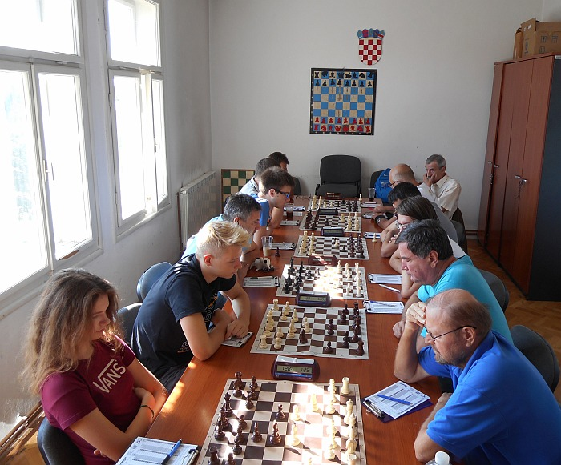
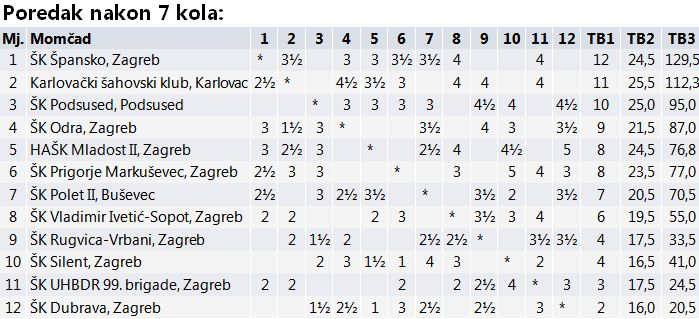

**Seniori, 7. kolo  
**

Seniorska ekipa ŠK Odra uspješno je odigrala sedmo kolo i pobjedom praktički osigurala ostanak u ligi.

  

U “seniorskoj” ekipi nastupilo je troje kadeta. 🙂 Po prvi put za seniore je zaigrala i Ana i remijem u jako dobroj partiji dala veliki doprinos današnjoj pobjedi. Ivan Maravić je silio poziciju do kraja, ali više od remija nije uspio ostvariti. Vraneša je krivo izračunao kombinaciju, ali uprkos tome, cijelu partiju imao je barem pola boda, kako je partija na kraju i završila. Prevagu su ipak donijeli seniori koji su ostvarili dvije pobjede. Zvjezdan je (ponovo) riješio partiju taktičkim udarom, a Cvetko je uzeo ponuđeni materijal i uspješno se obranio. Jura je na prvoj ploči rano preveo partiju u završnicu i remizirao.  
Lijepo je vidjeti da među kadetima imamo respektabilnih igrača (i igračica) koji nas mogu dostojno zamijeniti. A koji su svakim danom i sve bolji. Vraneša i Ivan su već zacementirali mjesto u seniorskoj postavi, a Ana je danas samo potvrdila da su tu i tri djevojke (Ana, Monika i Samanta) koje se mogu ravnopravno nositi sa protivnicima u seniorskoj ligi.

<table><tbody><tr><td></td><td></td><td>&nbsp;<strong>&nbsp;ŠK Odra</strong></td><td><strong>–</strong></td><td><strong>&nbsp;</strong></td><td><strong>&nbsp;&nbsp;ŠK Rugvica-Vrbani</strong></td><td><strong>4 :</strong> <strong>2</strong></td></tr><tr><td>1.</td><td>MK</td><td><table><tbody><tr><td></td><td>Bačurin, Juraj 2033</td></tr></tbody></table></td><td>–</td><td>I</td><td><table><tbody><tr><td></td><td>Vukalović, Željko 1930</td></tr></tbody></table></td><td>½ – ½</td></tr><tr><td>2.</td><td>MK</td><td><table><tbody><tr><td></td><td>Karlić, Zvjezdan 2113</td></tr></tbody></table></td><td>–</td><td>MK</td><td><table><tbody><tr><td></td><td>Mišković, Stevo 1900</td></tr></tbody></table></td><td>1 – 0</td></tr><tr><td>3.</td><td>I</td><td><table><tbody><tr><td></td><td>Maravić, Ivan 1947</td></tr></tbody></table></td><td>–</td><td>III</td><td><table><tbody><tr><td></td><td>Tomaško, Miljenko 1826</td></tr></tbody></table></td><td>½ – ½</td></tr><tr><td>4.</td><td>MK</td><td><table><tbody><tr><td></td><td>Cvetković, Ivan 1944</td></tr></tbody></table></td><td>–</td><td>II</td><td><table><tbody><tr><td></td><td>Mahečić, Lovre 1908</td></tr></tbody></table></td><td>1 – 0</td></tr><tr><td>5.</td><td>II</td><td><table><tbody><tr><td></td><td>Vraneša, Ivan 1601</td></tr></tbody></table></td><td>–</td><td>II</td><td><table><tbody><tr><td></td><td>Babaja, Mladen 1848</td></tr></tbody></table></td><td>½ – ½</td></tr><tr><td>6.</td><td>II</td><td><table><tbody><tr><td></td><td>Kolovrat, Ana 1179</td></tr></tbody></table></td><td>–</td><td>II</td><td><table><tbody><tr><td></td><td>Blagojević, Ranko 1683</td></tr></tbody></table></td><td>½ – ½</td></tr></tbody></table>

---

```pgn
[Event "S. Mišković vs Z. Karlić"]
[Date "2019.09.15"]
[Round "7"]
[SetUp "3"]
[FEN "3r2k1/1p3pb1/1q2bnpp/pP2p3/P1p1P3/B1Pn1NP1/2QN1PBP/5RK1 b - - 0 22"]22.  Ng4 23. Nb1 Ngxf2 24. h4 Nxe4+ 25. Kh2 Nef2 26. Bh1 Ng4+ 0-1
```
