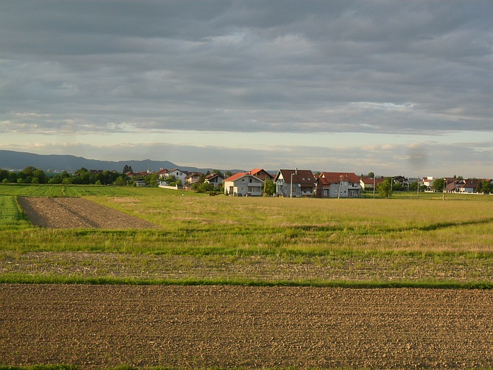
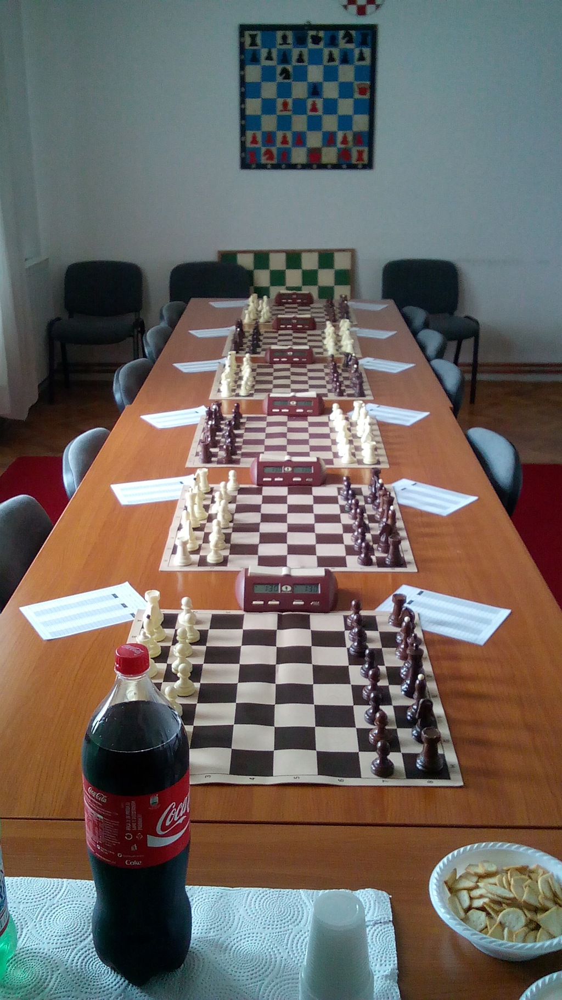
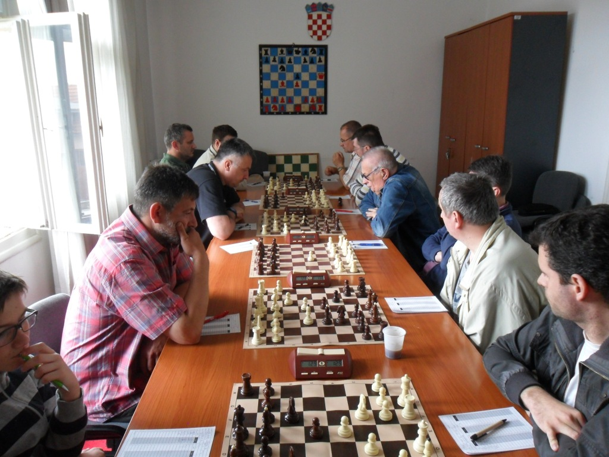
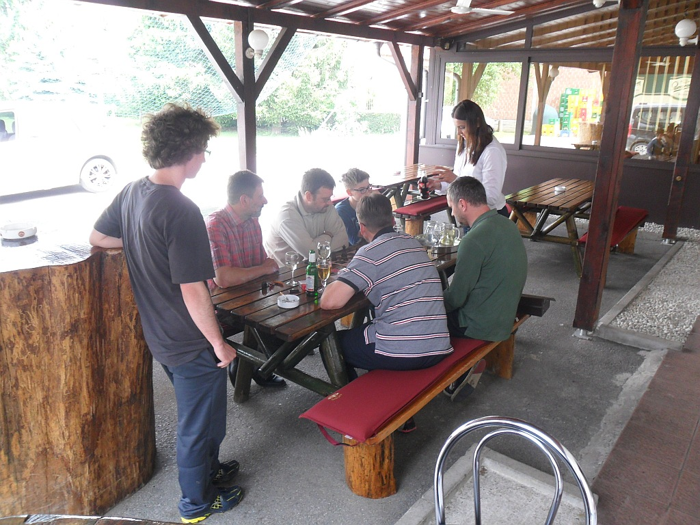
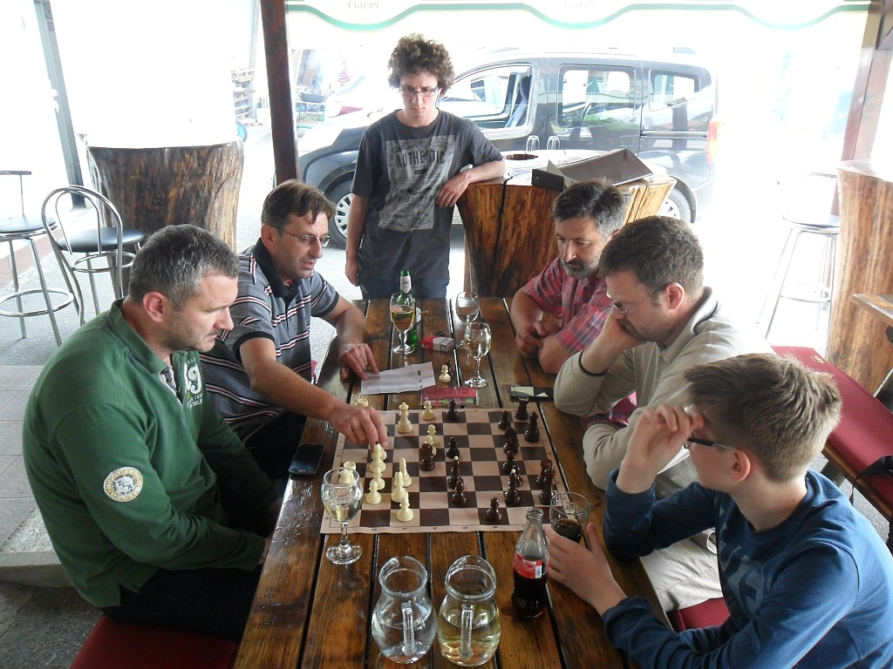
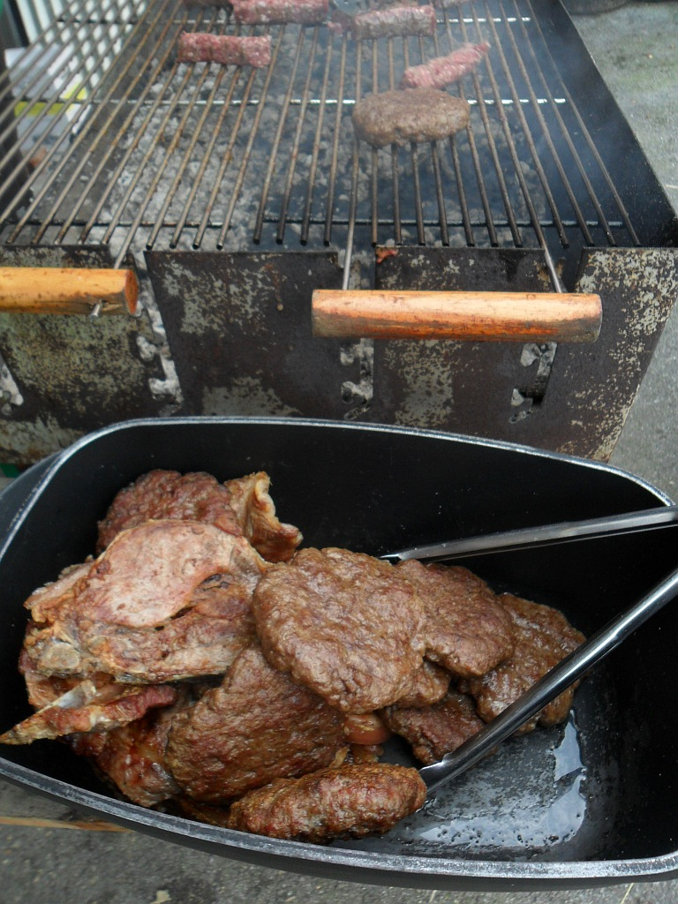
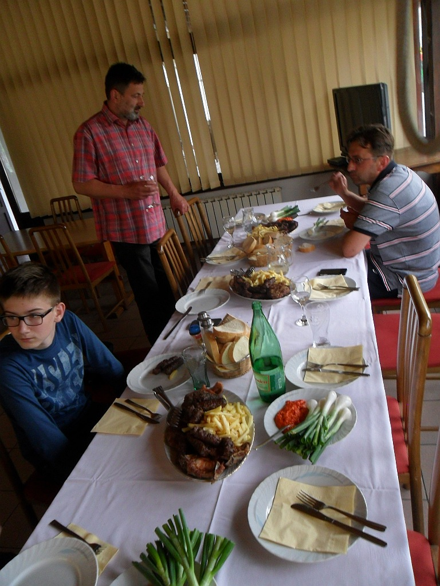
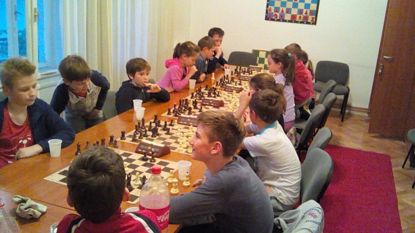

**Seniori, 6. kolo**

Danas je završen proljetni dio seniorske lige. U goste je došla ekipa ŠK Silent i zasluženo odnijela bodove. Na šestoj ploči Ivan je odigrao sigurno i bez pogrešaka odveo partiju u topovsku remi-završnicu, u kojoj je čak i bolje stajao, ali nedovoljno za više od podjele bodova. Cvetkov protivnik uspješno se obranio na petoj ploči i tu je također sklopljen remi. Stipe je sklopio remi na temelju ostalih pozicija koje su obećavale pozitivan rezultat. Ipak, Jura u završnici odustaje od vlastitog plana, previđa te gubi partiju. Darko je uspio u otvaranju ostati bez pješaka i kvalitete (šeh-šuh!), zatim preuzima inicijativu, ali na kraju u dobivenoj poziciji propušta nekoliko dobitnih nastavaka i protivnik s figurom manje uspijeva remizirati vječnim šahom. Zvjezdan, nažalost, premalo igra te je propustio nekoliko aktivnih nastavaka, a onda i grubo pogriješio te izgubio partiju. Poslije meča ekipa je u dobrom raspoloženju u  “Rujnu” analizirala partije i općenitu situaciju u klubu, s naglaskom na igrački kadar.  
   

ŠK ODRA – ŠK SILENT 2:4

1\. MK Karlić, Zvjezdan – FM Božinović, Bogdan 0:1  
2\. MK Maravić, Stjepan – MK Cechi, Goran ½  
3\. MK Vidaković, Darko – MK Nikolić, Emil ½  
4\. MK Bačurin, Juraj – I Švec, Darko 0:1  
5\. MK Cvetković, Ivan – I Golemović, Tvrtko ½  
6\. IV Maravić, Ivan – III Svornik, Zvonimir ½  
Liga se nastavlja 13. rujna gostovanjem u Jastrebarskom, s ekipom koja je izravni konkurent u borbi za ostanak u ligi. [4\. liga CENTAR A bilten br.3](/files/wp/2015/05/4.-liga-CENTAR-A-bilten-br.3.pdf)

**Šahovska škola**

Djevojke su sada u naprednijoj skupini i pravo je zadovoljstvo vidjeti da prostor postaje premalen za sve mlade šahiste i šahistice. Zato se u početničkoj skupini oslobodilo više mjesta i pozivamo sve zainteresirane da slobodno navrate i pridruže se. Šahovska je škola besplatna i ponajprije namijenjena sadašnjim i budućim učenicima OŠ Odra, ali su i svi ostali dobrodošli. Početnički tečaj održava se svakog petka od 18.30 do 19.30 prema rasporedu na ovim stranicama.

darko
