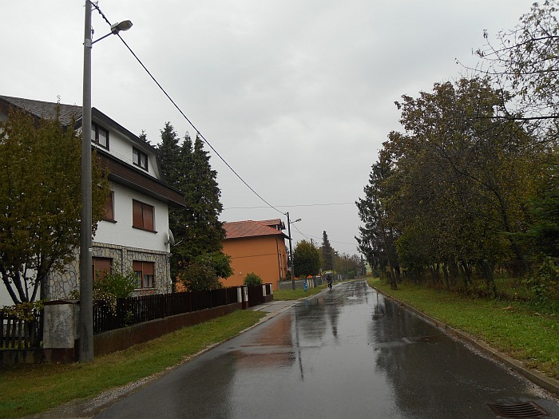
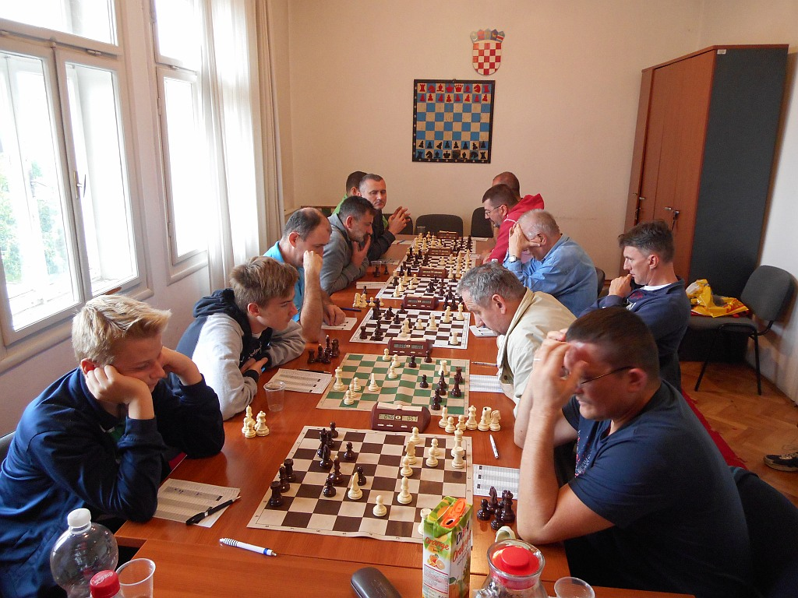
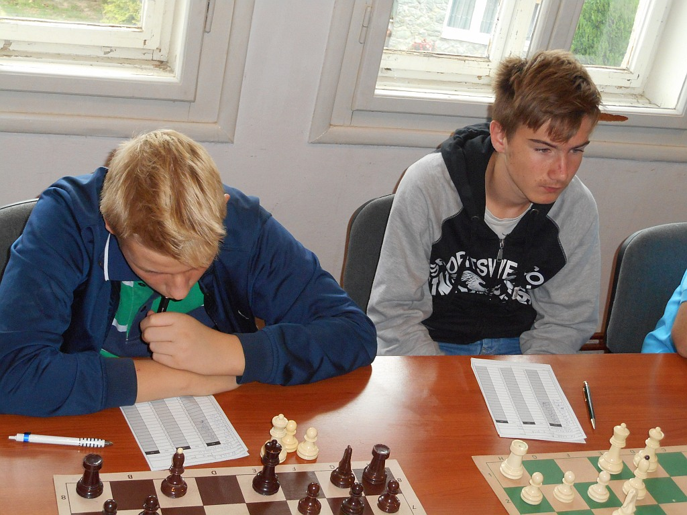

**Seniori, 9. kolo  
  
**Po pravome jesenskom vremenu ŠK Odra ugostio je danas ŠK Silent iz Zagreba. Tin se razbolio pa je u posljednji trenutak došlo do izmjena u sastavu. Darko je zbog obveze suđenja stoga ispao iz sastava, a uskočio je vrlo čvrsti Boris. Kao i u prošlom kolu, i u ovome smo nastupili s dva kadeta u ekipi. Čini mi se da Ivan i Vraneša postaju standardni prvotimci. Naime, u ovom kolu samo je **Vraneša** ubilježio pobjedu i spasio ugled Kluba! To je ujedno **njegova prva pobjeda u seniorskoj ligi** i tu partiju, kao i partiju Ivana Maravića, donosimo u nastavku. Dečki su uistinu ugodno iznenadili. Igrali su čvrsto i, što je najvažnije, forsirali te pokušavali izvući i više od pola boda. Ivan je zbog toga izgubio siguran remi, ali smatram da u ovoj dobi moraju upravo tako igrati.  
Na prvoj ploči Zvjezdan je protiv fide majstora Božinovića vrlo rano ušao u komplikacije koje mu nažalost nisu donijele ništa dobroga. Usprkos jučerašnjoj teškoj ozljedi desne ruke, Stipe (nasreću ljevak) postavio je čvrstu obranu, ali se njegov protivnik nije zalijetao i na drugoj ploči nije bilo više od pola boda. Cvetko je danas bio vrlo siguran, dugo je igrao lovačku završnicu i pokušavao na svaki način osvojiti cijeli bod za ekipu, ali se čvrsti Nikolić na trećoj ploči nije dao smesti pa je partija također završila remijem. Boris je cijelu partiju igrao mrvicu podređenu poziciju i taman kada mu je protivnik uzeo dva topa za damu i činilo se da to neće dobro završiti, Boris je ipak vidio više, iskoristio protivnikovu slabost prvog reda i lako remizirao vječnim šahom. Ivan je na petoj ploči imao cijelo vrijeme ugodnu, mrvicu bolju poziciju, ali je protivnik na kraju uspio izjednačiti. Tada je Ivan počeo siliti poziciju i brzo izgubio. Ipak, vjerujem da to što je naučio vrijedi više od izgubljenih pola boda. Na šestoj ploči Vraneša je igrao čvrsto i bez respekta. Kada je pozicija bila remi, držao je remi. Kada se protivnik zaletio, lako je iskoristio ponuđenu priliku. I on je tijekom partije dosta forsirao i to je za svaku pohvalu.  
Za tri tjedna ŠK Odra gostuje u Jastrebarskom kod ŠK Jaska.

**ŠK ODRA – ŠK SILENT 2,5:3,5**

1\. MK Zvjezdan Karlić 2166 – FM Bogdan Božinović 2226 **0:1**  
2\. MK Stjepan Maravić 2093 – MK Goran Cechi 2015 **1/2**  
3\. MK Ivan Cvetković 1960 – MK Emil Nikolić 2120 **1/2**  
4\. IV Borislav Kobali 1678 – I Darko Švec 1916 **1/2**  
5\. III Ivan Maravić 1439 – I Tvrtko Golemović 1731 **0:1**  
6\. IV Ivan Vraneša 1348 – IV Stjepan Špilek 1678 **1:0**

   

---

```pgn
[Event "IV liga centar A"]
[Site "sahovski-klub.com"]
[Date "2016.10.02"]
[Round "9"]
[White "Maravic, Ivan 1439"]
[Black "Golemovic, Tvrtko 1731"]
[Result "0-1"]
[ECO "B14"]
[PlyCount "90"]

1. e4 c6 2. d4 d5 3. exd5 cxd5 4. c4 Nf6 5. Nc3 e6 6. Nf3 Nc6 7. Bg5 Be7 8. Be2
Qb6 9. a3 dxc4 10. Bxc4 O-O 11. O-O a6 12. b4 Qd8 13. Qd2 b5 14. Be2 Bb7 15.
Rfd1 Nd5 16. Bxe7 Ncxe7 17. Rac1 Qd6 18. Ne4 Qf4 19. Nc5 Qxd2 20. Rxd2 Ra7 21.
Rdc2 Nf4 22. Nxb7 Nxe2+ 23. Rxe2 Rxb7 24. Rec2 Rd8 25. Rc7 Rxc7 26. Rxc7 Kf8
27. Kf1 f6 28. Ke2 Ke8 29. Kd3 Rd7 30. Rc5 Kd8 31. a4 bxa4 32. Ra5 Nd5 33. Rxa4
Rb7 34. g3 Rb6 35. Kc4 Rc6+ 36. Kd3 Rc3+ 37. Ke2 Rc6 38. Kd3 Rb6 39. Kc4 Kc7
40. Nd2 Rc6+ 41. Kd3 Kb6 42. Ne4 Kb5 43. Nc5 Nxb4+ 44. Kc3 Rxc5+ 45. Kb3 Rc4
0-1
```

---

```pgn
[Event "IV Liga centar A"]
[Site "sahovski-klub.com"]
[Date "2016.10.02"]
[Round "9"]
[White "Stjepan , Spilek 1678"]
[Black "Ivan , Vranesa 1348"]
[Result "0-1"]
[ECO "D30"]
[PlyCount "118"]

1. d4 d5 2. e3 e6 3. c4 c5 4. dxc5 Bxc5 5. cxd5 Qxd5 6. Qxd5 exd5 7. Nf3 Nc6 8.
Bb5 Nge7 9. Nc3 Be6 10. a3 O-O 11. b4 Bb6 12. Na4 Bc7 13. Nc5 Bc8 14. Bb2 Rd8
15. h3 f6 16. Rd1 a5 17. Bxc6 bxc6 18. O-O Kf7 19. Rd2 axb4 20. axb4 Rb8 21.
Bc3 Bd6 22. Ra2 Bxc5 23. bxc5 Rb5 24. Ra5 Bd7 25. Rfa1 Rdb8 26. Rxb5 Rxb5 27.
Bd4 Nf5 28. Ra7 Ke7 29. g4 Nxd4 30. exd4 Rb3 31. Kg2 Rd3 32. h4 h6 33. g5 hxg5
34. hxg5 Ke6 35. Ra8 Ke7 36. Ra7 Ke6 37. gxf6 gxf6 38. Kg3 Ke7 39. Kf4 Ke6 40.
Ra4 Ke7 41. Ne1 Rc3 42. Ng2 Rc4 43. Rxc4 dxc4 44. Ke3 Ke6 45. Kd2 Kf5 46. Kc3
Be6 47. Ne3+ Ke4 48. Nxc4 Bd5 49. Nd2+ Kf4 50. Kd3 f5 51. Nf1 Kf3 52. Ng3 f4
53. Nh5 Bf7 54. Nf6 Kxf2 55. Ng4+ (55. d5 cxd5 56. Kd2 Kg2 57. c6 f3 58. c7 Be6
59. Nxd5) 55... Kg3 56. Ne5 Bd5 57. Ke2 f3+ 58. Kf1 f2 59. Ke2 Kg2 0-1
```
