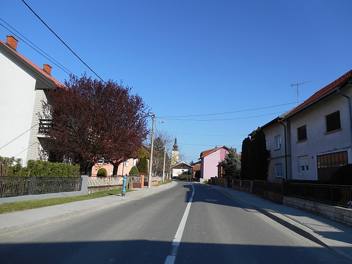
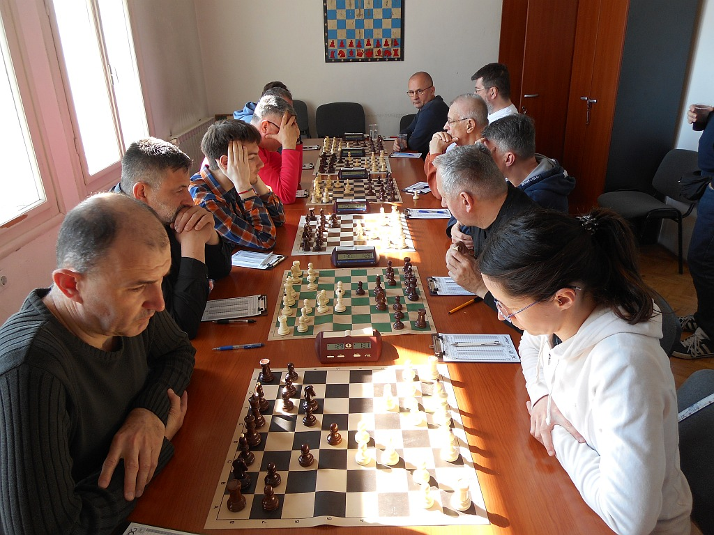

**Seniori, 3. kolo  
  
**Danas je malo nedostajalo za pobjedu nad ekipom ŠK Silent, koja nas inače redovito pobjeđuje. U ekipu se po završetku Kadetskog prvenstva Zagreba (na kojem je opet osvojio prvo mjesto!) vratio Ivan Maravić i lijepom pobjedom pokazao zašto je, uprkos godinama, standardan član seniorske ekipe. Korektno je žrtvovao kvalitet, da bi na kraju završio u završnici s dva pješaka više. Mala je šteta što je Vraneša, naš drugi kadet iz seniorske ekipe, ipak danas dao prednost nogometu. Jura i Stipe su bili nadigrani, ali je Darko propustio dobiti partiju. Cijelu partiju je bio nadmoćan, da bi na kraju uzeo materijal potez prerano, previdivši napad protivnika. Cvetko je vrlo brzo dobio u napadu kojeg je njegov protivnik podcijenio. A Kobali se dočepao prvih pola boda, prihvativši remi u boljoj poziciji.

<table><tbody><tr><td><strong>Kolo:</strong></td><td><strong>3.</strong></td><td><strong>&nbsp;&nbsp;ŠK Odra, Zagreb</strong></td><td><strong>–</strong></td><td>&nbsp;</td><td><strong>&nbsp;&nbsp;ŠK Silent, Zagreb</strong></td><td><strong>3 : 3</strong></td></tr><tr><td>1.</td><td>MK</td><td><table><tbody><tr><td></td><td>Bačurin, Juraj</td></tr></tbody></table></td><td>–</td><td>FM</td><td><table><tbody><tr><td></td><td>Božinović, Bogdan</td></tr></tbody></table></td><td>0 – 1</td></tr><tr><td>2.</td><td>MK</td><td><table><tbody><tr><td></td><td>Maravić, Stjepan</td></tr></tbody></table></td><td>–</td><td>MK</td><td><table><tbody><tr><td></td><td>Cechi, Goran</td></tr></tbody></table></td><td>0 – 1</td></tr><tr><td>3.</td><td>MK</td><td><table><tbody><tr><td></td><td>Vidaković, Darko</td></tr></tbody></table></td><td>–</td><td>MK</td><td><table><tbody><tr><td></td><td>Nikolić, Emil</td></tr></tbody></table></td><td>½ – ½</td></tr><tr><td>4.</td><td>II</td><td><table><tbody><tr><td></td><td>Maravić, Ivan</td></tr></tbody></table></td><td>–</td><td>I</td><td><table><tbody><tr><td></td><td>Švec, Darko</td></tr></tbody></table></td><td>1 – 0</td></tr><tr><td>5.</td><td>MK</td><td><table><tbody><tr><td></td><td>Cvetković, Ivan</td></tr></tbody></table></td><td>–</td><td>I</td><td><table><tbody><tr><td></td><td>Golemović, Tvrtko</td></tr></tbody></table></td><td>1 – 0</td></tr><tr><td>6.</td><td>IV</td><td><table><tbody><tr><td></td><td>Kobali, Borislav</td></tr></tbody></table></td><td>–</td><td>IV</td><td><table><tbody><tr><td></td><td>Vuljanić, Ana</td></tr></tbody></table></td><td>½ – ½</td></tr></tbody></table>
