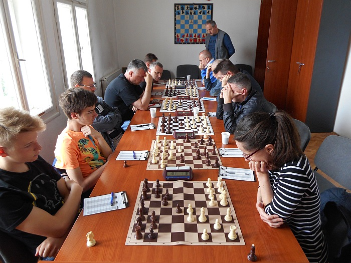

**Seniori, 5. kolo  
**ŠK Silent je zasluženo odnio bodove u petom kolu. A mi smo nastavili lošu igru započetu u prošlom kolu. Jura, Darko i Zvjezdan su loše odigrali otvaranja i ostali s pješakom manje, a Zvjezdan s kvalitetom. Jurina i Darkova pozicija se vremenom raspala, prvenstveno zahvaljujući dobroj igri protivnika, dok je Zvjezdan uspio ući u remi završnicu. Ali je onda nepotrebno ubrzao igru i uspio izgubiti. Stipe se dobro držao i sklopio remi u objektivno izjednačenoj završnici u kojoj je još mogao igrati, ali nije vidio jednostavan način na koji je mogao osvojiti pješaka. Ivan je igrao solidno, pod kraj partije napravio je neke slabosti u poziciji i ostao bez pješaka, ali je hrabro forsirao i zahvaljujući boljem položaju topova, remizirao. Vraneša je igrao strpljivo, vidi se da je malo radio i na otvaranjima (sličnu poziciju je izgubio u kadetskoj ligi), dočekao nekoliko lošijih izmjena protivnice, nakon kojih su njegove figure proigrale, osvojio materijal i lako završio partiju. On je za sada jedini standardni igrač bez poraza. Ovim porazom uspjeli smo ući u zonu ispadanja, trenutačno smo pretposljednji na [tablici](http://chess-results.com/tnr332243.aspx?lan=13&art=0), bez ijedne pobjede u proljetnom dijelu natjecanja. Liga se nastavlja 23. rujna kada gostujemo kod ŠK Vladimir Ivetić.

<table><tbody><tr><td></td><td></td><td>&nbsp;<strong>&nbsp;ŠK Odra, Zagreb</strong></td><td><strong>–</strong></td><td><strong>&nbsp;</strong></td><td><strong>&nbsp;&nbsp;ŠK Silent, Zagreb</strong></td><td><strong>2 : 4</strong></td></tr><tr><td>1.</td><td>MK</td><td><table><tbody><tr><td></td><td>Bačurin, Juraj</td></tr></tbody></table></td><td>–</td><td>FM</td><td><table><tbody><tr><td></td><td>Božinović, Bogdan</td></tr></tbody></table></td><td>0 – 1</td></tr><tr><td>2.</td><td>MK</td><td><table><tbody><tr><td></td><td>Maravić, Stjepan</td></tr></tbody></table></td><td>–</td><td>MK</td><td><table><tbody><tr><td></td><td>Nikolić, Emil</td></tr></tbody></table></td><td>½ – ½</td></tr><tr><td>3.</td><td>MK</td><td><table><tbody><tr><td></td><td>Vidaković, Darko</td></tr></tbody></table></td><td>–</td><td>MK</td><td><table><tbody><tr><td></td><td>Cechi, Goran</td></tr></tbody></table></td><td>0 – 1</td></tr><tr><td>4.</td><td>MK</td><td><table><tbody><tr><td></td><td>Karlić, Zvjezdan</td></tr></tbody></table></td><td>–</td><td>I</td><td><table><tbody><tr><td></td><td>Švec, Darko</td></tr></tbody></table></td><td>0 – 1</td></tr><tr><td>5.</td><td>II</td><td><table><tbody><tr><td></td><td>Maravić, Ivan</td></tr></tbody></table></td><td>–</td><td>I</td><td><table><tbody><tr><td></td><td>Golemović, Tvrtko</td></tr></tbody></table></td><td>½ – ½</td></tr><tr><td>6.</td><td>III</td><td><table><tbody><tr><td></td><td>Vraneša, Ivan</td></tr></tbody></table></td><td>–</td><td>II</td><td><table><tbody><tr><td></td><td>Vuljanić, Ana</td></tr></tbody></table></td><td>1 – 0</td></tr></tbody></table>
