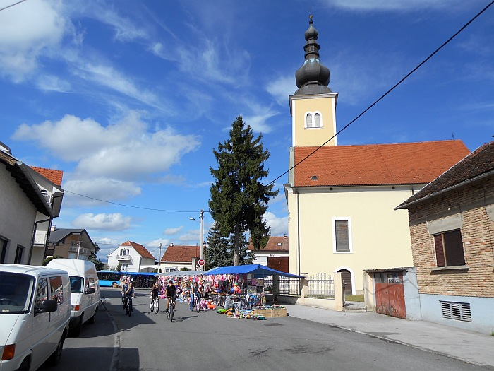
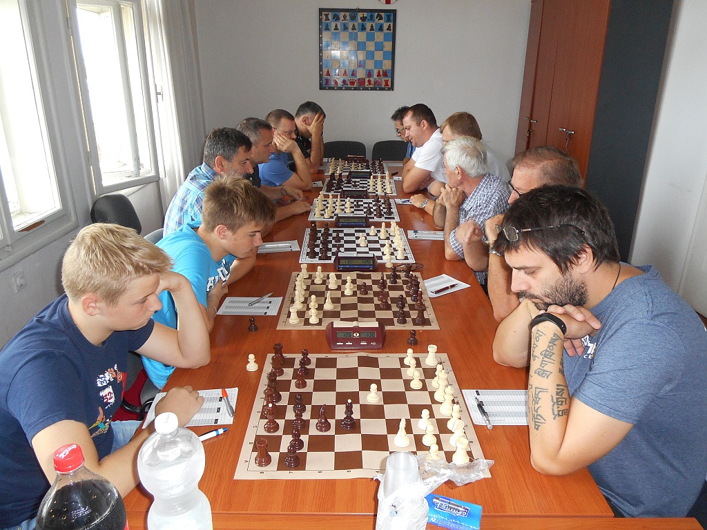
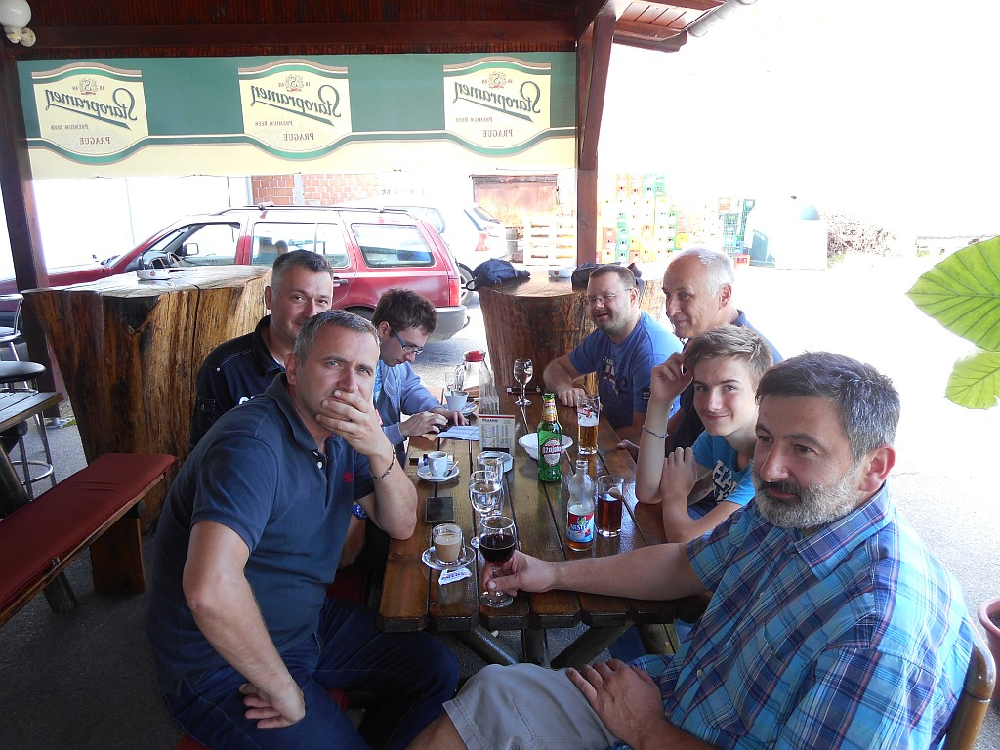

**Seniori, 7. kolo  
  
**U kišno jutro, koje se nešto poslije pretvorilo u lijep i sunčan dan, počeo je jesenski dio seniorske lige. U goste nam je došla ekipa ŠK Špansko, trenutačno druga na tablici, za razliku od nas, koji smo se prilijepili za njezino dno. Očekivano, izgubili smo i ovaj meč, a veliki plus može se vidjeti samo u napretku naših kadeta, koje smo postavili na posljednje dvije ploče. Na prvoj ploči, uz malu pomoć protivnika, Darko je brzo stekao izglednu poziciju. No pri prvom izboru kojeg pješaka uzeti, grubo je pogriješio i zapao pod neobranjiv napad. Na drugoj i trećoj ploči Zvjezdan i Stipe odigrali su čvrsto do kraja i partije su otišle u remi. Stipe je čak imao kvalitetu više, ali je pozicija ipak bila remi. Cvetko se dobro držao, imao čak i bolju poziciju koju je taktikom trebalo dokazati, ali je onda u jednom potezu sve upropastio. Ivan je na petoj ploči imao dva pješaka više, a time naravno i dobivenu poziciju, ali je i on, ugledavši se na starije kolege, počinio grubi previd te izgubio dva pješaka u jednom potezu i ušao u tešku završnicu, u koju je uspio previdjeti i trećeg pješaka. Šteta, jer je danas samo on bio u potpuno dobivenoj poziciji. Vraneša se dobro držao, ali se prekasno odlučio za rokadu te je na kraju ušao u završnicu koju nije mogao održati, s kvalitetom manje.  Zaslužena pobjeda ekipe iz Španskoga, koja je sada samo jedan bod iza vodeće ekipe iz Zaprešića. Meč je sudio Tin, koji je u sljedećem kolu spreman pokazati i šahovsko umijeće. Za jedan tjedan ŠK Odra gostuje kod ŠK Prigorje Markuševec.

**ŠK ODRA – ŠK ŠPANSKO 1:5**

1\. MK Vidaković, Darko 2099 – MK Mravunac, Damir 2142 **0:1**  
2\. MK Karlić, Zvjezdan 2143 – MK Knežević, Krešimir 2120 **1/2**  
3\. MK Maravić, Stjepan 2087 – MK Vodopija, Goran 2080 **1/2**  
4\. MK Cvetković, Ivan 1940 – MK Sonntag, Slavko 2020 **0:1**  
5\. III Maravić, Ivan 1756 – I Ranogajec, Borislav 1867 **0:1**  
6\. IV Vraneša, Ivan 1641 – II Poljak, Nikola 1907 **0:1**

 
