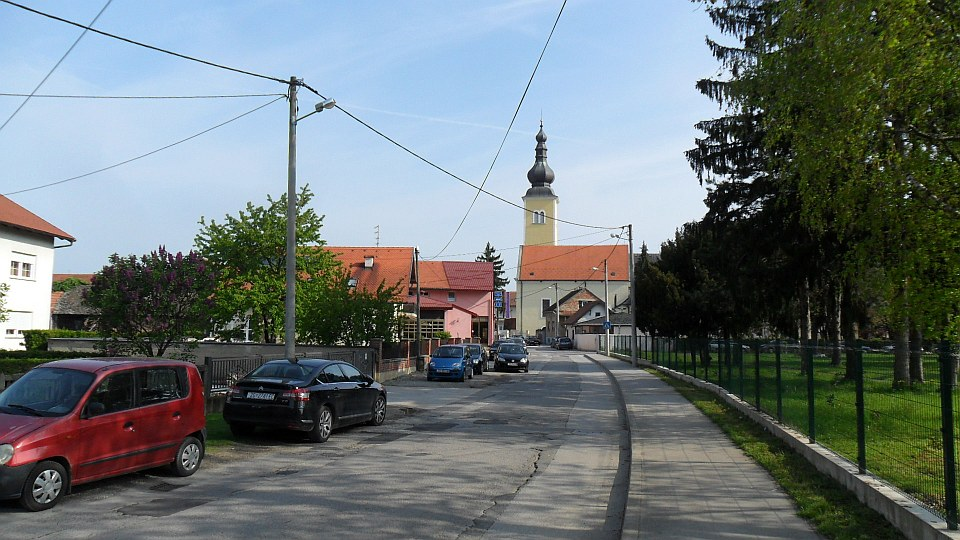

##### Seniori, 5. kolo

U danas odigranome šestom kolu, u meču između ŠK Odra i ŠK Špansko, mnogo je bolja bila ekipa iz Španskoga i uvjerljivo slavila sa 4:2. U ekipi domaćina dobro su igrali Stipe i Boris. Stipe je svoju dobru igru okrunio bodom, dok je Borisov protivnik ipak dočekao sitnu nepravilnost te osvojio materijal, a zatim i cijeli bod. Danko i Zvjezdan igrali su s previše propusta. Bilo je tu po nekoliko previda koji su mogli donijeti bodove ekipi domaćina, ali su na kraju te partije otišle u remi. Cvetko i Darko igrali su brzopleto i obojica previdjeli po figuru. Susret je sudio Tin Furčić.

ŠK ODRA – ŠK ŠPANSKO 2 : 4

1\. Maravić Stjepan – Mravunac Damir 1:0  
2\. Brajdić Danko – Blagojević Stanislav 1/2  
3\. Karlić Zvjezdan – Ranogajec Borislav 1/2  
4\. Cvetković Ivan – Petan Dragutin 0:1  
5\. Vidaković Darko – Belicki Antonijo 0:1  
6\. Kobali Borislav – Klemen Mladen 0:1

Jučer su u Varaždinskim toplicama završene kadetske lige. Dečki su ponovo imali dvije pobjede i jedan poraz, dok su kadetkinje izgubile sva tri meča. Plan je bio da se odigra ova liga, da mladi kadeti i kadetkinje steknu malo iskustva,naviknu se na pravila i počnu pisati (tu još zapinje ekipa kadetkinja!). U tome smo uspjeli i ove godine nastupili s dvije ekipe! Ovom prilikom zahvaljujem roditeljima, koji su iznijeli najveći teret, zahvaljujem igračima koji su se dobro zabavili, a i okupali nakon nastupa (a Ana se kupala i između dva kola, priča se… 🙂 ) te se nadam da će nastaviti igrati i turnire izvan liste obvezatnih kako bi sljedeće godine bili spremni za jedan iskorak te će ekipa kadetkinja početi dobivati mečeve, a ekipa kadeta izboriti plasman u višu ligu! Sljedeći petak okupljanje za sve skupine u 18:30.
