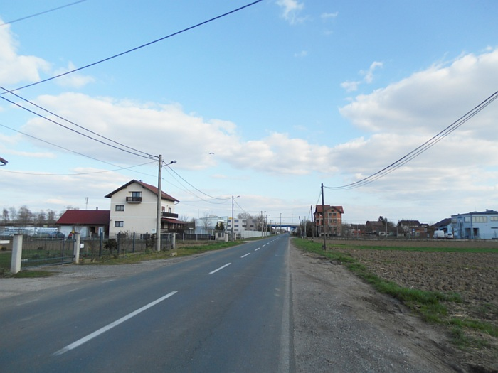
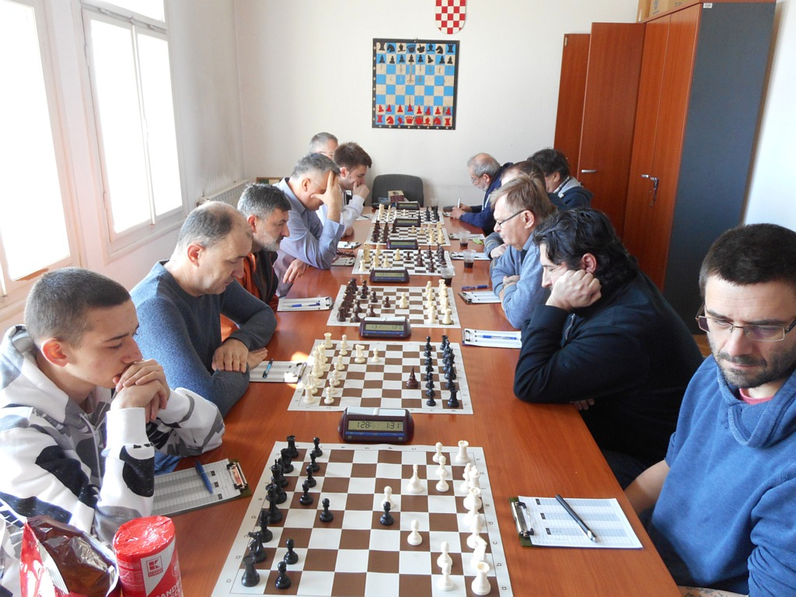

**Seniori, 1. kolo  
  
**Zasluženu pobjedu u prvom kolu [seniorske lige](https://chess-results.com/tnr514822.aspx?lan=13&art=0) odnijela je ekipa iz Španskog. Stipe je odigrao lijepu partiju i zasluženo uzeo bod na prvoj ploči. Mladi Ivan se branio cijelu partiju, već uobičajeno došao u vremenski tjesnac i kada je uspio potpuno izjednačiti, u cajtnotu je izabrao pogrešnu liniju. Darko je držao pritisak cijelu partiju te bio bolji i u vremenu te dočekao pogrešku protivnika. Cvetko se razvijao na pomalo čudan način, ali je uspio doći u potpuno dobivenu poziciju i onda neobjašnjivo uzeo pogrešnog pješaka. Boris je igrao brzopleto i previđao. Na kraju je čak previdio i mat. Božo je zadržao stare boljke i zapostavljao razvoj te ga je protivnik lako nadigrao. Nadamo se da će se već sljedeću partiju više pridržavati šahovskih principa. Sljedeće kolo gostujemo kod ŠK INA.

<table><tbody><tr><td></td><td>&nbsp;&nbsp;<strong>ŠK Odra</strong><strong>, Zagreb</strong></td><td><strong>–</strong></td><td><strong>&nbsp;</strong></td><td><strong>&nbsp;&nbsp;ŠK Špansko, Zagreb</strong></td><td><strong>2 : 4</strong></td></tr><tr><td>MK</td><td><table><tbody><tr><td></td><td>&nbsp;Maravić, Stjepan 2120</td></tr></tbody></table></td><td>–</td><td>FM</td><td><table><tbody><tr><td></td><td>Petrović, Zvonko 2156</td></tr></tbody></table></td><td>1 – 0</td></tr><tr><td>I</td><td><table><tbody><tr><td></td><td>Maravić, Ivan 2023</td></tr></tbody></table></td><td>–</td><td>MK</td><td><table><tbody><tr><td></td><td>Mravunac, Damir 2125</td></tr></tbody></table></td><td>0 – 1</td></tr><tr><td>MK</td><td><table><tbody><tr><td></td><td>Vidaković, Darko 2103</td></tr></tbody></table></td><td>–</td><td>MK</td><td><table><tbody><tr><td></td><td>Knežević, Krešimir 2058</td></tr></tbody></table></td><td>1 – 0</td></tr><tr><td>MK</td><td><table><tbody><tr><td></td><td>Cvetković, Ivan 1936</td></tr></tbody></table></td><td>–</td><td>MK</td><td><table><tbody><tr><td></td><td>Vodopija, Goran 2019</td></tr></tbody></table></td><td>0 – 1</td></tr><tr><td>I</td><td><table><tbody><tr><td></td><td>Kobali, Boris 1655</td></tr></tbody></table></td><td>–</td><td>I</td><td><table><tbody><tr><td></td><td>Benamatić, Krešimir 2014</td></tr></tbody></table></td><td>0 – 1</td></tr><tr><td>III</td><td><table><tbody><tr><td></td><td>Cvetković, Božo 1390</td></tr></tbody></table></td><td>–</td><td>I</td><td><table><tbody><tr><td></td><td>Poljak, Nikola 1900</td></tr></tbody></table></td><td>0 – 1</td></tr></tbody></table>

---

```pgn
[Event "IV A seniorska liga 2020."]
[Site "sahovski-klub.com"]
[Date "2020.03.08"]
[Round "1"]
[White "MK Stjepan, Maravić"]
[Black "FM Petrović, Zvonko"]
[Result "1-0"]
[ECO "A48"]
[WhiteElo "2120"]
[BlackElo "2156"]
[PlyCount "65"]

1. d4 Nf6 2. Nf3 g6 3. Bg5 Bg7 4. e3 h6 5. Bh4 g5 6. Bg3 d6 7. Bd3 Nh5 8. Nbd2
Nxg3 9. hxg3 Bg4 10. c3 c6 11. Qa4 Nd7 12. Nh2 Be6 13. f4 Nb6 14. Qd1 Nd5 15.
e4 Nf6 16. Qe2 Qb6 17. f5 Bd7 18. e5 dxe5 19. dxe5 Nd5 20. e6 Bc8 21. exf7+ Kf8
22. Nc4 Qc7 23. O-O Qxg3 24. Rae1 Bf6 25. Ng4 Kxf7 26. Nge5+ Bxe5 27. Nxe5+ Kg7
28. Qh5 Rf8 29. Qg6+ Kh8 30. Qxh6+ Kg8 31. f6 Nxf6 32. Bc4+ e6 33. Ng6 1-0
```

---

```pgn
[Event "IV A seniorska liga 2020."]
[Site "sahovski-klub.com"]
[Date "2020.03.08"]
[Round "1"]
[White "MK Vidaković,Darko"]
[Black "MK Knežević, Krešimir"]
[Result "1-0"]
[ECO "D02"]
[WhiteElo "2103"]
[BlackElo "2058"]
[PlyCount "81"]

1. d4 Nf6 2. Nf3 d5 3. g3 e6 4. Bg2 Bd6 5. c4 O-O 6. Nc3 c6 7. O-O Re8 8. e4
Nxe4 9. Nxe4 dxe4 10. Ng5 Be7 11. Nxe4 Nd7 12. Qc2 Nf6 13. Rd1 Qa5 14. Bf4 Nh5
15. Bd2 Qc7 16. Rac1 Rd8 17. Bc3 Nf6 18. Rd2 Bd7 19. Rcd1 Be8 20. b3 Rac8 21.
Qd3 h6 22. Qe3 Nxe4 23. Bxe4 Bg5 24. f4 Bf6 25. Qf3 g6 26. Kg2 Bg7 27. h3 b6
28. Kh2 c5 29. d5 exd5 30. cxd5 Qd6 31. f5 c4 32. f6 Bf8 33. b4 Qc7 34. Rf1 Rd7
35. Bc2 b5 36. h4 h5 37. a3 Bh6 38. Re2 Qd6 39. Rfe1 Qf8 40. Re7 Rcd8 41. Qe4
1-0
```
