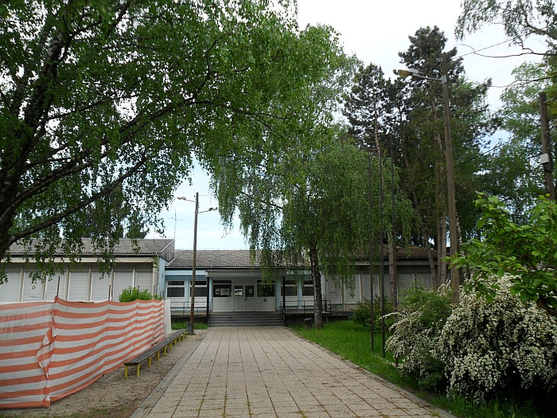
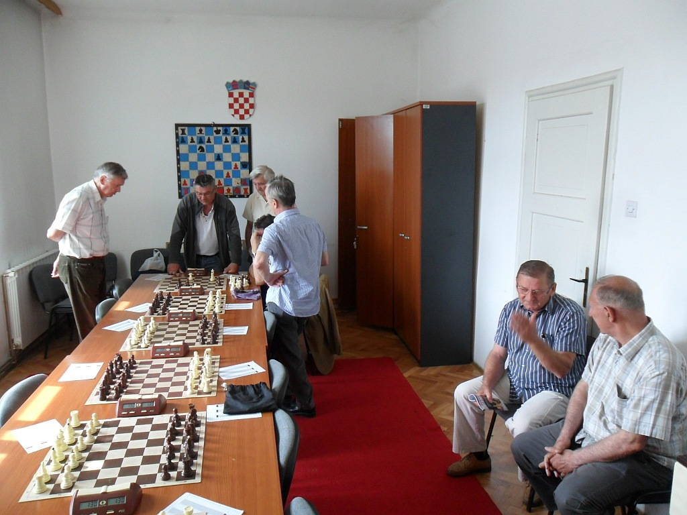
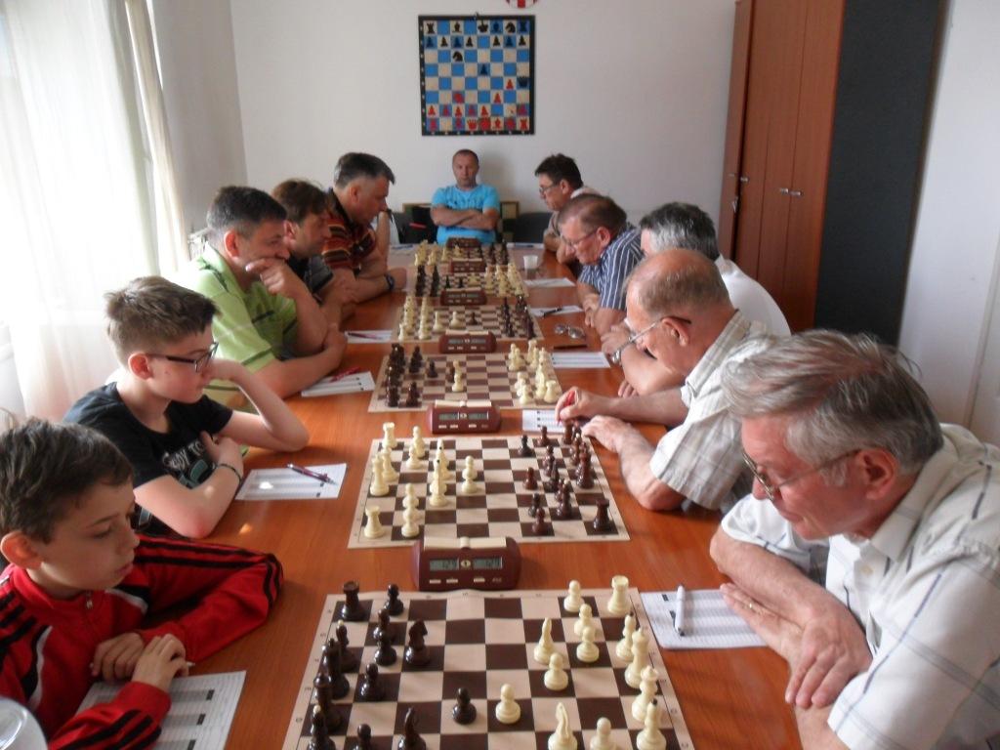

**Seniori, 5. kolo  
  
**

Prilično ravnopravan meč odigrale su danas ekipe ŠK Odra i ŠK Špansko. Na četvrtoj ploči Petan se podsjetio šahovskog pravila “taknuto – maknuto” te, nakon što je uzeo pogrešnu figuru u ruku, predao  partiju našem Cvetku već nakon pola sata igre. Božo, kojemu je od prvog svibnja potvrđena IV. kategorija (!),  danas je igrao ipak mnogo dulje nego u svome prvom nastupu. Imao je u jednom trenutku čak i bolju poziciju, ali je onda nažalost previdio zarobljavanje dame. Isto se desilo Darkovu protivniku Sontagu na drugoj ploči, i to u mnogo boljoj poziciji. Tako je u ranoj fazi igre već bilo 2:1 za domaću ekipu. Ivan je opet bio prepoznatljiv po razvezanim vezicama na tenisicama, ali je u partiji nepotrebno dopustio brojna vezivanja i to je završilo na jedini mogući način. Samo je Jura od početka do kraja partije držao pritisak na protivničku poziciju i učinkovito završio partiju. Stipe je na prvoj ploči igrao strpljivo i izgradio bolju poziciju te imao malu materijalnu prednost. Nažalost, kada nam je trebalo još samo pola boda za meč-pobjedu, Stipe se odlučio na komplikacije i usto trošio mnogo vremena. Očekivano, komplikacije su išle naruku protivniku i na kraju smo izgubili na prvoj ploči te je meč završio podjelom bodova.  
Tim rezultatom Klub i dalje dijeli tanka linija od ispadanja. Češće igramo s kadetima u ekipi i, iako se od njih još ne očekuju rezultati, teško je ostvarivati neke pozitivne rezultate u pojedinačnim mečevima. Nasreću, pozitivno je to što se kadeti privikavaju na ozbiljniji šah igrajući u seniorskoj ligi. Ipak, želimo li zadržati status četveroligaša, trojica standardnih igrača iz prve postave, Ljubić, Zvjezdan i Golub, morali bi ipak više dati za Klub, što slobodnog vremena, što truda, te pokušati prilagoditi neke prioritete, nedjeljom!  
Sljedeće, završno kolo proljetnog dijela igra se iduće nedjelje u Odri, a protivnik je ŠK Silent iz Zagreba.

**ŠK Odra – ŠK Špansko  3:3**

1\. MK Maravić, Stjepan – MK Mravunac, Damir   0:1  
2\. MK Vidaković, Darko – MK Sontag, Slavko      1:0  
3\. MK Bačurin, Juraj – I Ranogajec, Borislav       1:0  
4\. MK Cvetković, Ivan – II Petan, Dragutin           1:0  
5\. III Maravić, Ivan – III Belicki, Antonijo               0:1  
6\. IV Cvetković, Božo – I Vukman, Branko           0:1

darko
