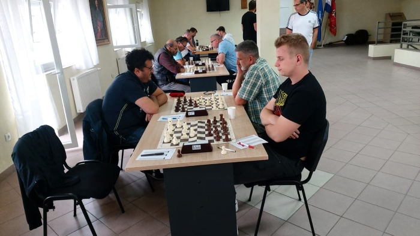

**Seniori, 8. kolo**  

<table><tbody><tr><td>Pl.</td><td></td><td><strong>ŠK Odra</strong></td><td>–</td><td></td><td><strong>ŠK Špansko</strong></td><td><strong>3,5-2,5</strong></td></tr><tr><td>1.</td><td>MK</td><td>Karlić, Zvjezdan 2098</td><td>–</td><td>MK</td><td>Machata, Martin 2204</td><td>½–½</td></tr><tr><td>2.</td><td>MK</td><td>Maravić, Ivan 2072</td><td>–</td><td>MK</td><td>Knežević, Krešimir 2050</td><td>½–½</td></tr><tr><td>3.</td><td>MK</td><td>Maravić, Stjepan 2113</td><td>–</td><td>MK</td><td>Mravunac, Damir 2124</td><td>0-1</td></tr><tr><td>4.</td><td>MK</td><td>Sliepčević, Mladen 2087</td><td>–</td><td>MK</td><td>Pauš, Veljko 2026</td><td>1-0</td></tr><tr><td>5.</td><td>MK</td><td>Cvetković, Ivan 1965</td><td>–</td><td>I</td><td>Benamatić, Krešimir 1976</td><td>½–½</td></tr><tr><td>6.</td><td>II</td><td>Vraneša, Ivan 1863</td><td>–</td><td>I</td><td>Poljak, Nikola 2031</td><td>1-0</td></tr></tbody></table>

Prošli vikend, po toplom i sunačnom vremenu, napokon smo odigrali dobar [meč i pobijedili](https://chess-results.com/tnr730961.aspx?lan=13&art=3&rd=8) veoma dobru ekipu Španskog. Meč je bio jedan od najnapetijih u zadnje vrijeme. Nakon dva sata sve su partije još bile u tijeku s aktivnim rezultatom. Prvi je završio Ivan Cvetković (imao i jedan nemogući potez!) koji je odigrao dobru partiju, imao jednu šansu prijeći u puno bolju završnicu, ali osim toga je partija cijelo vrijeme bila u balansu. Drugi je završio Ivan Maravić koji je od početka bio u podjednakoj završnici koja je završila ponavljanjem iste pozicije tri puta. U tome trenutku sve je izgledalo dobro, Zvjezdan je povoljno stajao, Vraneša isto, Stjepko je bio dobiven i Mladen nešto bolji. Međutim, tada Stjepko u vremenskom tjesnacu gubi te se stvari kompliciraju. Šteta za njega jer je ovo bila njegova daleko najbolja partija ove godine. Nakon toga Vraneša osvaja figuru vezivanjem po osnovnome redu te lagano privodi partiju kraju. Mladen osvaja figuru te polako, ali sigurno realizira materijalnu prednost. Zadnji je opet ostao Zvjezdan koji je bio većinu partije dobiven, ali kada se činilo da je sve gotovo je njegov protivnik pronašao studioznu obranu u završnici s figurom manje te tako postavio konačnih 3,5:2,5. Lijepo je bilo vidjeti sve igrače ekipe da igraju dobre partije. Iduće kolo gostujemo 8. listopada u Karlovcu.  
*IvanM*
