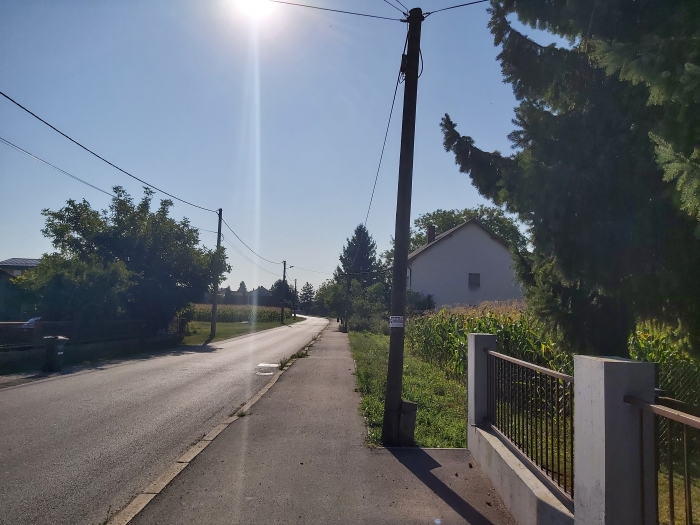

**IV A. liga, 3. kolo**  
  
Prekjučer smo pobijedili ŠK Špansko u 3. kolu [seniorske lige](https://chess-results.com/tnr549409.aspx?lan=13&art=0). U odnosu na prošlo kolo, Zvjezdan je zamijenio Ivana, a Tina Boris, koji je i prvi završio remijem nakon oko sat vremena. Drugi je završio Božo koji je donio par “čudnih” strateških odluka te nije vidio kako spasiti figuru. Iako rezultat nije tada izgledao dobro, pozicije jesu. Zvjezdan, Ivan Vraneša i Stjepko su bili dobiveni, dok je Ivan Maravić imao mikro prednost. Svi koji su bili dobiveni su dobili, a Ivanov protivnik se hladno branio i veoma lako održao remi za konačnih 4:2.  
Tin je sudio meč.  
Iduće kolo igramo iduće nedjelje u Dubravi.

<table><tbody><tr><td>Pl.</td><td></td><td><strong>ŠK Odra</strong></td><td>–</td><td></td><td><strong>ŠK Špansko</strong></td><td><strong>4-2</strong></td></tr><tr><td>1.</td><td>MK</td><td>Karlić Zvjezdan 2096</td><td>–</td><td>MK</td><td>Mravunac Damir 2115</td><td>1-0</td></tr><tr><td>2.</td><td>MK</td><td>Maravić Stjepan 2138</td><td>–</td><td>MK</td><td>Knežević Krešimir 2056</td><td>1-0</td></tr><tr><td>3.</td><td>I</td><td>Maravić Ivan 1925</td><td>–</td><td>MK</td><td>Pauš Veljko 1938</td><td>½–½</td></tr><tr><td>4.</td><td>II</td><td>Vraneša Ivan 1664</td><td>–</td><td>I</td><td>Benamatić Krešimir 2009</td><td>1-0</td></tr><tr><td>5.</td><td>IV</td><td>Kobali Borislav 1653</td><td>–</td><td>II</td><td>Petan Dragutin 1868</td><td>½–½</td></tr><tr><td>6.</td><td>III</td><td>Cvetković Božo 1431</td><td>–</td><td>I</td><td>Vukman Branko 1757</td><td>0-1</td></tr></tbody></table>
