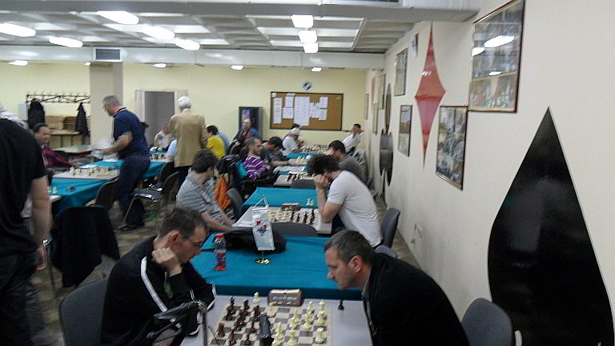

## 4\. kolo, seniori

U (meni osobno) turobnom prostoru za šah u Domu sportova, ŠK Odra odigrala je meč protiv trenutačno vodeće ekipe i zabilježila relativno laganu pobjedu. Ovaj put  v. d. kapetana ekipe Stipe sastavio je ekipu od nešto iskusnijih članova. Ivan je brzo sklopio remi da bi se oporavio od neugodnog niza u koji je zapao, Zvjezdan i Danko odigrali su čvrste remije i još jedanput potvrdili da su igrači koji ne rasipaju olako ekipne bodove. Stipe je na prvoj ploči izgubio nemoguće. Uspio je grubo previdjeti u poziciji s čista dva pješaka više. Zanimljivo je bilo na zadnjim pločama, gdje su presudne bodove za ekipu donijeli Darko i Vjekoslav, jer su obojica u jednom trenutku previdjeli čistu figuru, ali su ipak (uz svesrdnu pomoć protivnika) ubilježili pobjede.

REZULTATI:

**ŠK ODRA – ŠK STJEPAN BOSAK        3,5 : 2,5**

1\. Maravić Stjepan – Glažar Domagoj     0:1

2\. Brajdić Danko – Ognjačević Alen        1/2

3\. Karlić Zvjezdan – Kovačević Krsto       1/2

4\. Cvetković Ivan – Brajković Željko         1/2

5\. Vidaković Darko – Matana Zoran         1:0

6\. Novak Vjekoslav – Vrhovec Goran       1:0
