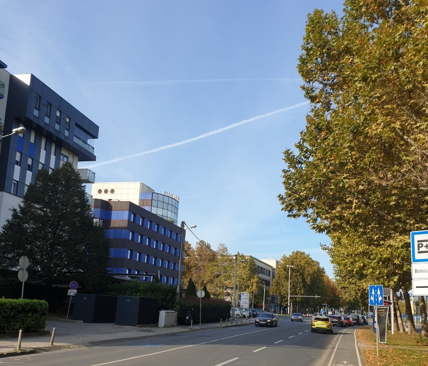

**Seniori – I. ekipa, 10.kolo  
  
**  
Prošli vikend smo [pobijedili](https://chess-results.com/tnr1127780.aspx?lan=13&art=3&rd=10) ekipu ŠK Stjepan Bosak. Stjepko nažalost nije imao protivnika te je to značilo rano naše vodstvo. Ivan Vraneša je odigrao par nepreciznosti u otvaranju, no nakon toga je skupljao male pluseve u svojoj poziciji u odnosu na protivničku sve dok nije došao do materijalne prednosti i boda. Ivo je rano osvojio kvalitetu, međutim stvari se kompliciraju kada ju je na prijelazu u završnicu previdio te imao samo pješaka više. Ipak, Ivo pokazuje zašto je jedan od stabilnijih naših igrača te mirno privodi partiju kraju. Ivan Maravić je odigrao dobro otvaranje te ostvario značajnu prednost. Tada ne pronalazi dobar plan te partija odlazi u jednaku završnicu i remi. Darko je odigrao napetu partiju u kojoj je njegov protivnik Ognjačević žrtvovao figuru korektno, ali nije se dobro snašao u tome žrtvenome nastavku te je izgubio partiju. Darko je time pobijedio prvi puta ove sezone, sam sebe prozvao “igračem utakmice”, pa smo bili primorani objaviti njegovu partiju. Zvjezdan je odigrao partiju punu nepreciznosti, ali je borbenošću uspio održati jednakost te sklopiti remi. Ovo kolo je obilježila dobra igra naše ekipe od treće ploče na dolje. Još jedna zanimljivost jest da nam je ovo najveća pobjeda otkad smo se vratili u ovu ligu. Idući vikend zaključujemo sezonu u Oroslavju, nadamo se pobjedom.

<table><tbody><tr><td>Pl.</td><td></td><td><strong>ŠK Odra</strong></td><td>–</td><td></td><td><strong>ŠK Stjepan Bosak</strong></td><td><strong>5-1</strong></td></tr><tr><td>1.</td><td>MK</td><td>Karlić, Zvjezdan 2044</td><td>–</td><td>I</td><td>Gujić, Vladmir 1926</td><td>½–½</td></tr><tr><td>2.</td><td>MK</td><td>Maravić, Ivan 2096</td><td>–</td><td>MK</td><td>Ćosić, Radoslav 1934</td><td>½–½</td></tr><tr><td>3.</td><td>MK</td><td>Vidaković, Darko 2102</td><td>–</td><td>MK</td><td>Ognjačević, Alen 1963</td><td>1-0</td></tr><tr><td>4.</td><td>MK</td><td>Maravić, Stjepan 2067</td><td>–</td><td>II</td><td>Matana, Zoran 1833</td><td>1-0</td></tr><tr><td>5.</td><td>II</td><td>Pahljina, Ivo 1865</td><td>–</td><td>III</td><td>Lisić, Mihovil 1775</td><td>1-0</td></tr><tr><td>6.</td><td>II</td><td>Vraneša, Ivan 1865</td><td>–</td><td>IV</td><td>Mikolaci, Saša 1633</td><td>1-0</td></tr></tbody></table>

```pgn
[Event "III A liga - Odra : Stjepan Bosak"]
[Site "sahovski-klub.com"]
[Date "2025.10.19"]
[Round "10"]
[White "MK Vidaković, Darko"]
[Black "MK Ognjačević, Alen"]
[Result "1/2-1/2"]
[ECO "A62"]
[WhiteElo "2102"]
[BlackElo "1963"]
[PlyCount "79"]
1. d4 Nf6 2. Nf3 c5 3. d5 e6 4. c4 d6 5. Nc3 exd5 6. cxd5 g6 7. g3 Bg7 8. Bg2 O-O 9. O-O Re8 10. Bf4 a6 11. a4 Qc7 12. Nd2 Nh5 13. Be3 f5 14. Nc4 Nd7 15. Qd2 Rb8 16. a5 b5 17. axb6 Nxb6 18. Na5 Bd7 19. Rfd1 Bb5 20. Bf3 Nf6 21. Bf4 Nc4 22. Nxb5 axb5 23. Nxc4 bxc4 24. Ra6 Ne4 25. Bxe4 Rxb2 26. Bc2 c3 27. Qc1 Rxe2 28. Bxd6 Qb7 29. Qa1 h6 30. Ra8+ Kh7 31. Ra7 Qb6 32. Bf8 c4 33. Rxg7+ Kh8 34. Rf1 Rexc2 35. Qa7 Qxa7 36. Rxa7 Kg8 37. Bg7 Rb3 38. Re1 Rb8 39. d6 Rd8 40. Bf6 1-0
```

  
*IvanM*
