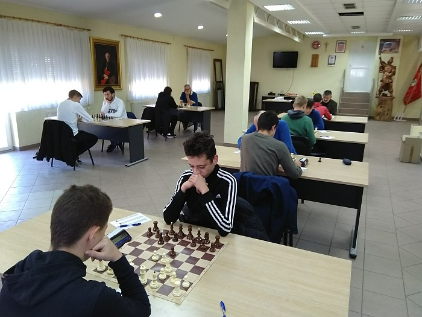

**IV A. liga, 10. kolo  
**  
Pretposljednje kolo [seniorske lige](https://chess-results.com/tnr549409.aspx?lan=13&art=0) u goste nam je došla mlada i talentirana ekipa iz Sv. Nedelje. Meč je odigran u prostorima društvenog doma Male Mlake. Sastav nam je opet bio mješovit, tri seniora i tri juniora. Možda je trebao zaigrati i Luka koji je još uvijek kadet, ali on ipak prednost daje nogometu. Stipe je na prvoj ploči bio brzo taktički nadigran, ali je njegov protivnik do kraja brzao te nesmotreno uletio u mat. Ivan Maravić je odigrao hrabro i iako gledajući sa strane njegova pozicija nije izgledala bajno, ispravno ju je procijenio i osvojio cijeli bod. Time je prešao rejting od 2100 bodova i nakon više desetljeća, imamo novog majstorskog kandidata u Klubu.  Ivane, čestitamo!!! Partija u prilogu. Cvetko je na trećoj ploči imao ravnopravnog protivnika, imao je i jedan grublji previd koji protivnik nije iskoristio, cijedio je završnicu i zasluženo upisao pobjedu. Vraneša je odigrao lijepu partiju, ali je u završnici ,u boljoj poziciji, grubo previdio materijal. Boris je od početka loše tretirao poziciju i stvorio si previše slabosti, da bi na kraju brzopleto ušao u izmjene koje su vodile u poraz. Božo se nije uspio izvući ni iz otvaranja, koje mu nije strano(!). Nadamo se da ga je sad ipak naučio.  Iako je rezultat pravedan, ostaje žal zbog propuštene pobjede kojom bismo se plasirali u višu ligu. Ovako, kolo prije kraja ne ovisimo više samo o sebi i šanse su svedene na minimum. Posljednje kolo igra se 14. studenog kada gostujemo kod HAŠK Zagreb.

<table><tbody><tr><td>Pl.</td><td></td><td><strong>ŠK Odra</strong></td><td>–</td><td></td><td><strong>ŠK Sv. Nedelja II</strong></td><td><strong>3-3</strong></td></tr><tr><td>1.</td><td>MK</td><td>Maravić Stjepan</td><td>–</td><td>I</td><td>Mahečić Lovre</td><td>1-0</td></tr><tr><td>2.</td><td>I</td><td>Maravić, Ivan</td><td>–</td><td>MK</td><td>Novosel, Lovro</td><td>1-0</td></tr><tr><td>3.</td><td>MK</td><td>Cvetković, Ivan</td><td>–</td><td>II</td><td>Morić, Ivan</td><td>1-0</td></tr><tr><td>4.</td><td>II</td><td>Vraneša, Ivan</td><td>–</td><td>II</td><td>Galoić, David</td><td>0-1</td></tr><tr><td>5.</td><td>IV</td><td>Kobali, Borislav</td><td>–</td><td>II</td><td>Ljubić, Luka</td><td>0-1</td></tr><tr><td>6.</td><td>III</td><td>Cvetković Božo</td><td>–</td><td>II</td><td>Cvetković, Erik</td><td>0-1</td></tr></tbody></table>

---

```pgn
[Event "IV A liga seniori"]
[Site "sahovski-klub.com"]
[Date "2021.10.24"]
[Round "10"]
[White "MK Lovro, Novosel"]
[Black "I Ivan, Maravic"]
[Result "0-1"]
[WhiteElo "2120"]
[BlackElo "2023"]
[ECO "E68"]

1. Nf3 Nf6 2. g3 g6 3. Bg2 Bg7 4. O-O O-O 5. d4 d6 6. c4 Nbd7 7. Nc3 e5 8. e4 a6
9. a4 Re8 10. Re1 exd4 11. Nxd4 Ng4 12. f4 Nc5 13. h3 Nf6 14. b3 Nh5 15. g4 Nxb3
16. Nxb3 Bxc3 17. gxh5 Qh4 18. Bd2 Bxa1 19. Nxa1 Bxh3 20. hxg6 hxg6 21. Qf3 Bg4 22. Qd3 Kg7 23. Bc3+ f6 24. e5 fxe5 25. fxe5
dxe5 26. Rxe5 Rxe5 27. Bxe5+ Kh7 28. Nc2 Rd8 29. Bd5 Bf5 30. Qf3 c6 31. Bg3 Qh5
32. Qe3 Rd7 33. Bf3 Qh3 34. Bg2 Qg4 35. Ne1 Qd4 36. Kf2 Qd2+ 37. Kf3 Bg4+ 38.
Kf4 Rf7+ 0-1
```

darko
