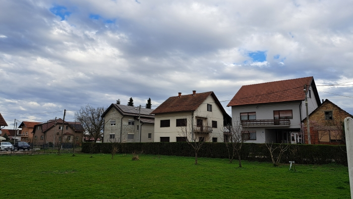

**Seniori – I. ekipa, 1.kolo  
  
**  
Danas je i prva ekipa seniora započela svoju [ligu](https://chess-results.com/tnr1127780.aspx?lan=13&art=3&rd=1). Ugostili smo simpatičnu i mladu ekipu iz Sv. Nedelje te zasluženo podijelili bodove. Meč je počeo dobro po nas jer je Ivo odigrao jako dobru partiju, imao je samo jedan propust koji protivnik ne koristi te Ivo upisuje prvi ovosezonski bod. Darko je upao u otvaranje koje ne poznaje, trošio puno vremena te krivo izračunao “dobitni” nastavak nakon kojega je ubrzo morao predati. Ivan Maravić je igrao standardno dosta loše te je njegov mlađi protivnik to znao iskoristiti odigravši jako lijepu partiju u kojoj praktički nije odigrao krivi potez. Naše novo pojačanje, Fran, je odigrao jako lijepu pozicionu partiju koju je, uz jedan taktički propust koji je dozvoljavao vječni šah, mirno priveo kraju. Sve pohvale za prvi nastup! Mladen je odigrao jako kompliciranu partiju u kojoj je većinu vremena stajao jako dobro s viškom materijala, ali u jednom trenutku u središnjici je dozvolio svome protivniku Mahečiću da preuzme inicijativu koja je mogla završiti kobno po nas. Nasreću, Mahečić ne pronalazi pravi nastavak te Mladen privodi partiju kraju. Taj sraz donosimo u prilogu. Zadnji je ostao igrati Hrvoje koji je pokazao jako dobro znanje otvaranja, ali je nakon toga počeo lutati među planovima da bi se na kraju našao u jednakoj damskoj završnici s pješakom manje. Imao je tijekom završnice koju priliku preći u remi pješačku, ali on bira krivi trenutak te nažalost gubi pješačku. Kada se sve zbroji i oduzme, meč je mogao otići na obje strane, pa podjela bodova djeluje pravedno. Idući tjedan gostujemo u Travnom.

<table><tbody><tr><td>Pl.</td><td></td><td><strong>ŠK Odra</strong></td><td>–</td><td></td><td><strong>ŠK Sveta Nedelja II</strong></td><td><strong>3-3</strong></td></tr><tr><td>1.</td><td>MK</td><td>Maravić, Ivan 2097</td><td>–</td><td>I</td><td>Šimunković, Bartol 2043</td><td>0-1</td></tr><tr><td>2.</td><td>MK</td><td>Sliepčević, Mladen 2092</td><td>–</td><td>I</td><td>Mahečić, Lovre 2083</td><td>1-0</td></tr><tr><td>3.</td><td>MK</td><td>Vidaković, Darko 2130</td><td>–</td><td>I</td><td>Galoić, David 2047</td><td>0-1</td></tr><tr><td>4.</td><td>MK</td><td>Kovač, Hrvoje 2107</td><td>–</td><td>I</td><td>Ljubić, Luka 2013</td><td>0-1</td></tr><tr><td>5.</td><td>MK</td><td>Šoš, Fran 2130</td><td>–</td><td>II</td><td>Morić, Ivan 1968</td><td>1-0</td></tr><tr><td>6.</td><td>II</td><td>Pahljina, Ivo 1951</td><td>–</td><td>II</td><td>Radalj, Niko 1897</td><td>1-0</td></tr></tbody></table>

```pgn
[Event "III A liga - Odra : Sveta Nedelja II"]
[Site "sahovski-klub.com"]
[Date "2025.03.23"]
[Round "1"]
[White "I Mahečić, Lovre"]
[Black "MK Sliepčević, Mladen"]
[Result "0-1"]
[ECO "A84"]
[WhiteElo "2083"]
[BlackElo "2092"]
[PlyCount "86"]
1. c4 f5 2. d4 d6 3. Nf3 Nf6 4. Nc3 g6 5. g3 Bg7 6. Bg2 O-O 7. O-O Qe8 8. Bg5 c6 9. c5 dxc5 10. Qb3+ Kh8 11. dxc5 Na6 12. Na4 e5 13. Rfd1 h6 14. Bxf6 Bxf6 15. Rd6 e4 16. Nd4 Nc7 17. Rd1 Be5 18. f3 Bxd6 19. cxd6 Nd5 20. fxe4 fxe4 21. Nc5 b6 22. Nxe4 Bf5 23. Nxf5 Rxf5 24. Rxd5 cxd5 25. Qc3+ Qe5 26. Qxe5+ Rxe5 27. Nc3 Rd8 28. Bxd5 Rxd6 29. e4 a6 30. Kf2 b5 31. a3 Kg7 32. Ke3 Re7 33. Bb3 Red7 34. Bd5 Rf6 35. Ke2 Rd8 36. Nd1 Kf8 37. Ne3 Rfd6 38. Kd3 Ke7 39. Kd4 Rf8 40. e5 Rdd8 41. Kc5 Rf2 42. b4 Re2 43. Kd4 Rxe3 0-1
```

  
*IvanM*
