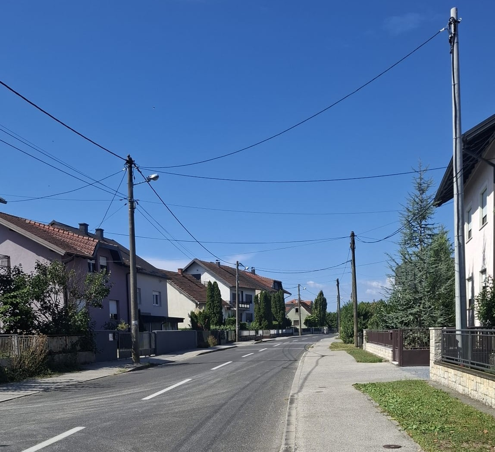

**Seniori – I. ekipa, 5.kolo**  
Ove nedjelje smo zatvorili proljetni dio sezone [porazom](https://s2.chess-results.com/tnr1352607.aspx?lan=13&art=3&rd=5&SNode=S0) od ekipe iz Travnog. Stjepko nije bio raspoložen za borbu te je ta partija bila gotova gotovo prije nego što je počela. Lucijan je previdio figuru jednostavnom taktikom u podjednakoj poziciji te je tu otišao jedan bod. Ivan Vraneša se nije najbolje otvorio, ali nakon toga je postepeno pojačavao poziciju te dobio partiju. Taj sraz možete pogledati u prilogu. Ivan Maravić je u otvaranju previdio jednostavan međupotez zbog kojega gubi figuru te kasnije više nije bilo povratka. Tu nam je otišao ključni bod te se tu može tražiti glavni krivac za poraz. Zvjezdan je odigrao jednu napetu i borbenu partiju u kojoj je on na kraju izvukao deblji kraj. Mario je još jednom pokazao zašto je dobar te je postepeno povećavao svoju prednost bijelima dok nije uspio slomiti obranu svoga kvalitetnog protivnika. Sve u svemu, naš klasičan proljetni dio sezone, imamo šest meč bodova te nam borba za opstanak ne gine. Mario se pokazao kao veliko pojačanje. Ivan Vraneša je također pokazao veoma zadovoljavajuću razinu igre. Ivan Maravić, Lucijan i Zvjezdan moraju podići svoju razinu igre ukoliko želimo opstati. Nadamo se da će Ivo i Darko biti češće dostupniji na jesen.

<table><tbody><tr><td>Pl.</td><td></td><td><strong>ŠK Odra</strong></td><td>–</td><td></td><td><strong>ŠK Travno</strong></td><td><b>2,5-3,5</b></td></tr><tr><td>1.</td><td>MK</td><td>Karlić, Zvjezdan 2020</td><td>–</td><td>MK</td><td>Šagovac, Kristijan 2098</td><td>0-1</td></tr><tr><td>2.</td><td>MK</td><td>Maravić, Ivan 2101</td><td>–</td><td>MK</td><td>Portada, Maroje 2061</td><td>0-1</td></tr><tr><td>3.</td><td>MK</td><td>Ljubičić, Mario 2111</td><td>–</td><td>MK</td><td>Nagl, Mladen 2024</td><td>1-0</td></tr><tr><td>4.</td><td>MK</td><td>Maravić, Stjepan 2050</td><td>–</td><td>MK</td><td>Meštrović, Toni 2000</td><td>&nbsp;½–½</td></tr><tr><td>5.</td><td>I</td><td>Hadviger, Lucijan 2041</td><td>–</td><td>I</td><td>Vukovojac, Vedran 1907</td><td>0-1</td></tr><tr><td>6.</td><td>II</td><td>Vraneša, Ivan 1871</td><td>–</td><td>I</td><td>Mudrinić, Nenad 1874</td><td>1-0</td></tr></tbody></table>

```pgn
[Event "III A liga - Odra : Travno"]
[Site "sahovski-klub.com"]
[Date "2026.05.10"]
[Round "5"]
[White "I Mudrinić, Nenad"]
[Black "II Vraneša, Ivan"]
[Result "0-1"]
[ECO "D00"]
[WhiteElo "1874"]
[BlackElo "1871"]
1. d4 d5 2. e3 Nf6 3. Bd3 e6 4. Nd2 Be7 5. f4 b6 6. Ngf3 Bb7 7. O-O c5 8. c3 O-O 9. Ne5 Ne4 10. Qf3 f5 11. Qh5 Nd7 12. Nxd7 Qxd7 13. Nf3 Rf6 14. Ne5 Qd6 15. Qe2 a6 16. Bd2 c4 17. Bxe4 fxe4 18. Be1 Rff8 19. g4 Bf6 20. Bg3 Qe7 21. Rf2 Bxe5 22. fxe5 Rxf2 23. Bxf2 Rf8 24. Rf1 Qg5 25. Bg3 Rxf1+ 26. Kxf1 Bc6 27. h4 Qe7 28. Qf2 Be8 29. h5 Qd7 30. Bh4 Qa4 31. Be7 Qd1+ 32. Qe1 Qxg4 33. Qf2 Bf7 34. h6 Qh3+ 35. Qg2 Qxh6 36. Qg5 Qh1+ 37. Qg1 Qh3+ 38. Kf2 Qf3+ 39. Ke1 Bh5 40. Kd2 Bg4 41. b3 cxb3 42. axb3 h6 43. Qe1 Qg2+ 44. Kc1 Qa2 45. Qg3 Qa1+ 46. Kc2 Qa2+ 47. Kc1 h5 48. Qf4 Qxb3 49. Qf8+ Kh7 50. Bf6 Qxc3+ 51. Kb1 Qc7 52. Be7 Bd1 53. Qf7 Qc2+ 54. Ka1 Qc3+ 55. Kb1 Bc2+ 56. Kc1 Bd3+ 57. Kd1 Qc2+ 58. Ke1 Qe2# 0-1
```
