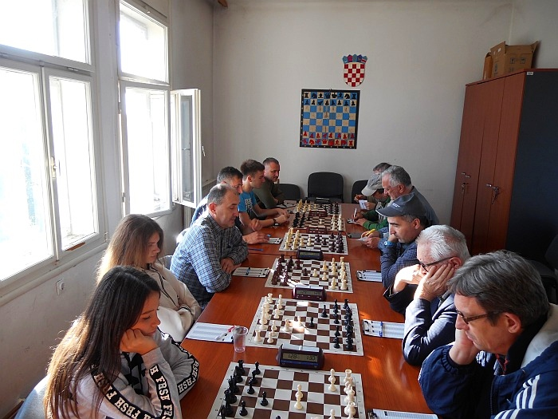
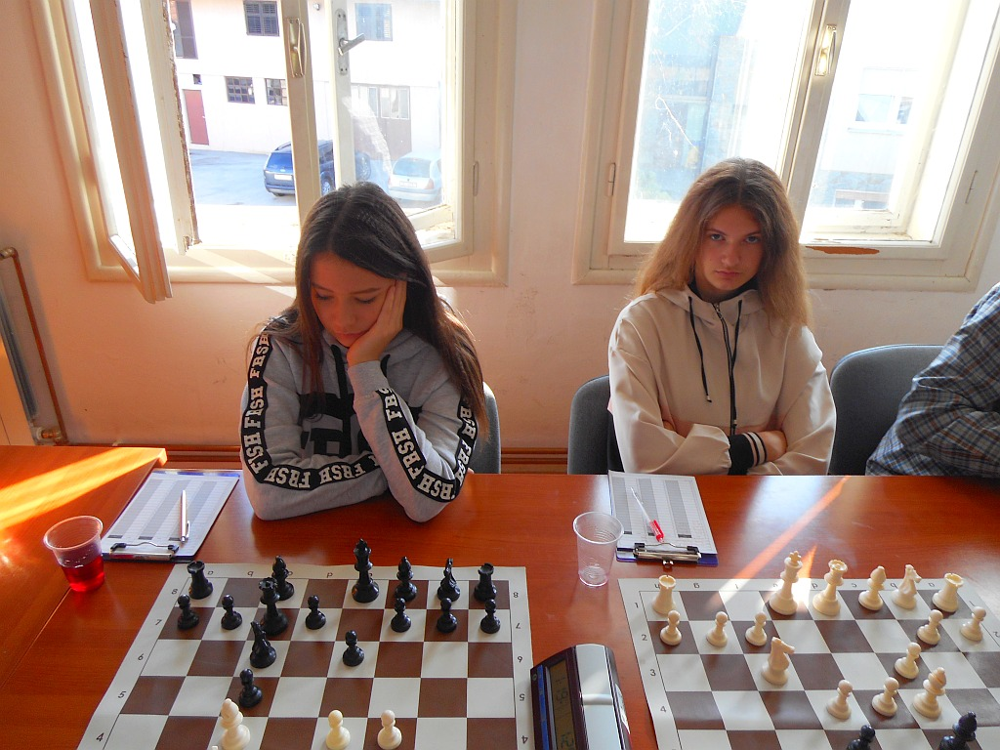

**Seniori, 10. kolo  
  
**

Minimalan poraz pretrpjela je seniorska ekipa u desetom kolu od iskusnije ekipe ŠK UHBDR 99. brigade. Mora se priznati da stariji dio ekipe nije pružio maksimum. Stipe i Cvetko remizirali su na samom početku, a slijedeći njihov primjer i Ivan je uzeo ponuđeni remi odmah po otvaranju. Boris je ponovo dobio priliku, ali ju nije najbolje iskoristio. Naime, u partiji je previdio jednostavnu taktiku kojom je mogao osvojiti cijelu figuru. Ana polako lovi samopouzdanje, dobro je odigrala otvaranje, ali je poslije malo odlutala krivim planom, te dopustila prijelaz u završnicu raznobojnih lovaca tako da je i ta partija završila podjelom bodova. Samanta se lijepo držala šahovskih principa, ali je propustila dosta jednostavnu taktiku. Protivnik joj je pružio šansu da žrtvom pješaka dođe u dobivenu poziciju. Poslije tog propusta, partija je otišla u protivničku korist. I sljedeće kolo dat će se prilika mladim kadetima i kadetkinjama da igraju za seniorsku ekipu i stječu potrebno iskustvo, a ujedno se pripremaju za skorašnja školska prvenstva. Jučer je u Čakovcu igrala i juniorska ekipa ŠK Odra (pobijedila Karlovac 3:1!), a tamo se vidjelo koliko nekima nedostaje vježbe. Franka je radila greške iz osnova šaha, a zbog jedne takve je i izgubila partiju (pustila je protivničkog topa na drugi red), Vraneša se također dugo mučio, ali je pobijedio neiskusnijeg protivnika, dok su Ivan i Monika odigrali vrlo dobre partije. Nadamo se da će i Lucija i Franka, kao i ostale djevojke, uložiti maksimum u pripremu za Školsko ekipno prvenstvo Zagreba koje im počinje za mjesec dana.  
Sljedeće, posljednje kolo seniorske lige igra se za tjedan dana, a gostujemo kod ŠK Vladimir Ivetić-Sopot.

<table><tbody><tr><td></td><td></td><td>&nbsp;<strong>&nbsp;ŠK Odra</strong></td><td><strong>–</strong></td><td><strong>&nbsp;</strong></td><td><strong>&nbsp; ŠK UHBDR 99. brigade</strong></td><td><strong>2,5 :</strong> <strong>3,5</strong></td></tr><tr><td>1.</td><td>MK</td><td><table><tbody><tr><td></td><td>Maravić, Stjepan 2121</td></tr></tbody></table></td><td>–</td><td>MK</td><td><table><tbody><tr><td></td><td>Matić, Željko 2183</td></tr></tbody></table></td><td>½ – ½</td></tr><tr><td>2.</td><td>I</td><td><table><tbody><tr><td></td><td>Maravić, Ivan&nbsp;1942</td></tr></tbody></table></td><td>–</td><td>MK</td><td><table><tbody><tr><td></td><td>Hećimović, Ivan 2013</td></tr></tbody></table></td><td>½ – ½</td></tr><tr><td>3.</td><td>MK</td><td><table><tbody><tr><td></td><td>Cvetković, Ivan 1953</td></tr></tbody></table></td><td>–</td><td>III</td><td><table><tbody><tr><td></td><td>Kovačević, Mladen 1820</td></tr></tbody></table></td><td>½ – ½</td></tr><tr><td>4.</td><td>IV</td><td><table><tbody><tr><td></td><td>Kobali, Boris 1650</td></tr></tbody></table></td><td>–</td><td>II</td><td><table><tbody><tr><td></td><td>Božičević, Josip 1862</td></tr></tbody></table></td><td>½ – ½</td></tr><tr><td>5.</td><td>II</td><td><table><tbody><tr><td></td><td>Kolovrat, Ana 1196</td></tr></tbody></table></td><td>–</td><td>II</td><td><table><tbody><tr><td></td><td>Peleh, Slavko 1835</td></tr></tbody></table></td><td>½ – ½</td></tr><tr><td>6.</td><td>III</td><td><table><tbody><tr><td></td><td>Halužan, Samanta 1193</td></tr></tbody></table></td><td>–</td><td>III</td><td><table><tbody><tr><td></td><td>Gverić, Tvrtko 1660</td></tr></tbody></table></td><td>0 – 1</td></tr></tbody></table>
