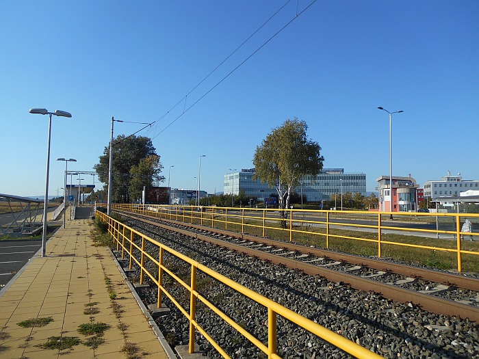
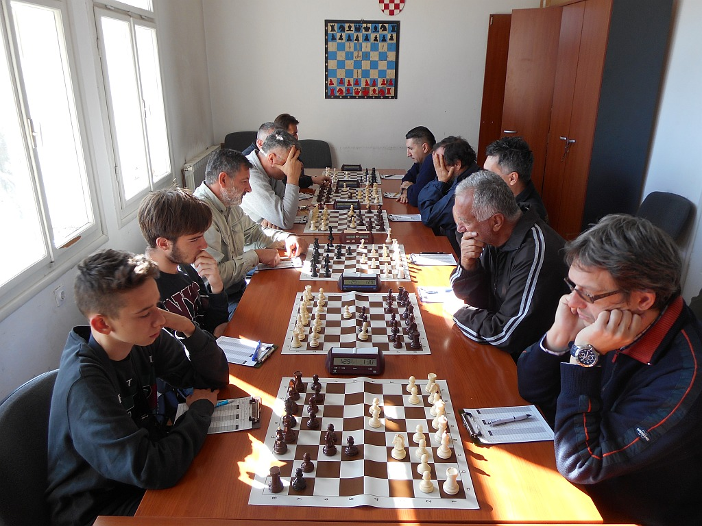

**Seniori, 7. kolo  
**Važan bod u borbi za [opstanak](http://chess-results.com/tnr332243.aspx?lan=13&art=0) osvojili smo danas u susretu sa ŠK UHBDR 99. brigade. Došlo je do nekih izmjena u sastavu jer Zvjezdan nije mogao igrati, a njegova zamjena Vraneša imao je važnu nogometnu utakmicu (koju su izgubili 5:1) te je umjesto njega priliku dobio drugi kadet, Božo Cvetković. Prvi je partiju završio Darko prihvativši ponudu remija već nakon pola sata igre. Nakon malo više od dva sata igre, pozicije nisu bile obećavajuće. Srećom, Jura je našao (nekorektnu) žrtvu figure i osvojio materijal. Stipe je uspio pronaći protuigru i vratiti se iz minusa od dva pješaka, ali je onda opet ostao s pješakom manje te morao remizirati vječnim šahom. Kadeti su upali u vremensku oskudicu. Ivan je veći dio partije imao nadmoćnu poziciju, ali je prednost ispustio i na kraju upao u matnu mrežu. Božo je igrao dobro, ali je u vremenskoj oskudici ipak odigrao jedan loš potez što je njegovom protivniku bilo dovoljno. To što mlađi članovi troše previše vremena je već pomalo zabrinjavajuće. U peti sat igre ušao je samo Cvetko i to u završnici topova i raznobojnih lovaca. Kako nam remi nije odgovarao, Cvetko je cijedio poziciju sve dok nije dočekao par nepreciznosti protivnika te uspio dobiti partiju, a time i meč bod za ekipu. Za tjedan dana igramo u Dugom Selu.

<table><tbody><tr><td></td><td></td><td>&nbsp;&nbsp;<strong>ŠK Odra</strong></td><td><strong>–</strong></td><td></td><td>&nbsp;&nbsp;<strong>ŠK UHBDR, 99 brigade</strong></td><td><strong>3:3</strong></td></tr><tr><td>1.</td><td>MK</td><td><table><tbody><tr><td></td><td>Bačurin, Juraj</td></tr></tbody></table></td><td>–</td><td>MK</td><td><table><tbody><tr><td></td><td>Matić, Željko</td></tr></tbody></table></td><td>1 – 0</td></tr><tr><td>2.</td><td>MK</td><td><table><tbody><tr><td></td><td>Maravić, Stjepan</td></tr></tbody></table></td><td>–</td><td>I</td><td><table><tbody><tr><td></td><td>Božičević, Ivan</td></tr></tbody></table></td><td>½ – ½</td></tr><tr><td>3.</td><td>MK</td><td><table><tbody><tr><td></td><td>Vidaković, Darko</td></tr></tbody></table></td><td>–</td><td>MK</td><td><table><tbody><tr><td></td><td>Hećimović, Ivan</td></tr></tbody></table></td><td>½ – ½</td></tr><tr><td>4.</td><td>MK</td><td><table><tbody><tr><td></td><td>Cvetković, Ivan</td></tr></tbody></table></td><td>–</td><td>II</td><td><table><tbody><tr><td></td><td>Božičević, Josip</td></tr></tbody></table></td><td>1 – 0</td></tr><tr><td>5.</td><td>II</td><td><table><tbody><tr><td></td><td>Maravić, Ivan</td></tr></tbody></table></td><td>–</td><td>III</td><td><table><tbody><tr><td></td><td>Kovačević, Mladen</td></tr></tbody></table></td><td>0 – 1</td></tr><tr><td>6.</td><td>III</td><td><table><tbody><tr><td></td><td>Cvetković, Božo</td></tr></tbody></table></td><td>–</td><td>III</td><td><table><tbody><tr><td></td><td>Gverić, Tvrtko</td></tr></tbody></table></td><td>0 – 1</td></tr></tbody></table>
