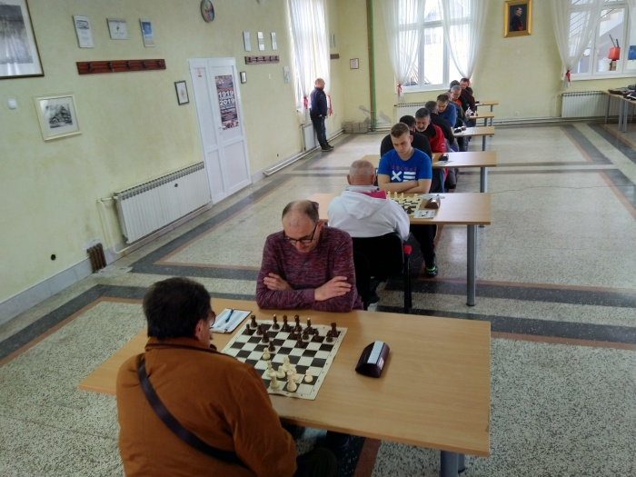

**III A. liga, 1. kolo  
**

<table><tbody><tr><td>Pl.</td><td></td><td><strong>ŠK Odra</strong></td><td>–</td><td></td><td><strong>ŠK Velika Gorica</strong></td><td><strong>2-4</strong></td></tr><tr><td>1.</td><td>MK</td><td>Karlić, Zvjezdan 2096</td><td>–</td><td>FM</td><td>Lasić, Luka 2110</td><td>½ – ½</td></tr><tr><td>2.</td><td>MK</td><td>Maravić, Stjepan 2116</td><td>–</td><td>MK</td><td>Vukić, Aleksandar 2086</td><td>0-1</td></tr><tr><td>3.</td><td>MK</td><td>Sliepčević, Mladen 2081</td><td>–</td><td>MK</td><td>Raljić, Mirko 2082</td><td>½ – ½</td></tr><tr><td>4.</td><td>MK</td><td>Cvetković, Ivan 1968</td><td>–</td><td>I</td><td>Lovreković, Kristijan 1996</td><td>½ – ½</td></tr><tr><td>5.</td><td>II</td><td>Vraneša, Ivan 1869</td><td>–</td><td>MK</td><td>Hrupački, Milan 2021</td><td>½ – ½</td></tr><tr><td>6.</td><td>IV</td><td>&nbsp;Kobali, Borislav 1769</td><td>–</td><td>I</td><td>Babić, Božidar 1876</td><td>0-1</td></tr></tbody></table>

Jučer je započela [seniorska liga](http://chess-results.com/tnr730961.aspx?lan=13&art=3&rd=1), a ŠK Odra je bio domaćin protivnicima iz ŠK Velika Gorica. Gosti su po prikazanoj igri zasluženo odnijeli bodove. Na trećoj, četvrtoj i petoj ploči brzo su sklopljeni remiji već nakon otvaranja. Mladen se žalio na zubobolju, Vraneša na neispavanost, a Cvetko nije bio raspoložen za borbu. Na šestoj ploči Boris je zaglavio vlastitog lovca na daminoj strani, što je protivnik iskoristio te žrtvovao figuru i napadom na rokadu upisao pobjedu. Stjepko je na drugoj ploči došao u više nego izglednu poziciju,a tada je njegov protivnik našao jako lijepu taktiku i žrtvom dame osvojio cijeli bod. Najdulje je igrao Zvjezdan. U središnjici je upao u probleme, ostao bez pješaka, upao u cajtnot i tonuo u izgubljenu završnicu. Srećom po njega protivnik je propustio nekoliko prilika za završiti meč i partija je izmjenama završila remijem. Sljedeće nedjelje gosti smo kod ŠK Straža u Humu na Sutli.  
Od dobrih vijesti je to da su se klinci ŠK Odra ipak malo aktivirali te je isti dan dosta njih (Slavko Biondić, Lucija Fiolić, Ivana Fiolić, Vjeka Vidra, Lucija Medoš, Petra Medoš, Emanuel Kovačević, Emanuel Čurić i Ana Predović) odigralo turnir “[Gospodar Turopolja 2023.](http://chess-results.com/tnr730094.aspx?lan=13&art=0)” u Okuju. Nadam se da će i nastaviti igrati turnire jer jedino vježbom i radom mogu i napredovati.

darko
