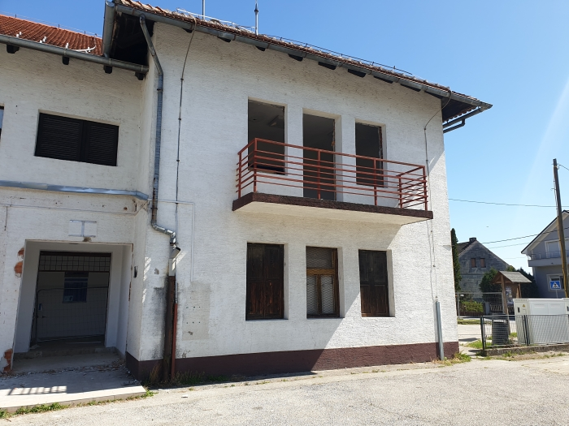
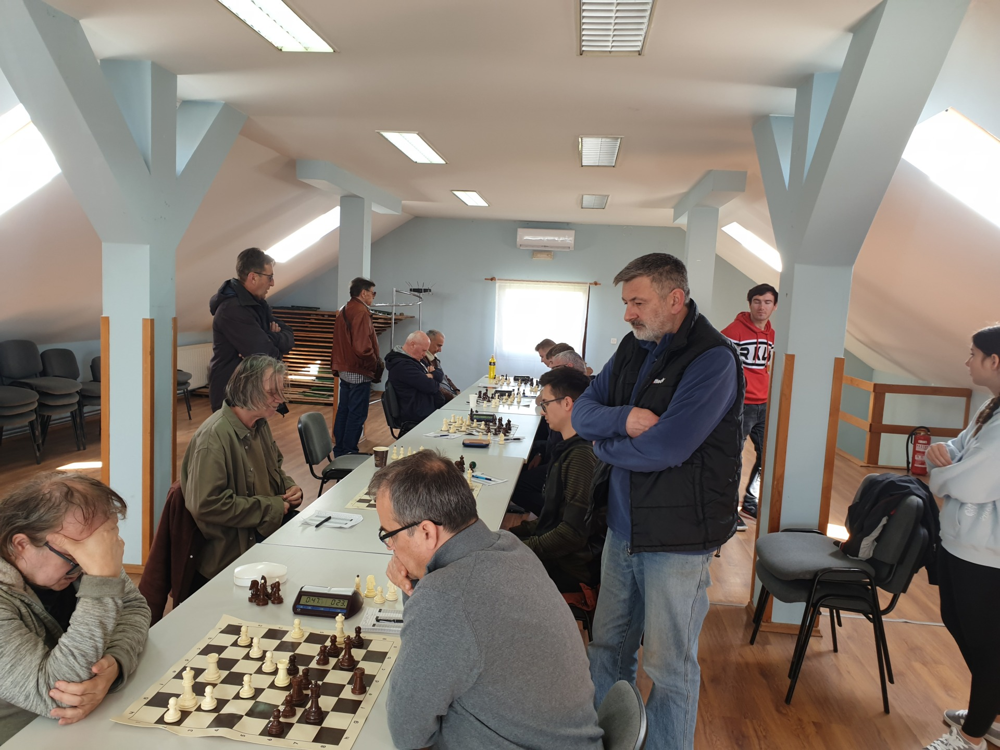
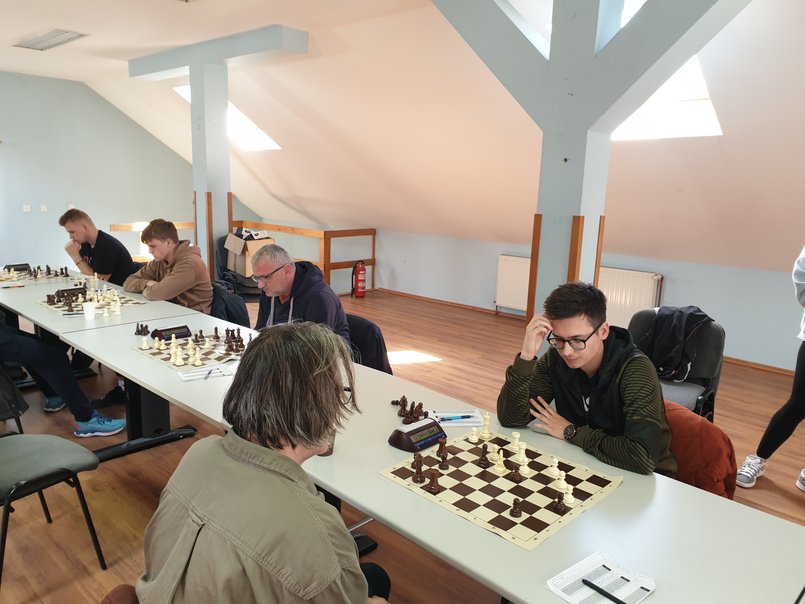

**Seniori – I. ekipa, 3.kolo  
  
**  
U nedjelju smo odigrali [meč](https://chess-results.com/tnr1127780.aspx?lan=13&art=3&rd=3) u Vatrogasnom domu u Odri kraj starog Društvenog doma u Odri koji se renovira (na slici). Ivan Maravić je slabo odigrao otvaranje te brzo došao u nešto lošiju završnicu gdje je njegov protivnik, koji očito nije bio borbeno raspoložen, ponudio remi koji je bio prihvaćen. Ivo je odigrao nešto lošiju partiju nego što smo od njega navikli, nakon kojeg promašaja u otvaranju je uspio doći do dobitne prednosti, ali je puno griješio te je partija nakon nekolicine preokreta otišla na protivničku stranu. Mladen je loše odigrao otvaranje te zapao u podređen položaj, međutim, nastavio se solidno braniti te nakon što je njegov protivnik Matić zatvorio sam sebi liniju je došlo do remija. Stjepko je debitirao ove sezone veoma napetom pobjedom gdje je nakon sumnjivog otvaranja njegov protivnik polukorektno žrtvovao figuru. Nakon te žrtve Stjepko precizno igra te se prednost povećava da bi se na kraju partija završila efektnim matom! Taj dvoboj donosimo u prilogu. Vraneša je odigrao jednu strpljivu partiju gdje je isprovocirao protivnika da si napravi slabosti te je na tim temeljima došao u završnici do cijelog boda. Zadnji je ostao igrati Fran koji je iz otvaranja izašao u podređenom položaju. Nakon toga počinje igrati dobro te dolazi do nešto bolje završnice u kojoj uspijeva osvojiti i pješaka. Međutim, u obostranoj oskudici vremena si pogoršava situaciju te gubi toga pješaka, ali nakon toga se počinje veoma dobro braniti te donosi presudnih pola boda. Ovo je čudna situacija za nas jer nam je nekih sezona trebalo deset kola da prebacimo broj bodova koji već sad imamo. Nadamo se kako ćemo nastaviti pobjednički niz idući nedjelje kada ugošćujemo sisačku ekipu.

<table><tbody><tr><td>Pl.</td><td></td><td><strong>ŠK Odra</strong></td><td>–</td><td></td><td><strong>ŠK Velika Gorica</strong></td><td><strong>3,5-2,5</strong></td></tr><tr><td>1.</td><td>MK</td><td>Maravić, Ivan 2097</td><td>–</td><td>FM</td><td>Koštrun, Slaven 2241</td><td>½–½</td></tr><tr><td>2.</td><td>MK</td><td>Sliepčević, Mladen 2092</td><td>–</td><td>MK</td><td>Matić, Željko 2188</td><td>½–½</td></tr><tr><td>3.</td><td>MK</td><td>Šoš, Fran 2130</td><td>–</td><td>FM</td><td>Lasić, Luka 2112</td><td>½–½</td></tr><tr><td>4.</td><td>MK</td><td>Maravić, Stjepan 2096</td><td>–</td><td>I</td><td>Lovreković, Kristijan 1994</td><td>1-0</td></tr><tr><td>5.</td><td>II</td><td>Pahljina, Ivo 1951</td><td>–</td><td>MK</td><td>Hrupački, Milan 2004</td><td>0-1</td></tr><tr><td>6.</td><td>II</td><td>Vraneša, Ivan 1898</td><td>–</td><td>III</td><td>Matić, Mirko 1791</td><td>1-0</td></tr></tbody></table>

```pgn
[Event "III A liga - Odra : Velika Gorica"]
[Site "sahovski-klub.com"]
[Date "2025.04.06"]
[Round "2"]
[White "I Lovreković, Kristijan"]
[Black "MK Maravić, Stjepan"]
[Result "0-1"]
[ECO "B07"]
[WhiteElo "1994"]
[BlackElo "2096"]
[PlyCount "68"]
1. e4 d6 2. d4 g6 3. Be3 Bg7 4. Nc3 c6 5. Qd2 Nd7 6. Bc4 b5 7. Bb3 a6 8. Nf3 Bb7
9. Ng5 e6 10. d5 exd5 11. exd5 c5 12. Nce4 Ndf6 13. c4 Nxe4 14. Nxe4 Nf6 15.
Nxc5 dxc5 16. Bxc5 Kd7 17. f3 Rc8 18. Be3 Bf8 19. O-O Bc5 20. Kh1 Qb6 21. Bg5 h6
22. Bh4 g5 23. Bg3 Nh5 24. Be1 Rhe8 25. Bc2 Be3 26. Qd3 Rxc4 27. Qf5+ Ke7 28.
Bb3 Rf4 29. Qd3 Qd4 30. d6+ Kf8 31. Qh7 Qg7 32. Qc2 Bb6 33. Bc3 Qg6 34. Qd2 Ng3+ 0-1
```

  
 * *

*IvanM*
