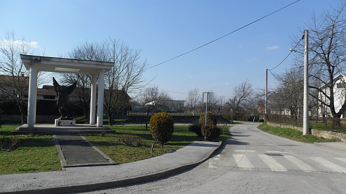
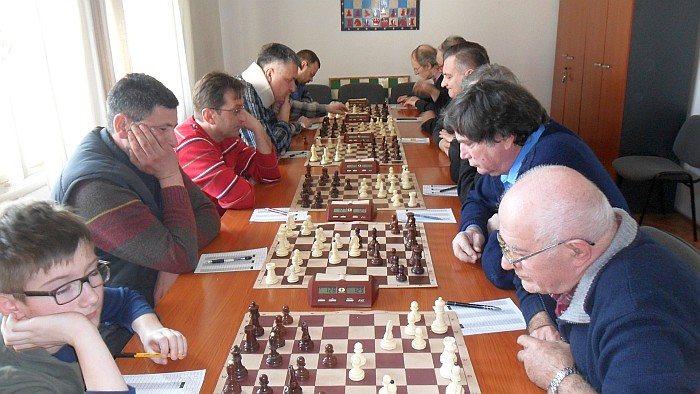

**Seniori, 1. kolo**

  
Svim ženama želimo sretan Dan žena!

Prvo kolo IV. lige centar A ekipa ŠK Odre bila je domaćin i zabilježila uvjerljivu pobjedu nad iskusnom, ali danas ipak oslabljenom ekipom ŠK Vrbani. Ivanda je na prvoj ploči previdio topa, Vukalović na četvrtoj figuru, a Blažeka je na trećoj previdio dva pješaka, tako da su Zvjezdan, Jura i Darko imali lakši put do pobjede. Mišković je protiv Stipeta držao nešto slabiju poziciju i uspio je održati do remija. Cvetko je ušao u završnicu raznobojaca, tako da je to samo po sebi vodilo u remi. Najdulje je igrana partija na šestoj ploči, gdje je Ivan uspio uloviti cijeli bod. Ako se ne varam, ovo je povijesna (prva!) pobjeda u seniorskoj konkurenciji! Partija je trajala gotovo četiri i pol sata i 90 poteza! Meč je sudio klupski sudac Tin Furčić.

ŠK Odra – ŠK Vrbani 5:1

1.  Zvjezdan Karlić –  Živko Ivanda                  1:0
2.  Stjepan Maravić – Stevo Mišković               1/2
3.  Darko Vidaković – Đuro Blažeka                 1:0
4.  Juraj Bačurin – Željko Vukalović                 1:0
5.  Ivan Cvetković – Mladen Babaja                1/2
6.  Ivan Maravić – Branko Mišković                1:0
