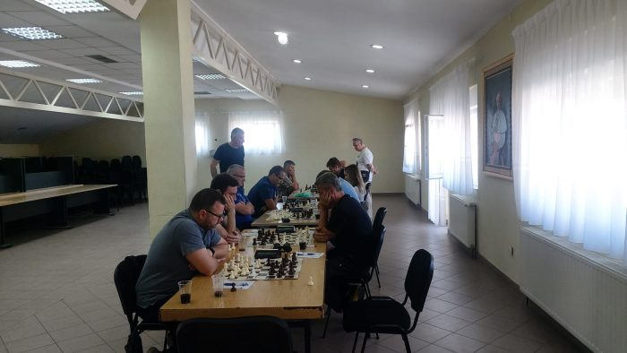

**Seniori, 7. kolo**  

<table><tbody><tr><td>Pl.</td><td></td><td><strong>ŠK Odra</strong></td><td>–</td><td></td><td><strong>ŠK Zaprešić</strong></td><td><strong>3-3</strong></td></tr><tr><td>1.</td><td>MK</td><td>Karlić, Zvjezdan 2098</td><td>–</td><td></td><td>Perić, Bernard 2145</td><td>0-1</td></tr><tr><td>2.</td><td>MK</td><td>Maravić, Ivan 2072</td><td>–</td><td>I</td><td>Ilijaš, Dejan 1976</td><td>½–½</td></tr><tr><td>3.</td><td>MK</td><td>Maravić, Stjepan 2113</td><td>–</td><td>MK</td><td>Jakupec, Denis 2041</td><td>½–½</td></tr><tr><td>4.</td><td>MK</td><td>Sliepčević, Mladen 2087</td><td>–</td><td>NM</td><td>Golub, Nikolina 2014</td><td>½–½</td></tr><tr><td>5.</td><td>MK</td><td>Vidaković, Darko 2124</td><td>–</td><td>II</td><td>Mesar, Antun 1981</td><td>1-0</td></tr><tr><td>6.</td><td>MK</td><td>Cvetković, Ivan 1965</td><td>–</td><td>II</td><td>Crnković, Miroslav 1772</td><td>½–½</td></tr></tbody></table>

Prošle nedjelje smo [remizirali](https://chess-results.com/tnr730961.aspx?lan=13&art=3&rd=7) protiv ŠK Zaprešić. Meč je krenuo veoma dobro po nas, Darko je iskoristio greške protivnika u otvaranju koji nije otišao u rokadu. To je bilo brzih 1-0 za nas. Zatim su sklopljena tri brza remija na trećoj, četvrtoj i šestoj ploči. Ivan je na drugoj ploči odigrao loše otvaranje te se morao izvlačiti prelaskom u potpuno simetričnu završnicu koja je nakon nešto vremena okončana remijem. Zvjezdan je ostao zadnji igrati na prvoj ploči, bila je to napeta pozicija s puno taktike u sebi u kojoj je na kraju Zvjezdan ostao bez pješaka. Zatim je njegov protivnik Perić strpljivo čekao na novu grešku nakon koje je imao dobitničku prednost. Pravedna podjela bodova.  
*IvanM*
