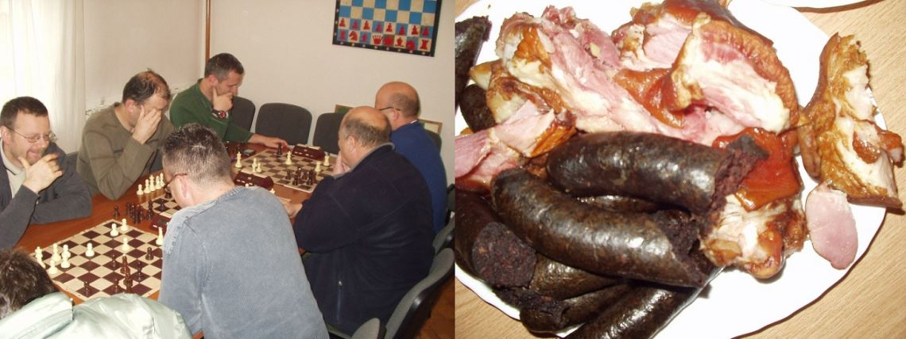
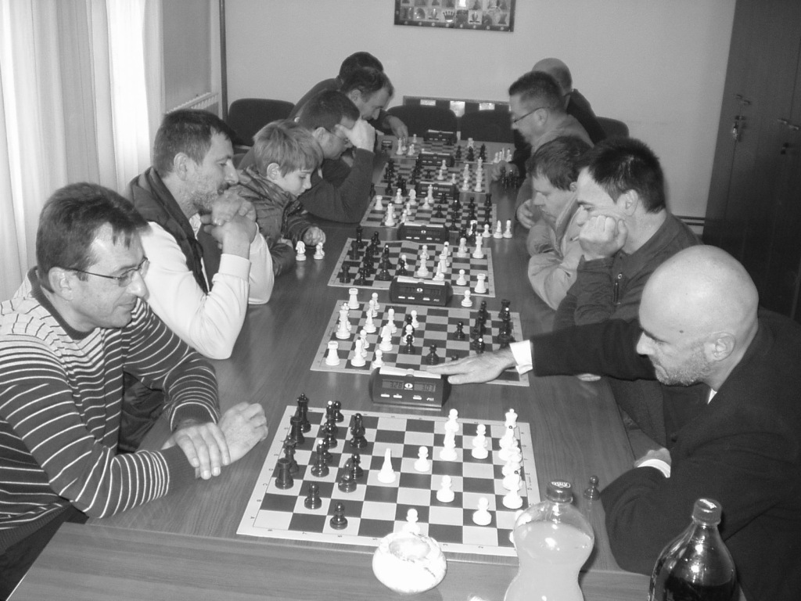
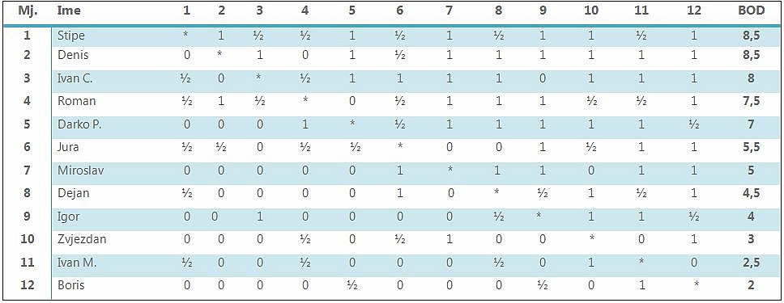

**Seniori, 11. kolo**

U pomalo prohladnom prostoru za igru, posve miroljubivo završilo je 11. kolo.  
Ipak, zahvaljujući v. d. predsjednika Kluba, gospodinu Bačurinu, od sada će uvjeti biti bolji jer je jutros popravljeno grijanje.  
Ekipe ŠK Odre i  ŠK Zaprešića čvrsto su na sredini tablice završile ovogodišnju ligu.  
Kako je službeni meč završio relativno brzo, tako je ostalo vremena za prijateljski brzopotezni turnir, koji je  
odigran u  zabavnom ozračju, kako i treba u amaterskom šahu.  
Poslije se uz druženje malo popilo i pojelo, kako i dolikuje službenom kraju ligaškog natjecanja!

 

I rezultati službenog dijela:

ŠK ODRA –  ŠK ZAPREŠIĆ   3:3

1\. Stjepan Maravić – Roman Urukalović 1/2

2\. Zvjezdan Karlić – Denis Jakupec           1/2

3\. Ivan Cvetković – Igor Boljat                    1/2

4\. Juraj Bačurin – Darko Pavlinić                1/2

5\. Ivan Maravić – Dejan Ilijaš                       1/2

6\. Borislav Kobali – Miroslav Crnković      1/2

…lige:

<table><tbody><tr><td>Mj.</td><td>Momčad</td><td>1</td><td>2</td><td>3</td><td>4</td><td>5</td><td>6</td><td>7</td><td>8</td><td>9</td><td>10</td><td>11</td><td>12</td><td>meč bod.</td><td>bod ukup.</td><td></td></tr><tr><td>1</td><td>ŠK_Stjepan_Bosak</td><td>*</td><td>3½</td><td>2½</td><td>3</td><td>5½</td><td>2½</td><td>3½</td><td>3½</td><td>4½</td><td>3½</td><td>4</td><td>6</td><td>&nbsp;&nbsp;&nbsp;&nbsp;&nbsp;17</td><td>42.0</td><td></td></tr><tr><td>2</td><td>ŠK Sveta Nedelja</td><td>2½</td><td>*</td><td>2½</td><td>3</td><td>3</td><td>5</td><td>4</td><td>4</td><td>4</td><td>4½</td><td>5</td><td>4</td><td>&nbsp;&nbsp;&nbsp;&nbsp; 16</td><td>41.5</td><td></td></tr><tr><td>3</td><td>ŠK Končar</td><td>3½</td><td>3½</td><td>*</td><td>1½</td><td>3</td><td>3½</td><td>3</td><td>4</td><td>4</td><td>3</td><td>6</td><td>3</td><td>&nbsp;&nbsp;&nbsp;&nbsp; 16</td><td>38.0</td><td></td></tr><tr><td>4</td><td>ŠK HRT</td><td>3</td><td>3</td><td>4½</td><td>*</td><td>2½</td><td>4</td><td>5</td><td>3½</td><td>2½</td><td>4</td><td>2</td><td>5</td><td>&nbsp;&nbsp;&nbsp;&nbsp; 14</td><td>39.0</td><td></td></tr><tr><td>5</td><td>ŠK Jaska</td><td>½</td><td>3</td><td>3</td><td>3½</td><td>*</td><td>4½</td><td>2½</td><td>3½</td><td>2</td><td>3½</td><td>3</td><td>4½</td><td>&nbsp;&nbsp;&nbsp;&nbsp; 13</td><td>33.5</td><td></td></tr><tr><td>6</td><td>ŠK Odra</td><td>3½</td><td>1</td><td>2½</td><td>2</td><td>1½</td><td>*</td><td>3½</td><td>3</td><td>3</td><td>4½</td><td>5</td><td>3½</td><td>&nbsp;&nbsp;&nbsp;&nbsp; 12</td><td>33.0</td><td></td></tr><tr><td>7</td><td>Karlovački ŠK</td><td>2½</td><td>2</td><td>3</td><td>1</td><td>3½</td><td>2½</td><td>*</td><td>3</td><td>3½</td><td>3</td><td>4</td><td>5</td><td>&nbsp;&nbsp;&nbsp;&nbsp; 11</td><td>33.0</td><td></td></tr><tr><td>8</td><td>ŠK Zaprešić</td><td>2½</td><td>2</td><td>2</td><td>2½</td><td>2½</td><td>3</td><td>3</td><td>*</td><td>3½</td><td>4</td><td>3</td><td>3½</td><td>&nbsp;&nbsp;&nbsp; &nbsp; 9</td><td>31.5</td><td></td></tr><tr><td>9</td><td>ŠK Vrbani</td><td>1½</td><td>2</td><td>2</td><td>3½</td><td>4</td><td>3</td><td>2½</td><td>2½</td><td>*</td><td>2½</td><td>3</td><td>4</td><td>&nbsp;&nbsp;&nbsp;&nbsp;&nbsp;&nbsp;8</td><td>30.5</td><td></td></tr><tr><td>10</td><td>ŠK INA</td><td>2½</td><td>1½</td><td>3</td><td>2</td><td>2½</td><td>1½</td><td>3</td><td>2</td><td>3½</td><td>*</td><td>3½</td><td>4½</td><td>&nbsp;&nbsp;&nbsp;&nbsp;&nbsp; 8</td><td>29.5</td><td></td></tr><tr><td>11</td><td>ŠK Maksimir</td><td>2</td><td>1</td><td>0</td><td>4</td><td>3</td><td>1</td><td>2</td><td>3</td><td>3</td><td>2½</td><td>*</td><td>6</td><td>&nbsp;&nbsp;&nbsp;&nbsp;&nbsp; 7</td><td>27.5</td><td></td></tr><tr><td>12</td><td>ŠK PIK-Vrbovec II</td><td>0</td><td>2</td><td>3</td><td>1</td><td>1½</td><td>2½</td><td>1</td><td>2½</td><td>2</td><td>1½</td><td>0</td><td>*</td><td>&nbsp;&nbsp;&nbsp;&nbsp;&nbsp; 1</td><td>17.0</td><td></td></tr></tbody></table>

… i cugera:

