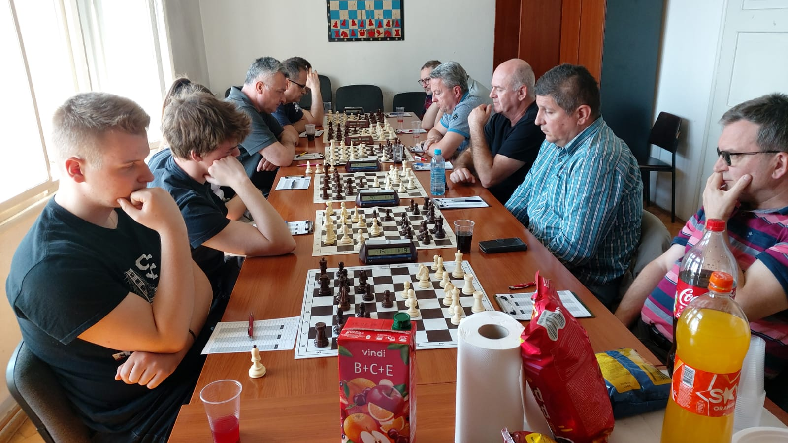

**Seniori, 4.kolo  
  
**  
Napokon dobra igra naše seniorske ekipe. U nedjelju smo odigrali jako kvalitetan meč i pobijedili dobru ekipu iz Zaprešića. Mladen je sklopio brzi remi. Zvjezdan je trošio previše vremena, žrtvovao je topa, u dobrom djelu partije imao i više nego dostatnu kompenzaciju, ali zbog teškoga cajtnota je pogriješio i izgubio. Darko se vratio starim navikama dobre igre, odigrao je partiju tijekom koje niti u jednome trenutku nije bio lošiji, postupno je povećavao pritisak, uzeo materijal, a time i bod. Najljepša činjenica ovoga meča je da smo na zadnje tri ploče osvojili tri boda i to s tri igrača koji imaju ukupno 60 godina. Naša nova igračica, višestruka prvakinja Bosne i Hercegovine, Ivana Mikić je odigrala neprecizno otvaranje, ali jednom kad je izjednačila je odigrala bolje od protivnika te pješačkim prodorom osvojila cijeli bod. Ivo je opet pokazao koliko je dobar, nalazio se u jako kompleksnoj podjednakoj poziciji, ali držao je dulje potrebnu razinu koncentracije od protivnika koji griješi na prijelazu u završnicu te Ivo lako realizira materijalnu prednost. Vraneša je loše odigrao otvaranje. Nakon toga se izvukao, a protivnik mu je prvo poklonio jednoga pa drugoga pješaka, a time i partiju. Napokon jedan dobar naš meč i igra za koju se nadamo da će ostati na ovoj razini do iduće nedjelje kada igramo u Oroslavju.

<table><tbody><tr><td>Pl.</td><td></td><td><strong>ŠK Odra</strong></td><td>–</td><td></td><td><strong>ŠK Zaprešić</strong></td><td><strong>4,5-1,5</strong></td></tr><tr><td>1.</td><td>MK</td><td>Karlić, Zvjezdan 2091</td><td>–</td><td>MK</td><td>Raljić, Mirko 2048</td><td>0-1</td></tr><tr><td>2.</td><td>MK</td><td>Sliepčević, Mladen 2093</td><td>–</td><td>MK</td><td>Jakupec, Denis 2037</td><td>½–½</td></tr><tr><td>3.</td><td>MK</td><td>Vidaković, Darko 2119</td><td>–</td><td>I</td><td>Ilijaš, Dejan 2026</td><td>1-0</td></tr><tr><td>4.</td><td></td><td>Mikić, Ivana 1873</td><td>–</td><td>II</td><td>Mihalinec, Predrag 1960</td><td>1-0</td></tr><tr><td>5.</td><td>II</td><td>Pahljina, Ivo 1969</td><td>–</td><td>I</td><td>Gabelica, Damir 1968</td><td>1-0</td></tr><tr><td>6.</td><td>II</td><td>Vraneša, Ivan 1893</td><td>–</td><td>I</td><td>Mesar, Darko 2015</td><td>1-0</td></tr></tbody></table>
