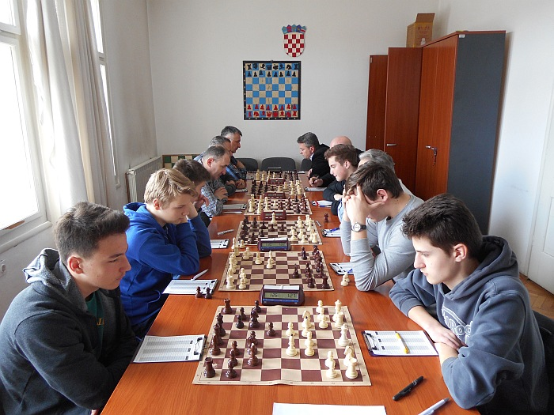

**Seniori, 1. kolo  
  
**Odigrano je prvo kolo V. seniorske lige. U goste nam je došla druga ekipa ŠK Zaprešić, s tri mlada člana u postavi. Kao novost u nastupima seniorske ekipe, i mi smo postavili tri kadeta u ekipu. Prvi put je za seniore zaigrao kadet Ivan Kljujev i potpuno opravdao svoj nastup.  Odradio je sve “školski”, pravilno se razvio, iskoristio slaba polja protivnika, osvojio slobodnu liniju i bolje stajao. Ipak, i protivnik se dobro branio i, usprkos boljoj poziciji, nije imao više od remija. Tada je počeo malo siliti poziciju, na što ih stalno motiviramo i što je u ovom stadiju razvoja vrlo pohvalno. Nažalost, tada je počinio grubi previd te izgubio partiju. U svakom slučaju, sve pohvale za prvi nastup!  
Vraneša je opet pokazao osobitu strpljivost. Ipak, opet je igrao poziciju s malom slabošću (izolirani pješak), što je njegov protivnik na kraju i iskoristio. Morat će više pripaziti u otvaranju.  
Ivan je igrao s protivnikom željnim nadigravanja. Na protivnikovu žalost, već je izrastao u dobrog taktičara i, barem je tako djelovalo, prilično lako nadigrao protivnika.  
Boris je odigrao čvrsto, ali je ušao u poziciju u kojoj nije mogao iskoristiti materijalnu prednost od jednog pješaka te je partija završila remijem, kao i na drugoj ploči, gdje su Stipe i Crnković sklopili prijateljski remi. Darko je igrao najdulje. Uz malu pomoć protivnika, iskoristio je slab položaj protivničkih figura te taktikom osvojio dva pješaka, ali je onda dugo realizirao stečenu prednost. Tako je ekipni meč završen zasluženom podjelom bodova.

**ŠK Odra – ŠK Zaprešić II   3:3**  
1\. MK Darko Vidaković 2125 – I Dejan Ilijaš  1954     1:0  
2\. MK Stjepan Maravić 2100 – II Miroslav Crnković 1810 1/2  
3\. IV Borislav Kobali 1669 – II Sven Winkler 1675     1/2  
4\. III Ivan Maravić 1626 – IV Ivica Drašković 1596       1:0  
5\. IV Ivan Vraneša 1417 – III Tomislav Ričković 1641        0:1  
6\. VK  Ivan Kljujev 1238 – II Vedran Mesar 1496     0:1
