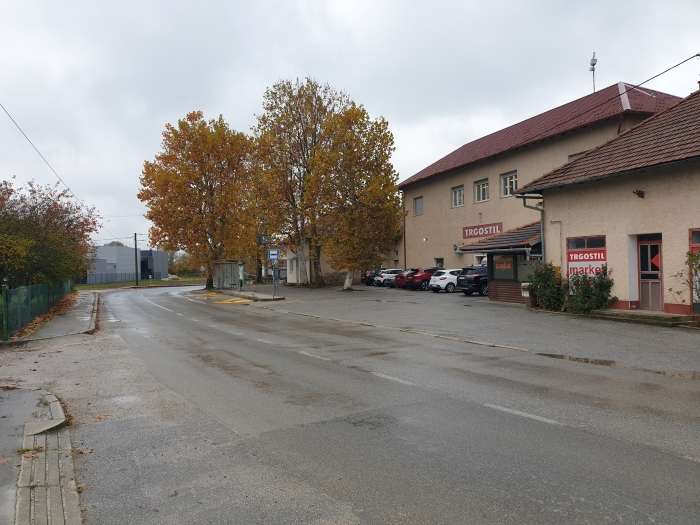
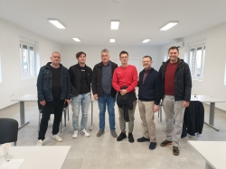
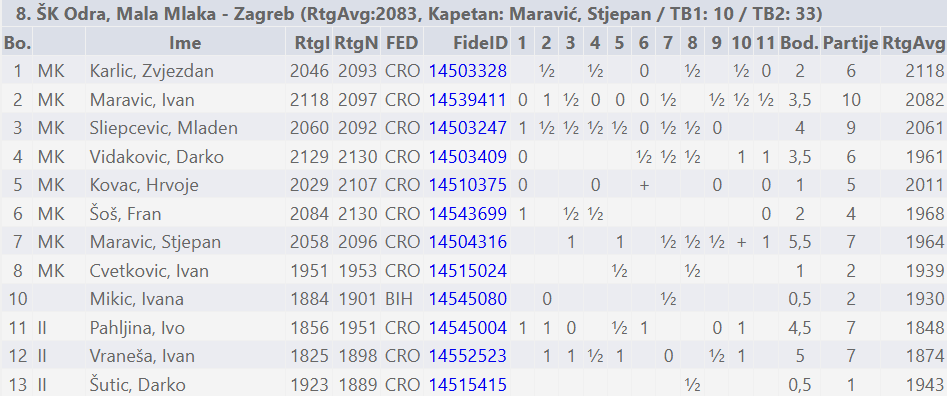
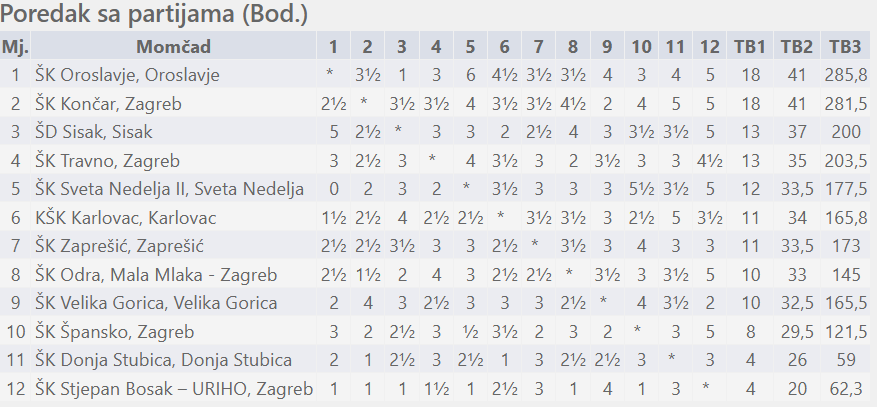

**Seniori – I. ekipa, 11.kolo**  
  
[Porazom](https://chess-results.com/tnr1127780.aspx?lan=13&art=3&rd=11) u Oroslavju smo završili ovogodišnju sezonu seniorske lige. Meč je počeo dobro za nas jer je Darko brzo uzeo pješaka, a zatim i figuru te je partija tu bila gotova. Taj sraz donosimo u prilogu. Hrvoje je rano previdio kvalitetu, kasnije se aktivnom igrom izborio za šansu za izjednačenje, ali to propušta te njegov mladi protivnik uzima bod. Stjepko je odigrao dobro, od početka do kraja je držao pritisak te uz manje propuste mirno priveo partiju kraju. Zvjezdan je uletio u teoretsku varijantu koju ne poznaje predobro te je konstantno padao pod sve veći pritisak dok mu konstrukcija nije pukla. Ivan je igrao jako loše, precjenjivao je puno protivničkih prijetnji te je na prijelazu u završnicu prepustio protivniku inicijativu. Na sreću, ni protivnik Marko se nije baš iskazao te propustio par čistih dobitaka te je na kraju sklopljen remi. Posljednji koji je igrao je Fran, odigrao je jako dobro otvaranje te je došao do velike prednosti. Na ulasku u cajtnot se vidio nedostatak prakse te je propustio nekoliko jakih poteza, pao pod probleme te ušao u tešku završnicu koju nažalost nije uspio održati. Čestitamo Oroslavju na zasluženom ulasku u višu ligu te im želimo sve najbolje tamo! Što se tiče nas, ovo je bila zanimljiva sezona i bolja od nekih prošlih. No, ponovio se i slučaj da zaredamo par lošijih kola gdje teško išta osvajamo. Dobili smo novog igrača, Frana, koji se pokazao kao pravo pojačanje te smatram da u budućnosti možemo očekivati i više bodova od njega. Stjepko je bio najbolji igrač ove sezone. Još je Vraneša imao dosta dobar preformans. Većina je bila osrednja, a podbacili su Zvjezdan, Hrvoje i Ivan. Sve u svemu, bila je ovo uspješnija sezona od prošlih, već smo sada ustalili kao trećeligaši, nadamo se kako ćemo iduće sezone i prvi puta ući u gornju polovicu. Nakon zadnjega kola smo imali tradicionalno izvrsnu hranu uz ugodno druženje.

<table><tbody><tr><td>Pl.</td><td></td><td><strong>ŠK Oroslavje</strong></td><td>–</td><td></td><td><strong>ŠK Odra</strong></td><td><strong>3,5-2,5</strong></td></tr><tr><td>1.</td><td>FM</td><td>Jaković, Roko 2181</td><td>–</td><td>MK</td><td>Karlić, Zvjezdan 2034</td><td>1-0</td></tr><tr><td>2.</td><td>MK</td><td>Novosel, Marko 2059</td><td>–</td><td>MK</td><td>Maravić, Ivan 2096</td><td>½–½</td></tr><tr><td>3.</td><td>I</td><td>Babić, Dalibor 1988</td><td>–</td><td>MK</td><td>Vidaković, Darko 2102</td><td>0-1</td></tr><tr><td>4.</td><td>I</td><td>Kucelj, Kevin 2050</td><td>–</td><td>MK</td><td>Kovač, Hrvoje 2008</td><td>1-0</td></tr><tr><td>5.</td><td>II</td><td>Klapač, Patrik 1888</td><td>–</td><td>MK</td><td>Šoš, Fran 2086</td><td>1-0</td></tr><tr><td>6.</td><td>II</td><td>Veverec, Ivo 1865</td><td>–</td><td>MK</td><td>Maravić, Stjepan 2067</td><td>0-1</td></tr></tbody></table>

  
  

```pgn
[Event "III A liga - Oroslavje : Odra"]
[Site "sahovski-klub.com"]
[Date "2025.10.26"]
[Round "11"]
[White "I Babić, Dalibor"]
[Black "MK Vidaković, Darko"]
[Result "0-1"]
[ECO "D10"]
[WhiteElo "1988"]
[BlackElo "2102"]
[PlyCount "38"]
1. d4 d5 2. c4 c6 3. Nc3 Nf6 4. Bg5 dxc4 5. Bxf6 exf6 6. e4 b5 7. a3 Be7 8. g3 O-O 9. Bg2 a5 10. Nge2 Na6 11. e5 Qb6 12. d5 fxe5 13. dxc6 Be6 14. O-O Rad8 15. Qc2 Rd3 16. Be4 Nc5 17. Bxd3 cxd3 18. Qd2 dxe2 19. Nxe2 Nb3 0-1
```

  
*IvanM*
