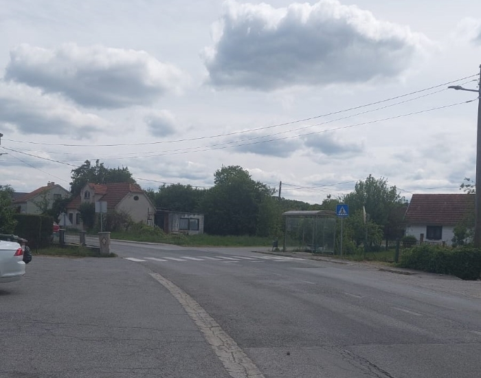

**Seniori, 5.kolo  
  
**  
Ove nedjelje smo izgubili u Oroslavju. [Meč](https://chess-results.com/tnr886630.aspx?lan=13&art=3&rd=5) nije krenuo dobro po nas jer je Ivana rano u otvaranju promašila i došla u izgubljenu poziciju iz koje nije bilo povratka. Ivan je na prvoj ploči odigrao podjednaku partiju koja je završila vječnim šehom. Stjepko je na drugoj ploči imao puno bolju poziciju, pješaka više i bolje pozicionirane figure. Međutim, previđa topa, ali njegov mladi protivnik u vremenskoj oskudici ne vidi dobitak te partija završava vječnim šahom. Cvetko je odigrao prvu partiju ove godine. Dobro je igrao, uspio je prvo osvojiti jednog pješaka, pa drugog, ali realizacija te prednosti nije izgledala lagano. Cvetko ne pronalazi pravu ideju te partija odlazi u remi. Ivo je na šestoj ploči nadigrao svoga protivnika te bio potpuno dobiven, međutim, na našu žalost, previđa figuru u dvopotezu te gubi partiju. Zadnji je ostao igrati Mladen koji je iz otvaranja izašao u malo podređenoj poziciji, ali preciznom igrom u središnjici uspijeva okrenuti poziciju i dobiti partiju. Ekipa Oroslavja se tako održala na vrhu tablice, a mi se po običaju nastavljamo boriti za opstanak. Ostaje žal za propuštenim prilikama na drugoj, četvrtoj i zadnjoj ploči. Sljedeći tjedan ugošćujemo Mače.

<table><tbody><tr><td>Pl.</td><td></td><td><strong>ŠK Oroslavje</strong></td><td>–</td><td></td><td><strong>ŠK Odra</strong></td><td><strong>3,5-2,5</strong></td></tr><tr><td>1.</td><td>MK</td><td>Kukas, Oliver 2229</td><td>–</td><td>MK</td><td>Maravić, Ivan 2086</td><td>½–½</td></tr><tr><td>2.</td><td>MK</td><td>Jaković, Roko 2179</td><td>–</td><td>MK</td><td>Maravić, Stjepan 2107</td><td>½–½</td></tr><tr><td>3.</td><td>MK</td><td>Novosel, Marko 2146</td><td>–</td><td>MK</td><td>Sliepčević, Mladen 2093</td><td>0-1</td></tr><tr><td>4.</td><td>MK</td><td>Đurić, Leon 2105</td><td>–</td><td>MK</td><td>Cvetković, Ivan 1958</td><td>½–½</td></tr><tr><td>5.</td><td>I</td><td>Frouth, Vibor 2022</td><td>–</td><td></td><td>Mikić, Ivana 1873</td><td>1-0</td></tr><tr><td>6.</td><td>I</td><td>Kucelj, Kevin 2029</td><td>–</td><td>II</td><td>Pahljina, Ivo 1969</td><td>1-0</td></tr></tbody></table>

*IvanM*
