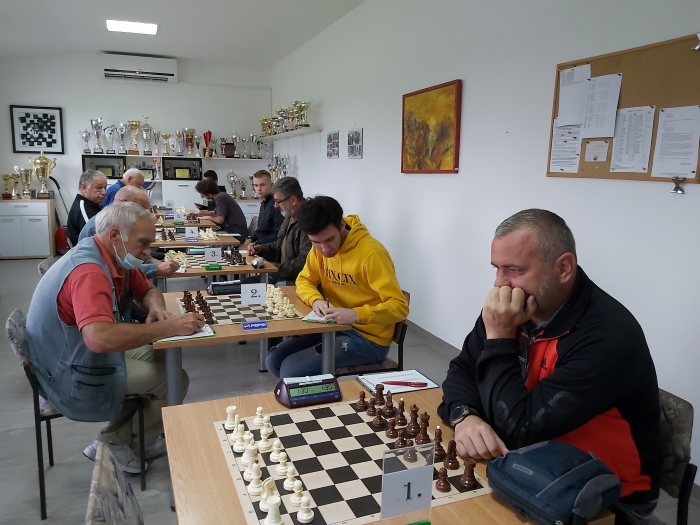

**IV. A liga, 2. kolo**  
  
Ovu nedjelju je odigrano 2. kolo seniorske [IV. A lige centar](https://chess-results.com/tnr549409.aspx?lan=13&art=0). Ugostio nas je ŠK Polet.  
Došli smo u pomlađenom sastavu, s tri juniora. Nakon prijateljskih remija između dva Cvetkovića i dva Rožića, Ivan Vraneša je uzeo dvije figure za topa te polako privodio kraju partiju u dubokoj, ali konstantno dobivenoj završnici. Tin je u otvaranju odigrao rizično, uzimajući pijuna te namještajući se na puno taktika, ali vješto izbjegao poraz te u jednakoj završnici, gdje su obojica držali balans do cajtnota, previdio i izgubio. Najduže je igrao Ivan Maravić koji je cijelu partiju branio nešto slabiju poziciju, da bi u dubokoj završnici s malo vremena njegov protivnik popustio te tako nakon nekoliko lošijih poteza i izgubio.  
Iduće kolo igra se iduću nedjelju kada nam dolazi u goste ŠK Špansko.

<table><tbody><tr><td>Pl.</td><td></td><td><strong>ŠK Polet II</strong></td><td>–</td><td></td><td><strong>ŠK Odra</strong></td><td><strong>2-4</strong></td></tr><tr><td>1.</td><td>I</td><td>Šafranić Josip 2044</td><td>–</td><td>MK</td><td>Maravić Stjepan 2130</td><td>0-1</td></tr><tr><td>2.</td><td>MK</td><td>Hudolin Krešimir 2019</td><td>–</td><td>I</td><td>Maravić Ivan 1991</td><td>0-1</td></tr><tr><td>3.</td><td>MK</td><td>Rožić Marijan 2019</td><td>–</td><td>MK</td><td>Cvetković Ivan 1948</td><td>½–½</td></tr><tr><td>4.</td><td>MK</td><td>Jurić Joso 1995</td><td>–</td><td>II</td><td>Vraneša Ivan 1622</td><td>0-1</td></tr><tr><td>5.</td><td>MK</td><td>Hibner Branko 1991</td><td>–</td><td>VK</td><td>Furčić Tin 1631</td><td>1-0</td></tr><tr><td>6.</td><td>I</td><td>Rožić Zlatko 1787</td><td>–</td><td>III</td><td>Cvetković Božo 1387</td><td>½–½</td></tr></tbody></table>
