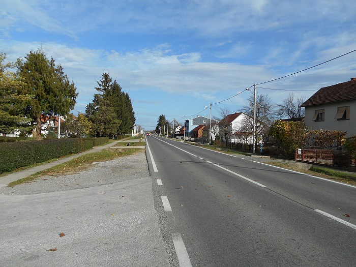
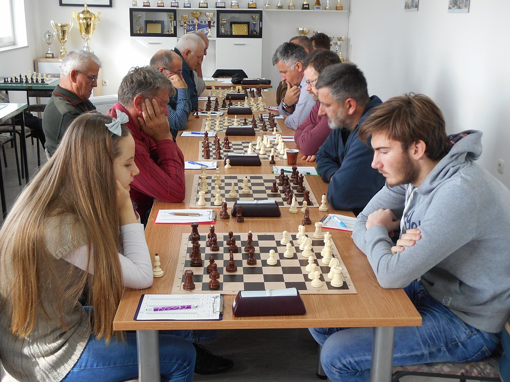

**Seniori,** **10**. **kolo**  
Na gostovanju u Buševcu, po vjetrovitom i neuobičajeno toplom vremenu za ovo doba godine, 24°C, upisali smo još jednu pobjedu i osigurali ostanak u ligi. Cvetko i Ivan su vrlo brzo imali pješaka više. Mlada Ivanova protivnica je nesmotreno poklonila pješaka već u ranoj fazi igre, a Cvetko se po osvajanju pješaka posvetio obrani. Darku je protivnik poklonio figuru u otvaranju i on je prvi završio partiju. Ivan je svoju prednost polako povećavao i upisao još jedan bod za ekipu. Stipe je stajao dobro i lijepu poziciju lako preveo u dobivenu završnicu. Zvjezdan je korektno žrtvovao, da bi kasnije nastavio neprecizno i taman kada je ulazio u izgubljenu završnicu s figurom manje, njegov protivnik je grubo pogriješio i dopustio još jednu žrtvu s matnim napadom. Jednako grubu grešku kao Zvjezdanov protivnik napravio je i Cvetko te ostao bez cijelog boda. Jura je od početka bio pasivan i nije se ozbiljnije pokušao otvoriti ili igrati na komplikacije te mu je protivnik napravio pritisak po sedmom redu, uzeo materijal i drugi bod za protivničku ekipu.  
Posljednje kolo igra se 4. studenoga kada nam u goste dolazi ŠK Ina.

<table><tbody><tr><td></td><td></td><td><strong>&nbsp;&nbsp;ŠK Polet II, Buševec</strong></td><td><strong>–</strong></td><td></td><td><strong>&nbsp;&nbsp;ŠK Odra, Zagreb</strong></td><td><strong>&nbsp;2 : 4</strong></td></tr><tr><td>1.</td><td>I</td><td><table><tbody><tr><td></td><td>Šafranić, Josip 2036</td></tr></tbody></table></td><td>–</td><td>MK</td><td><table><tbody><tr><td></td><td>Bačurin, Juraj 2040</td></tr></tbody></table></td><td>&nbsp; 1 – 0</td></tr><tr><td>2.</td><td>MK</td><td><table><tbody><tr><td></td><td>Hibner, Branko 2008</td></tr></tbody></table></td><td>–</td><td>MK</td><td><table><tbody><tr><td></td><td>Maravić, Stjepan 2108</td></tr></tbody></table></td><td>&nbsp; 0 – 1</td></tr><tr><td>3.</td><td>MK</td><td><table><tbody><tr><td></td><td>Rožić, Marijan 2025</td></tr></tbody></table></td><td>–</td><td>MK</td><td><table><tbody><tr><td></td><td>Vidaković, Darko 2116</td></tr></tbody></table></td><td>&nbsp; 0 – 1</td></tr><tr><td>4.</td><td>MK</td><td><table><tbody><tr><td></td><td>Čolić, Zdravko 1878</td></tr></tbody></table></td><td>–</td><td>MK</td><td><table><tbody><tr><td></td><td>Karlić, Zvjezdan 2103</td></tr></tbody></table></td><td>&nbsp; 0 – 1</td></tr><tr><td>5.</td><td>II</td><td><table><tbody><tr><td></td><td>Žgela, Joso 1865</td></tr></tbody></table></td><td>–</td><td>MK</td><td><table><tbody><tr><td></td><td>Cvetković, Ivan 1942</td></tr></tbody></table></td><td>&nbsp; 1 – 0</td></tr><tr><td>6.</td><td>II</td><td><table><tbody><tr><td></td><td>Trgovac, Marta 1266</td></tr></tbody></table></td><td>–</td><td>II</td><td><table><tbody><tr><td></td><td>Maravić, Ivan 1721</td></tr></tbody></table></td><td>&nbsp; 0 – 1</td></tr></tbody></table>
