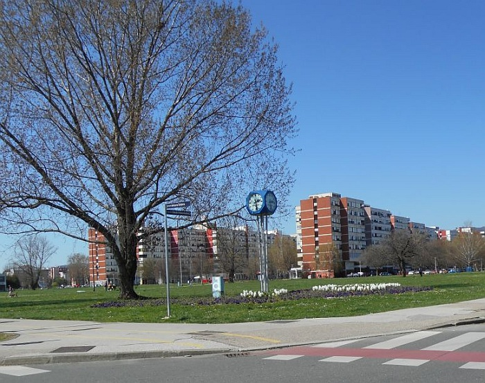

###### Seniori – II. ekipa, 2.kolo



Nakon povijesne pobjede protiv ŠK HAŠK, ekipa ŠK Odra II nastavila je u istom ritmu i slavila na gostovanju kod ŠK Pravi Potez! [Meč](https://chess-results.com/tnr1127793.aspx?lan=13&art=3&rd=2) je bio prepun uzbuđenja, ali naši su igrači još jednom pokazali kvalitetu i borbenost.

Za ekipu su nastupili Darko Šutić, Luka Fiolić, Nikola Pischiutta, Lucija Fiolić, Goran Fiolić i Ivan Karlović.

Darko je dobro započeo partiju, ali neočekivani previd dame bio je presudan, pa je morao predati partiju. Nikola je sigurno iskoristio figuru viška, stvorio napad i brzo priveo partiju kraju u svoju korist. Lucija se u početku mučila s otvaranjem, ali je ubrzo uhvatila ritam. Protivnik, koji je zaboravio kako se radi rokada, našao se u problemima, a Lucija je iskoristila tu i još nekoliko grešaka za pobjedu.

Goran je upisao svoju prvu pobjedu u nastavku profesionalne karijere i to na impresivan način! Napravio je taktičku viljušku kojom je natjerao protivnika na kapitulaciju. Kao što je Magnus Carlsen istaknuo, njegova prva velika pobjeda bila je ključna za njegovu karijeru, pa vjerujemo da je i za Gorana ovo početak niza uspjeha koji tek dolaze!​

Ivan Karlović odigrao je strateški zrelu partiju. Iz otvaranja je izašao s pješakom više te strpljivom igrom stigao do zaslužene pobjede. Luka je osigurao ključni remi, čime je ekipa potvrdila ukupnu pobjedu u meču.

S ovom pobjedom, ŠK Odra II nastavlja s odličnim rezultatima i puni samopouzdanja ulazi u sljedeće izazove. Sljedeći vikend donosi novi meč protiv ŠK Maksimir na domaćem terenu – može li ekipa nastaviti pobjednički niz?

<table><tbody><tr><td>Pl.</td><td></td><td><strong>ŠK Pravi Potez</strong></td><td>–</td><td></td><td><strong>ŠK Odra II</strong></td><td><b>1.5 – 4.5</b></td></tr><tr><td>1.</td><td></td><td>Garašić, Martin</td><td>–</td><td>II</td><td>Šutić, Darko</td><td>1-0</td></tr><tr><td>2.</td><td></td><td>Ivec, Ivan</td><td>–</td><td>IV</td><td>&nbsp;Fiolić, Luka</td><td>½–½</td></tr><tr><td>3.</td><td></td><td>Pavlović, Krunoslav</td><td>–</td><td></td><td>Pischiutta, Nikola</td><td>0-1</td></tr><tr><td>4.</td><td></td><td>Čukman, Vladimir</td><td>–</td><td>III</td><td>Fiolić, Lucija</td><td>0-1</td></tr><tr><td>5.</td><td></td><td>Crnković, Vjekoslav</td><td>–</td><td>&nbsp;II</td><td>&nbsp;Fiolić, Goran</td><td>0-1</td></tr><tr><td>6.</td><td></td><td>Čukman, Krešimir</td><td>–</td><td></td><td>Karlović, Ivan</td><td>0-1</td></tr></tbody></table>

```pgn
[Event "5. Liga ŠZŽ Centar 2025"]

[Site "Špansko"]
[Date "2025.03.23"]
[Round "2"]
[White "Crnković Vjekoslav"]
[Black "Fiolić Goran"]
[Result "1-0"]

1. e4 c5 2. Nf3 Nc6 3. d3 e6 4. Be3 Nf6 5. Nc3 d5 6. Qe2 d4 7. e5 Nd7 8. Bg5 f6 9. h4 Ndxe5 10. Nxd4 Nxd4 11. Qd2 Nef3+ 12. gxf3 Nxf3+ 13. Ke2 Nxd2 14. Kxd2 fxg5 15. hxg5 Qxg5+ 16. Ke2 Bd6 17. Ne4 Qe5 18. Re1 c4 19. Kd1 Qf4 20. c3 Bd7 21. dxc4 O-O-O 22. c5 Bxc5 23. Nxc5 Qd6+ 24. Kc1 Qxc5

0-1
```

IvanV
