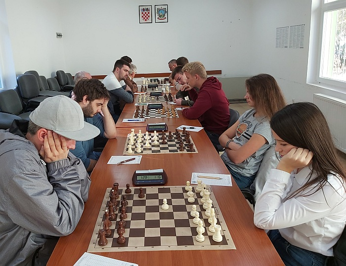

**Seniori, 9. kolo  
  
**U devetom kolu seniorske lige ekipa domaćina ŠK Prigorje zasluženo je pobijedila ekipu ŠK Odra.

<table><tbody><tr><td></td><td></td><td>&nbsp;<strong> ŠK Prigorje Markuševec</strong></td><td><strong>–</strong></td><td><strong>&nbsp;</strong></td><td><strong>&nbsp; ŠK Odra</strong></td><td><strong>5 :</strong> <strong>1</strong></td></tr><tr><td>1.</td><td>MK</td><td><table><tbody><tr><td></td><td>Šelendić, Ivan 2178</td></tr></tbody></table></td><td>–</td><td>MK</td><td><table><tbody><tr><td></td><td>Maravić, Stjepan 2121</td></tr></tbody></table></td><td>1 – 0</td></tr><tr><td>2.</td><td>MK</td><td><table><tbody><tr><td></td><td>Tušek, Milan 1947</td></tr></tbody></table></td><td>–</td><td>MK</td><td><table><tbody><tr><td></td><td>Karlić, Zvjezdan 2093</td></tr></tbody></table></td><td>½ – ½</td></tr><tr><td>3.</td><td>II</td><td><table><tbody><tr><td></td><td>Šelendić, Matija 1907</td></tr></tbody></table></td><td>–</td><td>I</td><td><table><tbody><tr><td></td><td>Maravić, Ivan 1942</td></tr></tbody></table></td><td>½ – ½</td></tr><tr><td>4.</td><td>I</td><td><table><tbody><tr><td></td><td>Klement, Dubravko 1804</td></tr></tbody></table></td><td>–</td><td>II</td><td><table><tbody><tr><td></td><td>Vraneša, Ivan 1830</td></tr></tbody></table></td><td>1 – 0</td></tr><tr><td>5.</td><td>II</td><td><table><tbody><tr><td></td><td>Putak, Karlo 1768</td></tr></tbody></table></td><td>–</td><td>II</td><td><table><tbody><tr><td></td><td>Kolovrat, Ana 1196</td></tr></tbody></table></td><td>1 – 0</td></tr><tr><td>6.</td><td>IV</td><td><table><tbody><tr><td></td><td>Domazet, Danijel 1725</td></tr></tbody></table></td><td>–</td><td>II</td><td><table><tbody><tr><td></td><td>Halužan, Samanta 1193</td></tr></tbody></table></td><td>1 – 0</td></tr></tbody></table>

Stipe je još u otvaranju previdio figuru, Zvjezdan je u završnici s dva piuna više, previdio piuna i našao se u završnici raznobojaca koju više nije mogao dobiti. Ivan je na trećoj ploči odigrao mlako, ali sigurno. Od njega očekujemo više u ovoj ligi. Vranešina pozicija se mijenjala tijekom partije, ali je na kraju presudnu ulogu odigrao cajtnot, kao i u Samantinoj partiji. Samanta se pogrešnim izmjenama našla u malo slabijoj poziciji, ali i u vremenskoj oskudici i to je odlučilo ishod. Ana je uspjela u središnjici nadigrati iskusnijeg protivnika, ali je onda u jednom potezu nepotrebno oslabila rokadni položaj i previdila materijal.  
Obzirom na solidnu poziciju na tablici, ovim porazom smo se zasad osigurali od plasmana u višu ligu. 🙂 A u ovoj ćemo davati sve više prilika mladim igračima i igračicama. Za ovo gostovanje računali smo i na Moniku, ali je zbog drugih obaveza preskočila ovo kolo. Djevojkama uskoro počinje školsko ekipno prvenstvo Zagreba i ove partije su im dobra priprema.  
Sljedeće, 10. kolo seniorske lige igra se za dva tjedna, a domaćini smo ŠK UHBDR 99. brigade.
