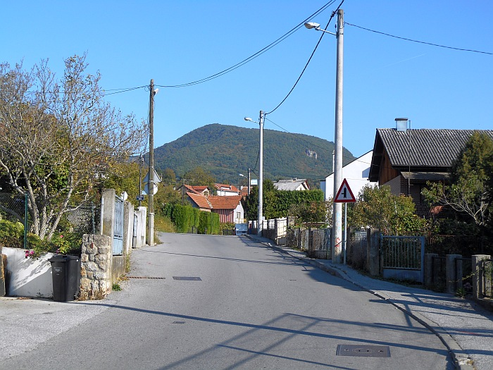
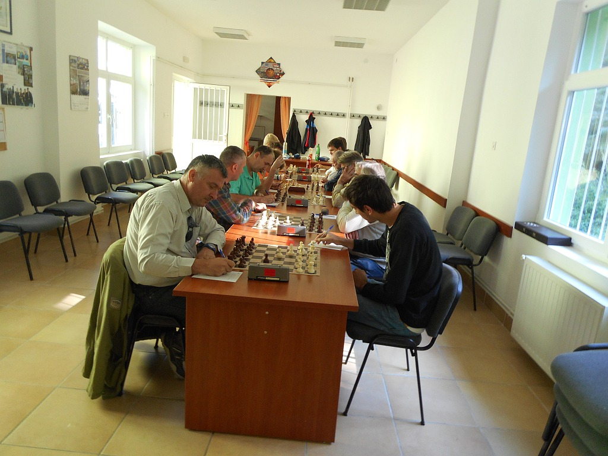

**Seniori, 8. kolo  
  
**Seniori ŠK Odra danas su odigrali osmo kolo IV. lige u gostima kod ŠK Prigorje Markuševec. Ekipa je bila pomlađena, a uz kadete Ivana i Vranešu, ekipi se pridružio i Tin. Cvetko, Jura i Zvjezdan zbog obveza su izostali s ovog kola i to su mlađi članovi dobro iskoristili. Posebno se vidi napredak Vraneše, koji je izgubio partiju tek u završnici. Da bi odigrao bolje završnice, treba mu, osim talenta, kojeg ima, i još dosta partija, tj. iskustva. No definitivno ide u dobrom smjeru. Na prvoj ploči Darko se nije snašao u otvaranju i protivnik ga je lijepom žrtvom doveo u izgubljenu poziciju. Na njegovu sreću i protivnik je u kasnoj fazi partije previdio pješaka te mu dopustio da se izvuče. Stipe je na drugoj ploči odbio remi i dočekao previd protivnika te jedini zabilježio cijeli bod. Tin se patio s otvaranjem, na kraju previdio masku, ali mislim da je dosta naučio iz ove partije. Borisa je protivnik neugodno svezao lovcima, tako da je i Boris ubilježio prvi poraz ove godine. U svakom slučaju i više nego zaslužena pobjeda ŠK Prigorje Markuševec. Meč je odigran u ugodnoj atmosferi, sve pohvale domaćinima na gostoprimstvu, suđenju…  
Sljedeće kolo seniori igraju za tjedan dana, a u goste dolazi ŠK Silent iz Zagreba.

**ŠK Prigorje Markuševec – ŠK Odra, Zagreb 4,5:1,5**

1\. MK Šelendić, Ivan 2097 – MK Vidaković, Darko 2124       1/2  
2\. MK Tušek, Milan 1974 – MK Maravić, Stjepan 2093         0:1  
3\. I Bačić, Mile 1980 – IV Kobali, Borislav 1678                      1:0  
4\. I Klement, Dubravko 1895 – III Maravić, Ivan 1439          1:0  
5\. II Šelendić, Matija 1760 – VK Furčić, Tin 1646                    1:0  
6\. II Putak, Karlo 1714 – IV Vraneša, Ivan 1348                      1:0
