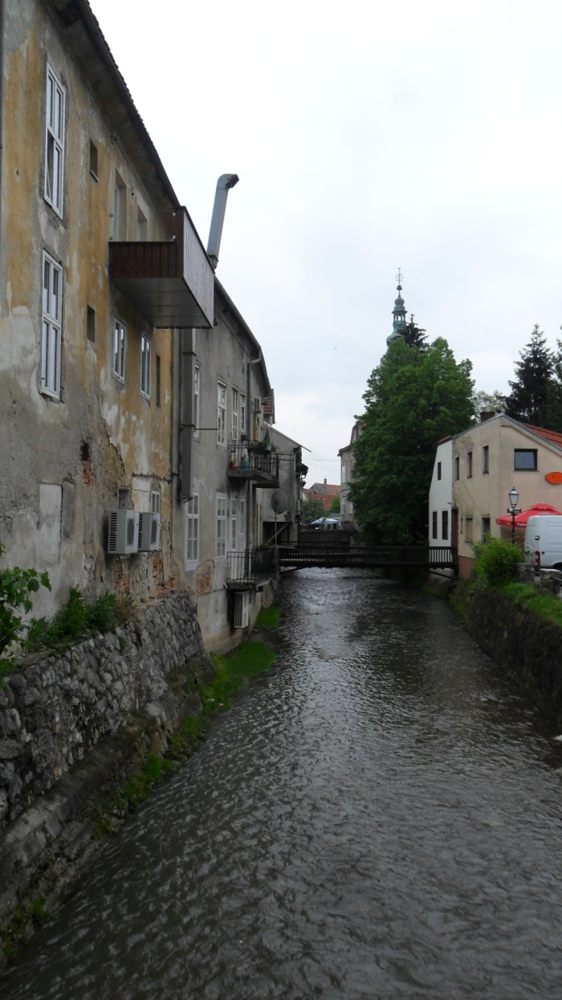

**Seniori, 6.kolo  
  
**

<table><tbody><tr><td>Pl.</td><td></td><td><strong>ŠK Samobor</strong></td><td>–</td><td></td><td><strong>ŠK Odra</strong></td><td><strong>4,5-1,5</strong></td></tr><tr><td>1.</td><td>MK</td><td>Zamostni, Jan 2204</td><td>–</td><td>MK</td><td>Karlić, Zvjezdan 2096</td><td>½–½</td></tr><tr><td>2.</td><td>MK</td><td>Franc, Borna 2202</td><td>–</td><td>MK</td><td>Maravić, Ivan 2085</td><td>½–½</td></tr><tr><td>3.</td><td>NM</td><td>Mihalinec, Damir 2184</td><td>–</td><td>MK</td><td>Maravić, Stjepan 2107</td><td>1-0</td></tr><tr><td>4.</td><td>MK</td><td>Fauković, Matija 2105</td><td>–</td><td>MK</td><td>Cvetković, Ivan 1968</td><td>1-0</td></tr><tr><td>5.</td><td>MK</td><td>Bartaković, Tomislav 2082</td><td>–</td><td>MK</td><td>Bačurin, Juraj 2014</td><td>1-0</td></tr><tr><td>6.</td><td>MK</td><td>Car, Filip 2104</td><td>–</td><td>MK</td><td>Kovač, Hrvoje 2122</td><td>½–½</td></tr></tbody></table>

Loši rezultati praćeni još lošijom igrom se nastavljaju. Ove nedjelje nas je ugostio ŠK Samobor. Unatoč prvom sastavu nakon više godina koji se sastojao od šest majstorskih kandidata, uspjeli smo upisati (i to uz mnogo sreće!) bod i pol. Prvo je Cvetko zapao u probleme zbog neznanja teorije. Nikako se nije uspio izvući iz istih te je brzo izgubio. Jura je zapao u pasivnu poziciju nakon otvaranja te se onda jednim potezom “samoubio”. Stjepko je stajao dobro, ali je previdio jedan potez na kraju forsiranog nastavka te je tu partiji bio kraj. Zvjezdan je odigrao dobru partiju, napetu Sicilijanku u kojoj je sklonio kralja u velikoj rokadi. Međutim, njegov protivnik je također dobre poteze vukao te je ponavljanjem iste pozicije tri puta sklopljen remi. Ivan Maravić je nastavio igrati loše, izgubio je pješaka već u otvaranju i bio potpuno izgubljen. Međutim, njegov mladi protivnik je bio neinspiriran i odigrao 20 “dalje” poteza i tako pomogao Ivanu da i on osvoji neke bodove. Hrvoje je ostao zadnji, još jedna Sicilijanka, ali ova pozicionog karaktera. Držao je pritisak po otvorenoj liniji, u jednom trenutku je mogao osvojiti figuru, ali na kraju je podjednaka pozicija otisla u jednaku završnicu gdje je Hrvoje čak u jednom trenutku studiozno bio izgubljen! No, na kraju je sklopljen remi. Sve u svemu, po prikazanoj igri, možemo biti sretni količinom bodova koju smo osvojili. Slijedi nam ljetna pauza nakon koje ugošćujemo ŠK Zaprešić.

*IvanM*
