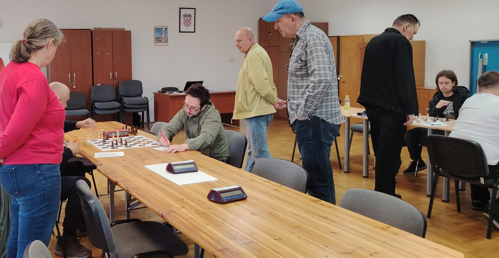

###### Seniori – II. ekipa, 4.kolo



Protekle nedjelje, **26\. travnja**, druga ekipa ŠK Odre gostovala je kod ŠK Silent te ostvarila uvjerljivu **[pobjedu](https://s1.chess-results.com/tnr1352599.aspx?lan=13&art=3&rd=4&SNode=S0)** rezultatom **4,5:1,5**.

Ekipa je nastupila u sastavu: Darko Šutić, Tin, Boris, Luka Fiolić, Luka Lesničar i Filip Cvetković.

**Darko** je na prvoj ploči imao najteži zadatak protiv njihovog najjačeg igrača te je, unatoč borbenoj partiji, nažalost upisao poraz.

**Tin** na drugoj ploči ponovno potvrđuje odličnu formu i sigurnom igrom s bijelim figurama dolazi do nove pobjede. Bravo za Tina koji igra zaista impresivno!

**Boris** je s crnim figurama odigrao stabilno i odgovorno te rutinski osigurao remi i važnih pola boda za ekipu.

**Luka Fiolić** ovoga puta odlučuje igrati na pobjedu, što mu se itekako isplatilo. Prepoznao je dobitnu pješačku završnicu i sigurno priveo partiju kraju. Bravo za Luku! Njegovu partiju donosimo u prilogu.

**Luka Lesničar** je odigrao vrlo lijepu i preciznu partiju te zasluženo upisao pobjedu. Njegovu partiju također donosimo u prilogu.

**Filip** nastavlja svoj pobjednički niz – kada igra, pobjeđuje! Još jednom donosi cijeli bod ekipi i potvrđuje svoju konstantu.

Ovom pobjedom završena je polusezona, a ekipa trenutno drži solidno 5. mjesto od ukupno 8 ekipa. Čestitke cijeloj ekipi na odličnom nastupu!

Nastavak lige slijedi 4. listopada na domaćem terenu, gdje ŠK Odra II dočekuje ekipu ŠK Sloga. 💪♟️

<table><tbody><tr><td>Pl.</td><td></td><td><strong>ŠK Silent</strong></td><td>–</td><td></td><td><strong>ŠK Odra II</strong></td><td><b>1,5:4,5</b></td></tr><tr><td>1.</td><td>FM</td><td>Božinović, Bogdan</td><td>–</td><td>II</td><td>Šutić, Darko</td><td>1-0</td></tr><tr><td>2.</td><td>I</td><td>Golemović, Tvrtko</td><td>–</td><td>III</td><td>Furčić, Tin</td><td>0-1</td></tr><tr><td>3.</td><td>I</td><td>Vuljanić, Ana</td><td>–</td><td>III</td><td>Kobali, Borislav</td><td>1/2-1/2</td></tr><tr><td>4.</td><td>&nbsp;II</td><td>&nbsp;Špilek, Kristina</td><td>–</td><td>IV</td><td>Fiolić, Luka</td><td>0-1</td></tr><tr><td>5.</td><td>&nbsp;IV</td><td>Marić, Stana</td><td>–</td><td>IV</td><td>Lesničar, Luka</td><td>0-1</td></tr><tr><td>6.</td><td>&nbsp;V</td><td>Vlašić, Anamarija</td><td>–</td><td></td><td>Cvetković, Filip</td><td>0-1</td></tr></tbody></table>

```pgn
[Event "5 B Liga Centar"]
[Site "Zagreb"]
[Date "26.04.2026."]
[Round "4"]
[White "Fiolić, Luka"]
[Black "Špilek, Kristina"]
[Result "1-0"]
[WhiteElo "1681"]
[BlackElo "1524"]
[Board "4"]

1. e4 e6 2. Nf3 d5 3. exd5 exd5 4. d4 Nf6 5. Nc3 c6 6. Bg5 Be7 7. h3 h6 8. Bf4 Bd6 9. Qd2 Qc7 10. Bxd6 Qxd6 11. Bd3 Be6 12. O-O O-O 13. Rfe1 Nbd7 14. Ne2 Ne4 15. Qf4 g5 16. Qxd6 Nxd6 17. g4 Kg7 18. Ng3 Nf6 19. Re2 Rae8 20. Rae1 Bd7 21. Rxe8 Rxe8 22. Rxe8 Ndxe8 23. Ne5 Be6 24. Nf5+ Bxf5 25. Bxf5 Nd6 26. Bd3 Kf8 27. Kg2 Ke7 28. f4 gxf4 29. Kf3 Nd7 30. Kxf4 f6 31. Ng6+ Kf7 32. Nh4 Nf8 33. Nf5 Ne6+ 34. Ke3 Nxf5+ 35. Bxf5 Ke7 36. Bxe6 Kxe6 37. Kf4 b6 38. b4 b5 39. c3 Kf7 40. Kf5 a6 41. a3 Kg7 42. Ke6 Kg6 43. Kd6 f5 44. gxf5+ Kxf5 45. Kxc6 h5 46. Kxd5 Kg5 47. Ke5 Kh4 48. d5 Kxh3 49. d6 Kg4 50. d7 h4 51. d8=Q h3 52. Qd3 h2 53. Qe4+ Kg3 54. Qh1 1-0
```

```pgn
[Event "5 B Liga Centar"]
[Site "Zagreb"]
[Date "26.04.2026."]
[Round "4"]
[White "Marić, Stana"]
[Black "Lesničar, Luka"]
[Result "0-1"]
[WhiteElo "1410"]
[BlackElo "1597"]
[Board "5"]

1. e4 e5 2. Nf3 Nc6 3. d4 exd4 4. Nxd4 Nf6 5. Nc3 Bb4 6. a3 Bxc3+ 7. bxc3 Nxe4 8. Qd3 O-O 9. Be2 Re8 10. O-O d5 11. Nxc6 bxc6 12. f3 Nd6 13. Re1 Bf5 14. Qd1 Qf6 15. Bd2 Qg6 16. Bd3 Bxd3 17. Rxe8+ Rxe8 18. cxd3 Qxd3 19. Qc1 Re2 20. Qb2 Qxd2 21. Qb8+ Ne8 0-1
```
