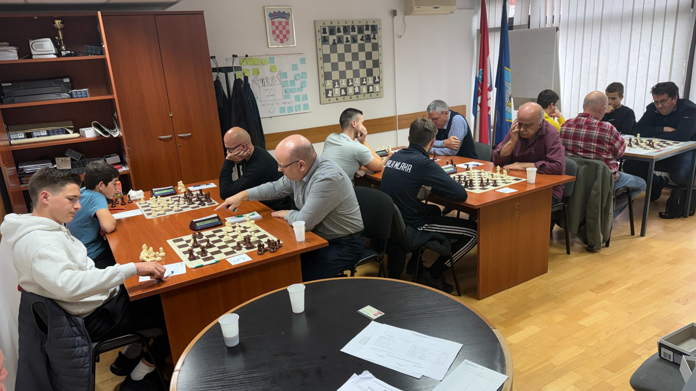
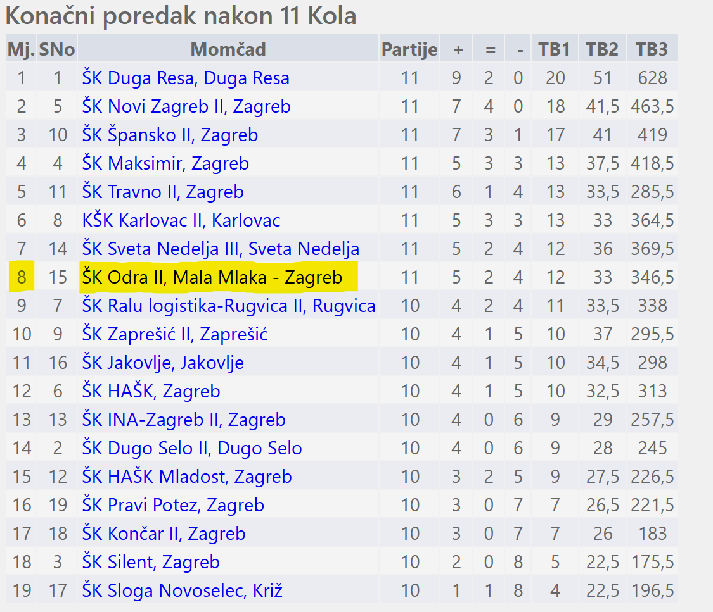
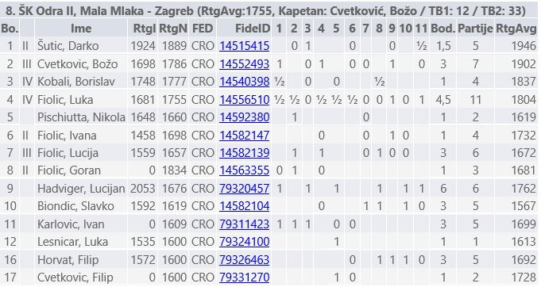

###### Seniori – II. ekipa, 11.kolo

###### 

Prošle nedjelje, 26. listopada, druga ekipa ŠK Odra gostovala je kod ŠK Špansko II. Nažalost, u posljednjem kolu sezone zabilježen je poraz, ali susret je bio napet i neizvjestan do samoga kraja.

Ekipa je nastupila u sastavu: Darko Šutić, Božo, Luka Fiolić, Lucijan, Slavko i Filip Horvat.

**Darko** je na prvom ploči pokazao čvrstoću i odigrao solidnu partiju koja je završila remijem.

**Božo** se dobro otvorio i vodio borbu u središnjici, ali pod pritiskom vremena napravio je previd i izgubio partiju.

**Luka** je briljirao u otvaranju i središnjici, stekao veliku prednost i na kraju realizirao pobjedu. Čestitamo mu na tome što je odigrao sva kola sezone! Njegovu partiju donosimo u prilogu.

**Lucijan** je klasično dominirao protivnika i lako ostvario pobjedu. Također, skupio je puni broj bodova u svih šest odigranih partija – prava impresija! Njegovu partiju također možete pogledati u prilogu.

**Slavko** je imao prednost u otvaranju, no dvije grube greške u središnjici koštale su ga pobjede. **Filip Horvat** se u otvaranju izgubio, a pod pritiskom protivnika i vremena također je zabilježio poraz. Oba mladića stječu vrijedno iskustvo u seniorskim partijama i sigurno će biti sve bolji.

**Sve u svemu**, ekipa ŠK Odre II sezonu je završila na 8. mjestu od 19 ekipa – vrlo solidan rezultat za njihov prvi nastup. Bilo je uspona i padova, a iduće sezone ciljamo na plasman među prva tri mjesta!

<table><tbody><tr><td>Pl.</td><td></td><td><strong>ŠK Špansko&nbsp;</strong><strong style="font-family: inherit;font-size: inherit">II</strong><strong><br></strong></td><td>–</td><td></td><td><strong>ŠK Odra II</strong></td><td><b>3.5 – 2.5</b></td></tr><tr><td>1.</td><td>I</td><td>Benamatić, Krešimir</td><td>–</td><td>II</td><td>Šutić, Darko</td><td>1/2-1/2</td></tr><tr><td>2.</td><td>II</td><td>Biti, Tin</td><td>–</td><td>III</td><td>Cvetković, Božo</td><td>1-0</td></tr><tr><td>3.</td><td>III</td><td>Smoljan, Branko</td><td>–</td><td>IV</td><td>Fiolić, Luka</td><td>0-1</td></tr><tr><td>4.</td><td>III</td><td>Žepić, Luka</td><td>–</td><td></td><td>Hadviger, Lucijan</td><td>0-1</td></tr><tr><td>5.</td><td></td><td>Dedović, Alen</td><td>–</td><td></td><td>Biondić, Slavko</td><td>1-0</td></tr><tr><td>6.</td><td>&nbsp;IV</td><td>Hasanbegoić, Kemal</td><td>–</td><td></td><td>Horvat, Filip</td><td>1-0</td></tr></tbody></table>



```pgn
[Event "5 A Liga Centar"]
[Site "Špansko"]
[Date "26.10.2025."]
[Round "11"]
[White "Smoljan, Branko"]
[Black "Fiolić, Luka"]
[Result "1-0"]
[WhiteElo "1855"]
[BlackElo "1618"]
[Board "3"]

1. d4 d5 2. c4 e6 3. Nf3 Nf6 4. Nc3 Nbd7 5. cxd5 Nxd5 6. e4 Nxc3 7. bxc3 Be7 8. Bd3 O-O 9. O-O b6 10. Qe2 Bb7 11. Bb2 c5 12. Rfd1 Qc7 13. Rac1 Qf4 14. Rc2 c4 15. Bxc4 Bxe4 16. Bc1 Qf5 17. Bd3 Bxd3 18. Qxd3 Qxd3 19. Rxd3 Rfc8 20. Kf1 b5 21. Ke2 Rc6 22. Kd1 Rac8 23. a3 Nb6 24. Ne5 R6c7 25. g3 Nd5 26. Bb2 a5 27. Rc1 Nb6 28. Rb1 f6 29. Ng4 Na4 30. Ba1 Nxc3+ 31. Bxc3 Rxc3 32. Rxc3 Rxc3 33. Rxb5 Rxa3 34. Kc2 Bb4 35. h4 Rc3+ 36. Kb2 Rd3 37. Rb8+ Kf7 38. Rb7+ Be7 39. Rd7 h5 40. Ne3 Ke8 41. Ra7 Rxd4 42. Rxa5 Rd2+ 43. Kc3 Rxf2 44. Ra8+ Kf7 45. Ra7 f5 46. Nc4 Kf6 47. Kd4 Rc2 48. Rb7 Rg2 49. Ne5 Bc5+ 50. Kxc5 Kxe5 51. Rxg7 Rd2 52. Rg5 Rd3 53. Kc4 Ke4 54. Rxh5 Rxg3 55. Rh8 f4 56. h5 f3 57. h6 f2 58. Rf8 Rf3 0-1
```

```pgn
[Event "5 A Liga Centar"]
[Site "Špansko"]
[Date "26.10.2025."]
[Round "11"]
[White "Hadviger, Lucijan"]
[Black "Žepić, Luka"]
[Result "1-0"]
[WhiteElo "2030"]
[BlackElo "1801"]
[Board "4"]

1. e4 e5 2. Nf3 Nc6 3. c3 Be7 4. d4 exd4 5. cxd4 d6 6. Nc3 a6 7. Be2 Nf6 8. O-O
O-O 9. e5 Ne8 10. Bf4 dxe5 11. dxe5 Be6 12. Qc2 Nd4 13. Nxd4 Qxd4 14. Bg3 Qc5
15. Bd3 h6 16. Bf5 Bd5 17. Nxd5 Qxd5 18. Rfd1 Qa5 19. Rd7 Bd8 20. e6 fxe6 21.
Bxe6+ Kh8 22. Qg6 Qg5 23. Rf7 Rxf7 24. Qxf7 Nf6 25. Re1 Kh7 26. Bb3 h5 27. Bc2+
Kh6 28. Bf4 1-0
```

IvanV
