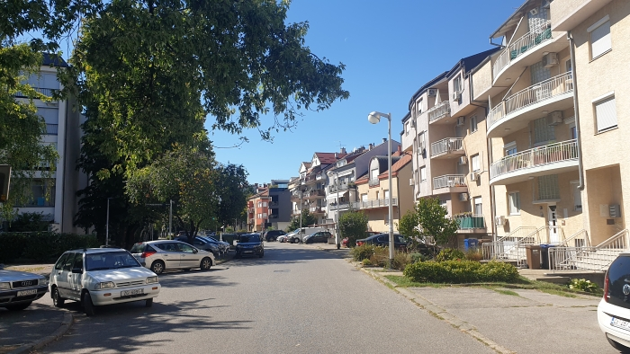

**Seniori – I. ekipa, 6.kolo**  


Jesenski dio sezone otvorili smo tijesnom [pobjedom](https://s2.chess-results.com/tnr1352607.aspx?lan=13&art=3&rd=6&SNode=S0) u Španskom. Meč je bio pun napetosti te je nakon tri sata igre i dalje bilo 0-0. Prvi je izgubio Lucijan koji je odigrao podjednaku partiju u kojoj je psihički pao nakon apsurdnog previda dame koji njegov protivnik nije iskoristio. Stjepko je odigrao kompleksnu i jako dobru partiju gdje je dominaciju iz otvaranja veoma uvjerljivo pretočio u čitav bod. Kao i Mladen u 4.kolu, pokazao je da se čuda mogu napraviti kada se ne remizira nakon pet minuta. Ivan Maravić je odigrao jednu blijedu partiju, ali treba dati i priznanje njegovu protivniku Blagojeviću koji je ispravno procijenio dugoročnu žrtvu figure te praktički bez greške pobijedio. Darko je odigrao jednu dobru partiju, u dva trenutka je počinio grubi previd gdje bi njegov protivnik Pauš žrtvom dame došao u jako dobru poziciju, na našu sreću, on to ne koristi te Darko lagano realizira materijalnu prednost. Prilažemo taj dvoboj uz ovaj članak. Mario je na početku partije i kroz većinu središnjice jako loše stajao. Tijekom cajtnota je uspio stvari preokrenuti u svoju korist. Međutim, zbog nedostatka vremena opet griješi te ulazi u forsirano izgubljenu poziciju. No, tada nas je pomazila sreća te je njegov iskusan protivnik, posežući za dobitničkim potezom, pao na vrijeme te je taj trenutak prelomio meč. Nakon partije, njegov protivnik Dadić je pokazao cijelu kombinaciju od više poteza kojom bi dobio partiju. Tu mu možemo samo čestitati i konstatirati da nam je drago da to nije stigao odigrati. Zadnji je ostao Ivan Vraneša koji je većinu partije imao pješaka manje, ali na kraju, njegov neiskusniji protivnik se ne snalazi najbolje u završnici te Ivan skroz preokreće partiju svojim slobodnjacima, tako postavljajući konačan rezultat 2-4. Iduće kolo ugošćujemo Sisak 20. rujna.

<table><tbody><tr><td>Pl.</td><td></td><td><strong>ŠK Špansko</strong></td><td>–</td><td></td><td><strong>ŠK Odra</strong></td><td><b>2-4</b></td></tr><tr><td>1.</td><td>MK</td><td>Blagojević, Marijan 2251</td><td>–</td><td>MK</td><td>Maravić, Ivan 2039</td><td>1-0</td></tr><tr><td>2.</td><td>MK</td><td>Dadić, Ivan 2043</td><td>–</td><td>MK</td><td>Ljubičić, Mario 2119</td><td>0-1</td></tr><tr><td>3.</td><td>I</td><td>Kovačić, Damir 2018</td><td>–</td><td>MK</td><td>Maravić, Stjepan 2049</td><td>0-1</td></tr><tr><td>4.</td><td>MK</td><td>Pauš, Veljko 1911</td><td>–</td><td>MK</td><td>Vidaković, Darko 2115</td><td>&nbsp;0-1</td></tr><tr><td>5.</td><td>I</td><td>Poljak, Nikola 1916</td><td>–</td><td>I</td><td>Hadviger, Lucijan 2014</td><td>1-0</td></tr><tr><td>6.</td><td>I</td><td>Biti, Tin 2065</td><td>–</td><td>II</td><td>Vraneša, Ivan 1881</td><td>0-1</td></tr></tbody></table>

```pgn
[Event "III A liga - Špansko : Odra"]
[Site "sahovski-klub.com"]
[Date "2026.09.06"]
[Round "6"]
[White "MK Vidaković, Darko"]
[Black "MK Pauš, Veljko"]
[Result "1-0"]
[ECO "D02"]
[WhiteElo "2115"]
[BlackElo "1911"]
1. d4 d5 2. Nf3 Nf6 3. g3 e6 4. Bg2 Nbd7 5. O-O b6 6. c4 Bb7 7. Nc3 dxc4 8. Qa4 a6 9. Qxc4 b5 10. Qd3 c5 11. Bf4 cxd4 12. Qxd4 Bc5 13. Qd3 Qb6 14. a4 b4 15. a5 Qd8 16. Na4 Be7 17. Rac1 Qxa5 18. b3 O-O 19. Bc7 Qd5 20. Qb1 Qe4 21. Qb2 Qg4 22. Ne5 Nxe5 23. Bxb7 Ra7 24. Bg2 Ned7 25. Rc4 Qh5 26. Bf3 Qb5 27. Bc6 Qf5 28. Bxd7 Nxd7 29. Qd4 Nc5 30. Nxc5 Rxc7 31. Nxe6 Qxe6 32. Rxc7 Rd8 33. Qc4 Qxc4 34. Rxc4 g6 35. Ra1 Rd2 36. Re4 Bc5 37. Rxa6 Rb2 38. Rc6 Bf8 39. Rc8 Kg7 40. Re3 h6 41. Kf1 Rb1+ 42. Kg2 Rb2 43. Kf3 Ra2 44. Rxf8 Kxf8 45. Re4 { Crni predaje. } 1-0
```

*IvanM*
