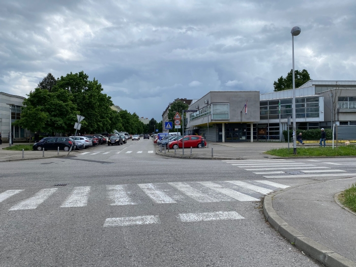

**Seniori, 1.kolo  
  
**  
Ovaj vikend smo započeli novu sezonu [3.A seniorske lige](https://chess-results.com/tnr886630.aspx?lan=13&art=3&rd=1). Ugostio nas je ŠK Špansko u Španskom. Prvi je završio kapetan Stjepko, sklopivši remi u jednakoj poziciji. Hrvoje je zapao u probleme nakon otvaranja, imao je jednu šansu da se izvuče, ali nakon tog promašaja je sve otišlo na mlin njegova protivnika. Vraneša je odigrao jako tešku partiju, njegov protivnik je žrtvovao za veliki pritisak, ali Vraneša se hladnokrvno branio i donio puni bod. Darko je odigrao, za sebe već tipično, jako dobru i preciznu partiju, ali mora se odati priznanje i njegovu protivniki Starešini koji je do cajtnota držao jednaku poziciju, a u cajtnotu ostavio figuru. Zvjezdan je upao u probleme i cajtnot zbog nepoznavanja teorije, imao je jednu studioznu priliku za izvući se, ali osim toga je njegov protivnik lijepo realizirao svoju prednost. Zadnji je ostao Ivan koji je imao pješaka više, ali uz svoju već poznatu tehniku realizacije, došao do punih pola boda. Na kraju, pravedna raspodjela bodova. Sljedeći vikend ugošćujemo ekipu ŠK Končar.

<table><tbody><tr><td>Pl.</td><td></td><td><strong>ŠK Špansko</strong></td><td>–</td><td></td><td><strong>ŠK Odra</strong></td><td><strong>3-3</strong></td></tr><tr><td>1.</td><td>MK</td><td>Blagojević, Marijan 2192</td><td>–</td><td>MK</td><td>Karlić, Zvjezdan 2099</td><td>1-0</td></tr><tr><td>2.</td><td>FM</td><td>Petrović, Zvonko 2117</td><td>–</td><td>MK</td><td>Maravić, Ivan 2079</td><td>½–½</td></tr><tr><td>3.</td><td>MK</td><td>Knežević, Krešimir 2056</td><td>–</td><td>MK</td><td>Maravić, Stjepan 2107</td><td>½–½</td></tr><tr><td>4.</td><td>I</td><td>Starešina, Alan 2062</td><td>–</td><td>MK</td><td>Vidaković, Darko 2127</td><td>0-1</td></tr><tr><td>5.</td><td>MK</td><td>Pauš, Veljko 2019</td><td>–</td><td>MK</td><td>Kovač, Hrvoje 2126</td><td>1-0</td></tr><tr><td>6.</td><td>I</td><td>Poljak, Nikola 2023</td><td>–</td><td>II</td><td>Vraneša, Ivan 1885</td><td>0-1</td></tr></tbody></table>

*IvanM*
