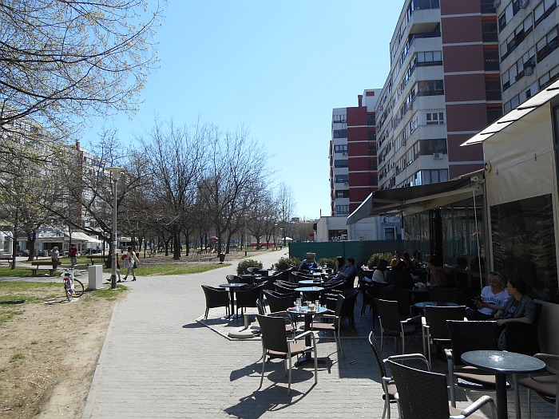

**Seniori, 2. kolo  
  
**U [drugom kolu](http://chess-results.com/tnr414083.aspx?lan=13&art=3&rd=2) seniorske lige donekle oslabljena ekipa ŠK Odra izborila je neriješen rezultat protiv vrlo dobre ekipe iz Španskog. Na trenutke se činilo da imamo i mogućnost pobjede. Kadeti Ivan i Vraneša danas su igrali na Kadetskom prvenstvu Zagreba, ali se nadamo da se vraćaju u ekipu već sljedeće kolo. Novi u postavi bio je Tin koji je pobjedom na šestoj ploči osigurao spasonosni bod i pomak sa začelja.  
Podbacio je jedino Boris koji je inače dobar igrač, ali u ekipnim nastupima ne pruža zadovoljavajuće rezultate. Možda zbog treme, možda zbog prevelikog htijenja.  
Sljedeće kolo igra se 31. ožujka kada smo domaćini ŠK Silent.

<table><tbody><tr><td></td><td>&nbsp;&nbsp;<strong>ŠK Špansko, Zagreb</strong></td><td><strong>–</strong></td><td><strong>&nbsp;</strong></td><td><strong>&nbsp;&nbsp;ŠK Odra, Zagreb</strong></td><td><strong>3 : 3</strong></td></tr><tr><td>MK</td><td><table><tbody><tr><td></td><td>Mravunac, Damir 2186</td></tr></tbody></table></td><td>–</td><td>MK</td><td><table><tbody><tr><td></td><td>Bačurin, Juraj 2050</td></tr></tbody></table></td><td>1 – 0</td></tr><tr><td>MK</td><td><table><tbody><tr><td></td><td>Vodopija, Goran 2043</td></tr></tbody></table></td><td>–</td><td>MK</td><td><table><tbody><tr><td></td><td>Maravić, Stjepan 2115</td></tr></tbody></table></td><td>0 – 1</td></tr><tr><td>MK</td><td><table><tbody><tr><td></td><td>Knežević, Krešimir 2052</td></tr></tbody></table></td><td>–</td><td>MK</td><td><table><tbody><tr><td></td><td>Karlić, Zvjezdan 2115</td></tr></tbody></table></td><td>½ – ½</td></tr><tr><td>I</td><td><table><tbody><tr><td></td><td>Benamatić, Krešimir 2029</td></tr></tbody></table></td><td>–</td><td>MK</td><td><table><tbody><tr><td></td><td>Cvetković, Ivan 1936</td></tr></tbody></table></td><td>½ – ½</td></tr><tr><td>II</td><td><table><tbody><tr><td></td><td>Poljak, Nikola 1905</td></tr></tbody></table></td><td>–</td><td>IV</td><td><table><tbody><tr><td></td><td>Kobali, Borislav 1660</td></tr></tbody></table></td><td>1 – 0</td></tr><tr><td>III</td><td><table><tbody><tr><td></td><td>Backović, Hrvoje 1858</td></tr></tbody></table></td><td>–</td><td>VK</td><td><table><tbody><tr><td></td><td>Furčić, Tin 1602</td></tr></tbody></table></td><td>0 – 1</td></tr></tbody></table>
