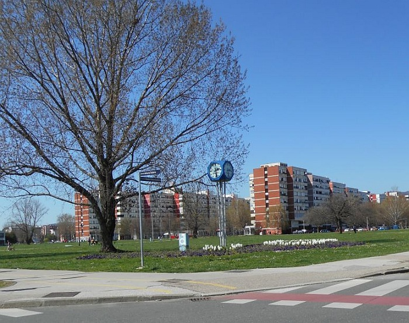
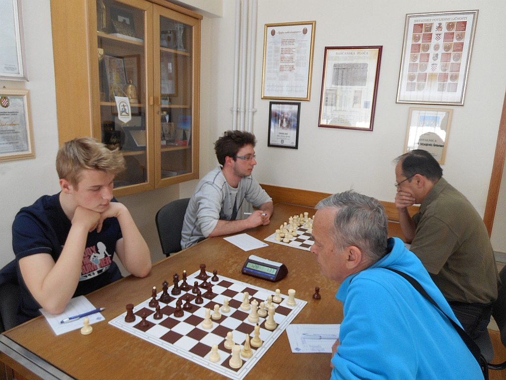
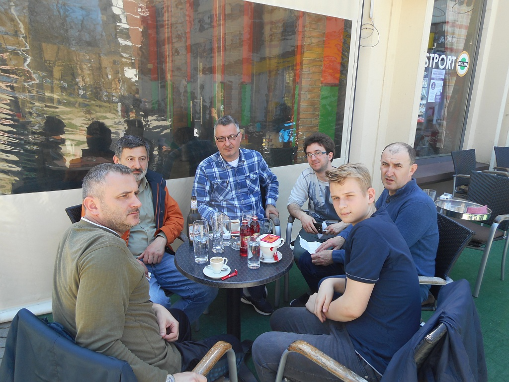

**Seniori, 2. kolo  
**[Drugo kolo](http://chess-results.com/tnr332243.aspx?lan=13&art=3&rd=2) seniorske lige gostovali smo kod ŠK Špansko. Ovo kolo priliku su dobili Boris i Tin jer su se Jura i Zvjezdan izvukli na poslovne obaveze, a od kadeta je igrao samo Vraneša jer i nogometna kadetska ekipa muku muči sa sastavljanjem tima. Donja polovica ekipe je odigrala očekivano. Boris opet nije izdržao, iako se dobro razvio. Nedostaje mu samopouzdanja i prodornosti. Tin i Vraneša su remizirali protiv respektabilnih protivnika, ali je podbacio rezultat na gornjim pločama. Stipe je uspio taktikom osvojiti damu za dvije figure i pješaka i onda je dugom i strpljivom igrom uspio realizirati tu minimalnu prednost. Darko je opet forsirao i čak imao puno ugodniju poziciju, ali na ulasku u završnicu uspio je i pogriješiti te ušao u izgubljenu poziciju, koju njegov protivnik zbog vremenskog tjsnaca u koji je upao, nije realizirao. Rezultat se slomio na trećoj ploči gdje je Cvetko odigrao “školski”, uspio u rokadnom napadu, osvojio figuru i kada smo svi očekivali predaju protivnika, Cvetko je previdio žrtvu  s matnim napadom. Šteta, jer taj jedan bod je odlučio i ekipnog pobjednika. A i Cvetku pada samopouzdanje, uprkos tome što dobro igra.  
Sljedeće kolo igra se 15. travnja kada smo domaćini ŠK Klaka.

**ŠK Špansko** – **ŠK Odra 3,5:2,5**  
1\. MK Mravunac, Damir 2213 – MK Maravić, Stjepan 2108 **0:1**  
2\. MK Knežević, Krešimir 2062 – MK Vidaković, Darko 2125 **1/2**  
3\. I Benamatić, Krešimir 2045 – MK Cvetković, Ivan 1969 **1:0**  
4\. MK Globan, Tomislav 2012 – IV Kobali, Boris 1665 **1:0**  
5\. MK Blagojević, Stanislav 1960 – III Vraneša, Ivan 1605 **1/2**  
6\. I Banek, Krešimir 1969 – VK Furčić, Tin 1586 **1/2  
  **  darko
