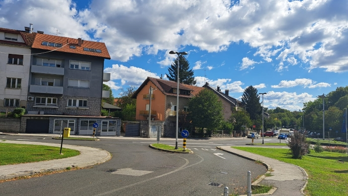

**Seniori, 9.kolo  
  
**  
Prošlu nedjelju smo odigrali jako loš meč te uvjerljivo i zasluženo [izgubili](https://chess-results.com/tnr886630.aspx?lan=13&art=3&rd=9). Prvi je završio Ivan koji je, slično kao Zvjezdan protiv Ivanića, loše odigrao otvaranje, ali Kovačević nije bio previše ratoboran te je sklopljen remi. Hrvoje je nažalost nastavio loš niz u koji je upao, pomiješao je izračunate varijante te ostao bez dame. Stjepko je također odigrao jako loše, krivo procijenio poziciju u koju ulazi te lagano izgubio. Mladen je dobro igrao, ali je trošio previše vremena, u dobivenoj poziciji previđa, a i pada na vrijeme. Jedina dobra vijest ovog kola jest da se Zvjezdan polako vraća svojoj staroj igri. Odigrao je dinamičnu partiju s par preokreta te na kraju taktikom osvojio materijal. Taj susret donosimo u prilogu. Vraneša je odigrao dosta dobro, došao i do dobivene završnice, ali na samom kraju, što zbog umora, što zbog neopreznosti, previđa međupotez i gubi. Više nego zaslužena pobjeda domaćina, koji su zaboravili počastiti barem kavom, a inače simpatična ekipa ŠK Stjepan Bosak ima nažalost suca Jergovića koji se ponaša kao da sudi Europsko prvenstvo. Čini se da mu nitko nije rekao da je ovo amaterska liga, iako, i da mu netko to kaže, ne vjerujem da bi shvatio.  
Iduće kolo igramo u Velikoj Gorici 20. listopada.

<table><tbody><tr><td>Pl.</td><td></td><td><strong>ŠK Stjepan Bosak</strong></td><td>–</td><td></td><td><strong>ŠK Odra</strong></td><td><strong>4,5-1,5</strong></td></tr><tr><td>1.</td><td>MK</td><td>Glažar, Domagoj 2156</td><td>–</td><td>MK</td><td>Karlić, Zvjezdan 2081</td><td>0-1</td></tr><tr><td>2.</td><td>MK</td><td>Kovačević, Krsto 2126</td><td>–</td><td>MK</td><td>Maravić, Ivan 2102</td><td>½–½</td></tr><tr><td>3.</td><td>I</td><td>Gujić, Vladimir 1978</td><td>–</td><td>MK</td><td>Maravić, Stjepan 2108</td><td>1-0</td></tr><tr><td>4.</td><td>MK</td><td>Ćosić, Radoslav 2051</td><td>–</td><td>MK</td><td>Sliepčević, Mladen 2092</td><td>1-0</td></tr><tr><td>5.</td><td>MK</td><td>Ognjačević, Alen 2036</td><td>–</td><td>MK</td><td>Kovač, Hrvoje 2116</td><td>1-0</td></tr><tr><td>6.</td><td>MK</td><td>Gujić, Leonard 1887</td><td>–</td><td>II</td><td>Vraneša, Ivan 1912</td><td>1-0</td></tr></tbody></table>

```pgn
[Event "III A liga - Stjepan Bosak : Odra"]
[Site "sahovski-klub.com"]
[Date "2024.09.29"]
[Round "9"]
[White "MK Glažar, Domagoj"]
[Black "MK Karlić, Zvjezdan"]
[Result "0-1"]
[ECO "D80"]
[WhiteElo "2156"]
[BlackElo "2081"]
[PlyCount "126"]

1. d4 Nf6 2. c4 g6 3. Nc3 d5 4. Bg5 c6 5. Bxf6 exf6 6. cxd5 cxd5 7. Qb3 Nc6 8. e3 Bb4 9. Bb5 Qa5 10. Bxc6+ bxc6 11. Ne2 Ba6 12. a3 Bxe2 13. Kxe2 Qa6+ 14. Kf3 Bd6 15. Rhc1 h5 16. Qa4 Qc8 17. Ke2 O-O 18. Kf1 a5 19. Kg1 Qe6 20. Rc2 h4 21. h3 Rfb8 22. Rac1 g5 23. Nd1 g4 24. hxg4 Qxg4 25. Qxc6 Rc8 26. Qxc8+ Rxc8 27. Rxc8+ Kg7 28. Kf1 Qe4 29. R8c3 f5 30. f4 Be7 31. Nf2 Qe6 32. Ke2 Qg6 33. Kf1 Qe6 34. Rc6 Qxe3 35. Re1 Qb3 36. Rxe7 Qb5+ 37. Kg1 Qxc6 38. Nd3 Qb6 39. Ne5 Qxd4+ 40. Kh1 Qxf4 41. Rxf7+ Kh6 42. Rf6+ Kg5 43. Re6 Qc1+ 44. Kh2 Qxb2 45. a4 f4 46. Nd3 Qc2 47. Re5+ Kf6 48. Rxd5 Qxa4 49. Rd6+ Ke7 50. Re6+ Kf7 51. Re2 Qa3 52. Ne5+ Kf6 53. Nd7+ Kg7 54. Ne5 a4 55. Nf3 Qb3 56. Nd4 Qd3 57. Re7+ Kf6 58. Rd7 a3 59. Ra7 h3 60. gxh3 Qg3+ 61. Kh1 Qxh3+ 62. Kg1 Qe3+ 63. Kg2 Qxd4 0-1
```

  
*IvanM*
