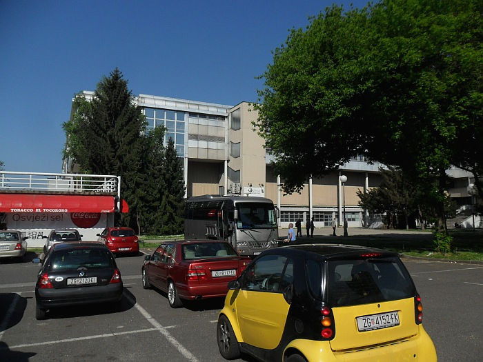
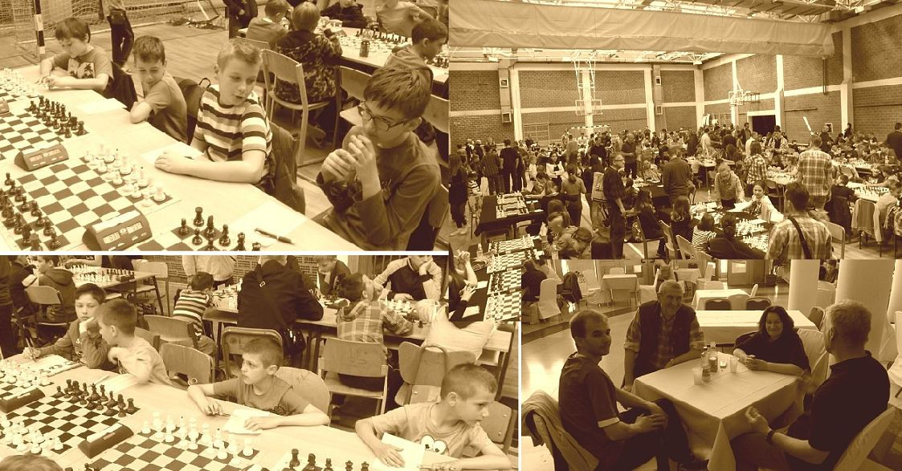

**Seniori, 4. kolo  
  
**

U četvrtom kolu seniorske lige ekipa ŠK Stjepan Bosak – URIHO uvjerljivo i zasluženo pobijedila je ŠK Odra. Naš kadet Ivan danas je za seniorsku ekipu skupio jednak broj bodova kao ostatak ekipe od pet seniora! Cvetko i Darko previdjeli su po topa i damu u vremenskom tjesnacu, a Cvetku je to uspjelo u dobivenoj poziciji. Boris je opet našao način nekako izgubiti pješaka te tako i partiju, dok je neispavani Jura po povratku sa sinoćnje svadbe ipak uspio remizirati. Na prvoj ploči Stipe je imao nekoliko nepreciznosti, što je njegovu protivniku bilo dovoljno da pritiskom dođe u dobivenu poziciju.

**ŠK Stjepan Bosak – URIHO, Zagreb –  ŠK Odra, Zagreb 5:1**  
1\. FM Rosandić, Denis – MK Maravić, Stjepan 1:0  
2\. MK Glažar, Domagoj – MK Vidaković, Darko 1:0  
3\. MK Kovačević, Krsto – MK Bačurin, Juraj ½  
4\. MK Ognjačević, Alen – MK Cvetković, Ivan 1:0  
5\. II Matana, Zoran – IV Kobali, Borislav 1:0  
6\. IV Glažar, Zvonko-Karlo – IV Maravić, Ivan ½

Sljedeće kolo igra se 10. svibnja u Odri, a gost je ekipa ŠK Špansko.

**Kadetska liga – završni krug  
**Jučer su u Novom Zagrebu u Ugostiteljsko-turističkom učilištu odigrana završna kola kadetskih liga. U višu ligu iz IV. kadetske lige, u kojoj se natječu i naši kadeti, plasirale su se ekipe **ŠD Moslavina** iz Kutine i **ŠK Novi Zagreb II**, a ova potonja baš pobjedom u posljednjem kolu nad našom prvom ekipom. Gledajući [rezultate](http://chess-results.com/tnr163328.aspx?lan=13&art=0&wi=821 "IV kadetska liga"), nešto su slabiji nego prošle godine, ali smo  dobili  još jednoga standardnog igrača, Luku Frana, dok mlađem Luki nedostaje još malo koncentracije pa će se i on pridružiti prvoj ekipi po snazi. Inače, dečki su bili pomalo odsutni i dekoncentrirani, posebno Vraneša, a pridružio mu se i Ivan, samo su Bruno i Božo pokazali dovoljno truda. Božo je ove godine odigrao nekoliko briljantnih partija, a ostvario je i nevjerojatan [rezultat](http://chess-results.com/tnr163328.aspx?lan=13&art=20&wi=821&snr=26 "rezultati ODRA I") 8/9! Vjerujem da će vrlo brzo postati naš drugi kadet s osvojenom kategorijom. Što se tiče djevojaka, one su također postigle slabiji rezultat, ali je veliki napredak što su već gotovo svladale pisanje. Marko, Juraj i Petar nastupili su prvi put i prilično se dobro snašli. Još nema rezultata, ali, vjerujem, za godinu dana i na rezultatskom će području  pokazati napredak, kao što je Luka ove godine ubilježio prvu pobjedu, i to igrajući na drugoj ploči!

[KADETSKE LIGE bilten br.3](/files/wp/2015/04/KADETSKE-LIGE-bilten-br.3.pdf "Završni bilten, kadetske lige 2015.")
