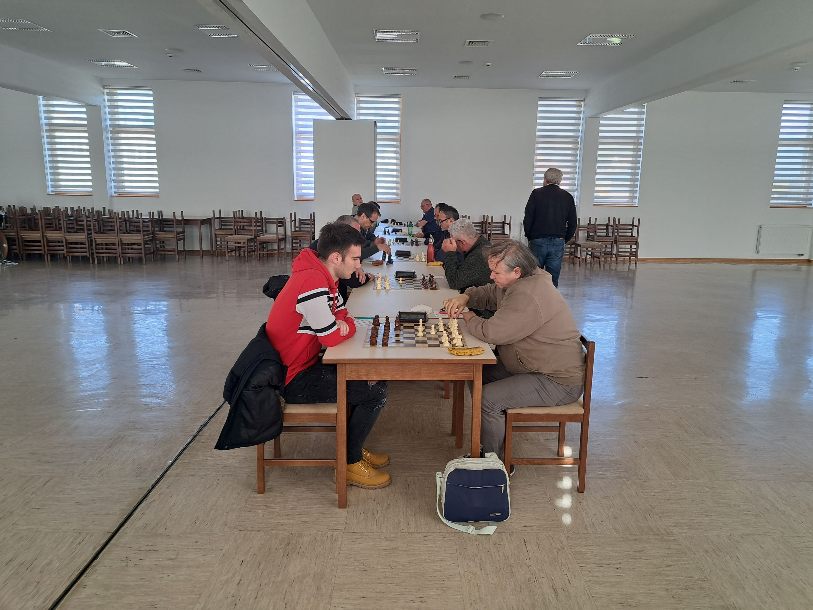

**Seniori, 2. kolo**  

<table><tbody><tr><td>Pl.</td><td></td><td><strong>ŠK Straža</strong></td><td>–</td><td></td><td><strong>ŠK Odra</strong></td><td><strong>3,5-2,5</strong></td></tr><tr><td>1.</td><td>MK</td><td>Matić, Željko 2169</td><td>–</td><td>MK</td><td>Maravić, Ivan 2091</td><td>1-0</td></tr><tr><td>2.</td><td>MK</td><td>Zelenika, Zoran 2117</td><td>–</td><td>MK</td><td>Maravić, Stjepan 2116</td><td>½–½</td></tr><tr><td>3.</td><td>MK</td><td>Bašić, Krešimir 2075</td><td>–</td><td>MK</td><td>Sliepčević, Mladen 2081</td><td>½–½</td></tr><tr><td>4.</td><td>MK</td><td>Hećimović, Ivan 2066</td><td>–</td><td>MK</td><td>Bačurin, Juraj 2013</td><td>½–½</td></tr><tr><td>5.</td><td></td><td>Goručan, Jožef 1702</td><td>–</td><td>MK</td><td>Kovač, Hrvoje 2124</td><td>0-1</td></tr><tr><td>6.</td><td>IV</td><td>Krklec, Josip 1728</td><td>–</td><td>II</td><td>Šutić, Darko 1926</td><td>1-0</td></tr></tbody></table>

Prošle nedjelje smo odigrali 2. kolo [seniorske lige](https://chess-results.com/tnr730961.aspx?lan=13&art=3&rd=2). Izgubili smo od ŠK Straža rezultatom 3,5:2,5. Po prikazanoj igri nismo zaslužili više. Nakon brzih remija na drugoj i četvrtoj ploči, Mladen je također remizirao nakon što se uspio izvući iz manjih problema u koje je zapao u otvaranju. Hrvoje je u svom debiju za Klub odigrao sumnjivo otvaranje, ali njegov protivnik je ubrzo nekorektno žrtvovao figuru te nakon toga nije bilo povratka. Hrvoje je imao lijepu tehniku i mirno priveo partiju kraju. Šutić je izašao iz otvaranja puno bolji, ali nakon lutanja bez plana u središnjici zapao u probleme. Imao je šansu uzeti kvalitetu u jednome momentu koju nije iskoristio te je njegov protivnik mirno priveo partiju kraju. Ivan je zadnji ostao igrati, iz otvaranja je izašao bez ikakvih problema, čak je imao šansu postati dosta bolji u jednom trenutku, koju nije iskoristio. Nakon toga je apsolutno nepotrebno prešao u neugodnu završnicu koju je svojim znanjem i tehnikom igre završnica na kraju izgubio. Sve u svemu, zaslužen poraz. Do prvih bodova ćemo probati doći iduće nedjelje kada ugošćujemo ŠK Polet.
