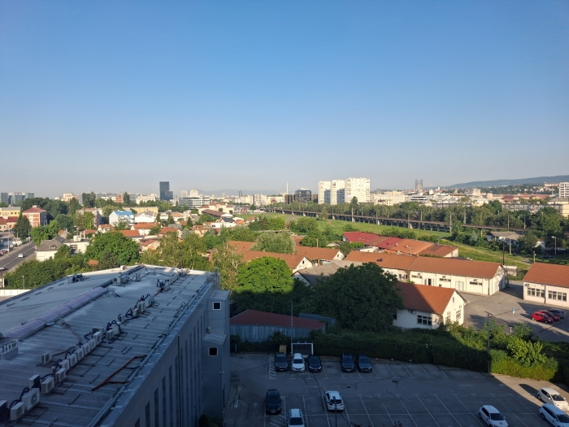

**Seniori – I. ekipa, 4.kolo**  


Prošlu nedjelju smo [remizirali](https://s1.chess-results.com/tnr1352607.aspx?lan=13&art=3&rd=4&SNode=S0) protiv mlade ekipe iz Sv.Nedelje u borbenom meču. Meč je krenuo jako loše jer su Stjepko i Zvjezdan učinili grube previde te je to bilo rano vodstvo za naše protivnike. Mario je odigrao jednu jako dobru partiju te je malo po malo njegova prednost rasla dok nije došao do dobivene pozicije. Ivana je upisala prvi ovosezonski poraz u partiji gdje ju je njen protivnik Ljubić nadigrao. Mladen je odigrao dobru partiju, brzo došao do dobivene pozicije te se samo realizacija malo odužila. Pokazao je da može odigrati dobro kada igra, nadamo se da će mu ovo biti podstrek da ne remizira nakon pet minuta u budućnosti. Partiju donosimo u prilogu. Zadnji je ostao Ivan Vraneša koji je odigrao nekarakteristično lošu partiju koja je sadržavala puno preokreta i previda. Na našu sreću, Ivan je pretposljedni previdio te upisao cijeli pojedinačni, a spasio i meč bod. Kako je počelo, možemo biti zadovoljni podjelom bodova.

<table><tbody><tr><td>Pl.</td><td></td><td><strong>ŠK Sveta Nedelja II</strong></td><td>–</td><td></td><td><strong>ŠK Odra</strong></td><td><b>3-3</b></td></tr><tr><td>1.</td><td>MK</td><td>Šimunković, Bartol 2090</td><td>–</td><td>MK</td><td>Karlić, Zvjezdan 2034</td><td>1-0</td></tr><tr><td>2</td><td>MK</td><td>Malarić, Marko 2010</td><td>–</td><td>MK</td><td>Ljubičić, Mario 2107</td><td>0-1</td></tr><tr><td>3.</td><td>I</td><td>Mahečić, Lovre 2039</td><td>–</td><td>MK</td><td>Maravić, Stjepan 2072</td><td>1-0</td></tr><tr><td>4.</td><td>I</td><td>Galoić, David 2001</td><td>–</td><td>MK</td><td>Sliepčević, Mladen 2045</td><td>0-1</td></tr><tr><td>5.</td><td>I</td><td>Ljubić, Luka 1917</td><td>–</td><td></td><td>Mikić, Ivana 1906</td><td>1-0</td></tr><tr><td>6.</td><td>II</td><td>Radalj, Niko 1713</td><td>–</td><td>II</td><td>Vraneša, Ivan 1863</td><td>0-1</td></tr></tbody></table>

```pgn
[Event "III A liga - Sveta Nedelja II : Odra"]
[Site "sahovski-klub.com"]
[Date "2026.04.24"]
[Round "4"]
[White "MK Sliepčević, Mladen"]
[Black "I Galoić, David"]
[Result "1-0"]
[ECO "B23"]
[WhiteElo "2045"]
[BlackElo "2001"]
1. e4 c5 2. Nc3 d6 3. g3 Nf6 4. Bg2 e6 5. d3 Be7 6. f4 Nc6 7. Nf3 a6 8. O-O O-O 9. h3 b5 10. Be3 Bb7 11. Ne2 e5 12. g4 d5 13. fxe5 Nd7 14. e6 fxe6 15. Nf4 dxe4 16. Nxe6 Qc8 17. dxe4 Rf7 18. Neg5 Bxg5 19. Nxg5 Rxf1+ 20. Qxf1 Nce5 21. Qf5 g6 22. Qe6+ Kh8 23. Qe7 Qg8 24. Bxc5 Re8 25. Qd6 Qc4 26. Bd4 Kg8 27. Rf1 h6 28. Bxe5 Nxe5 29. b3 Qxc2 30. Ne6 Qc8 31. Rf6 Qb8 32. Nc7 Nf7 33. Rxg6+ Kh7 34. Qf6 1-0
```

*IvanM*
