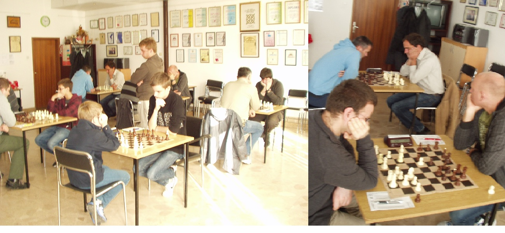

**8\. kolo, seniori**

Seniorska šahovska ekipa pretrpjela  je težak poraz od danas znatno jače ekipe ŠK Sveta Nedelja.  Partije i nisu bile toliko loše, ali su strpljenje, upornost i volja na strani igrača Sv. Nedelje prevagnuli.  Na prvoj i drugoj ploči Stipe i Zvjezdan izgubili su u dubokim završnicama, kada je koncentracija najpotrebnija, ali i najmanja. Darko je na trećoj ploči iskoristio pasivnost u otvaranju protivnika i u matnom napadu ostvario materijalnu prevagu. Jura se opet izgubio u planovima, preciznije, opet je krenuo u napad na krivoj strani. Vjeko je od otvaranja ušao u komplikacije, dao i materijal, imao napad, ali kada se njegov mladi protivnik obranio, partija je bila završena. Ivan je na šestoj opet (slično kao i u Jastrebarskom) krivo izmijenio lovca na e6. Poslije partije izjavio je da mu uopće nije palo na pamet da svog lovca s c4 brani i zadrži pritisak na d5, umjesto da ga mijenja  za protivničkoga. Uglavnom, zaslužena visoka pobjeda ŠK Sveta Nedelja.

ŠK SVETA NEDELJA  – ŠK ODRA                  5:1

1\. Ivan Kalajžić – Stjepan Maravić                   1:0  
2\. Igor Ševo – Zvjezdan Karlić                         1:0  
3\. Ivan Peles – Darko Vidaković                       0:1  
4\. Tomislav Jazvić – Juraj Bačurin                   1:0  
5\. Hrvoje Požgaj – Vjekoslav Novak                1:0  
6\. Danijel Vojak – Ivan Maravić                        1:0
