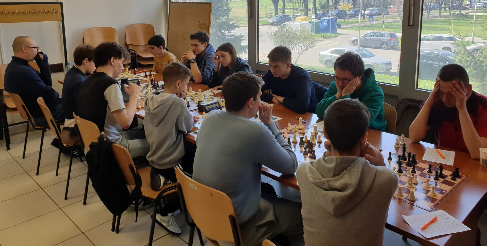

###### Seniori – II. ekipa, 1.kolo  


Protekle nedjelje, 15. ožujka, u [**prvom kolu nove sezone**](https://s3.chess-results.com/tnr1352599.aspx?lan=13&art=3&rd=1&SNode=S0) druga ekipa ŠK Odra gostovala je kod ekipe ŠK Travno II, gdje je upisan poraz rezultatom 4:2.

Ekipa je nastupila u sastavu: Božo, Tin Furčić, Luka, Ivana, Slavko i Filip Horvat.

**Kapetan Božo** dobro je otvorio partiju i stekao blagu prednost u središnjici, no uslijed nedostatka vremena i nekoliko nepreciznosti pozicija se preokrenula u izgubljenu.

**Tin**, koji se ove sezone priključio drugoj ekipi, još traži pravu formu te je u ovom susretu upisao poraz.

**Luka** je vrlo uvjerljivo ušao u partiju i već u ranoj fazi imao priliku taktički osvojiti figuru, no nije je uočio. Nakon toga pozicija se izjednačila, a razmjenom topova prešlo se u pješačku završnicu koja je, nažalost, završila porazom.

**Ivana** se solidno razvila iz otvaranja, no protivnik je preciznom igrom postupno gradio napad i na kraju došao do pobjede.

**Slavko** je dobro otvorio partiju, a ubrzo nakon toga protivnik radi grubi previd i ostavlja figuru, što Slavko koristi i sigurno privodi partiju kraju. Sjajan početak sezone! Njegovu partiju donosimo u prilogu.

**Filip** je odigrao dinamičnu i taktički bogatu partiju punu komplikacija, u kojoj je uspio zbuniti protivnika i zasluženo upisati pobjedu.

Mlade nade ekipe donijele su dva boda, na čemu im čestitamo! Očekujemo buđenje ostatka ekipe već u sljedećem kolu, kada ŠK Odra II gostuje kod ŠK Dugo Selo II.

<table><tbody><tr><td>Pl.</td><td></td><td><strong>ŠK Travno II</strong></td><td>–</td><td></td><td><strong>ŠK Odra II</strong></td><td><b>4-2</b></td></tr><tr><td>1.</td><td>&nbsp;III</td><td>Benković, Duje</td><td>–</td><td>III</td><td>Cvetković, Božo</td><td>1-0</td></tr><tr><td>2.</td><td>&nbsp;IV</td><td>Milanović Bolfek, Mak</td><td>–</td><td>III</td><td>Furčić, Tin</td><td>1-0</td></tr><tr><td>3.</td><td>&nbsp;III</td><td>Marić, Mihael</td><td>–</td><td>&nbsp;IV</td><td>Fiolić, Luka</td><td>1-0</td></tr><tr><td>4.</td><td>&nbsp;II</td><td>Muha, Martin</td><td>–</td><td>&nbsp;II</td><td>&nbsp;Fiolić, Ivana</td><td>1-0</td></tr><tr><td>5.</td><td>&nbsp;V</td><td>Maurović, Šimun</td><td>–</td><td>&nbsp;V</td><td>&nbsp;Biondić, Slavko</td><td>0-1</td></tr><tr><td>6.</td><td></td><td>Sladoljev, Tomislav</td><td>–</td><td>&nbsp;V</td><td>&nbsp;Horvat, Filip</td><td>0-1</td></tr></tbody></table>

```pgn
[Event "5. Liga ŠZŽ Centar 2025"]

[Site "Travno"]
[Date "2026.03.15"]
[Round "1"]
[White "V Maurović Šimun (1528)"]
[Black "V Biondić Slavko (1554)"]
[Result "0-1"]

1. d4 d5 2. Nc3 e6 3. Bf4 Bb4 4. Qd3 Bd6 5. e3 Nf6 6. Nf3 O-O 7. Be2 b6 8. O-O Bb7 9. Qd1 c5 10. Nb5 Bxf4 11. exf4 a6 12. Nc3 Nbd7 13. Ne5 Qc7 14. Qd3 c4 15. Qh3 b5 16. Nb1 b4 17. Nd2 a5 18. Ndf3 Ne4 19. Ng5 Nxg5 20. fxg5 Nxe5 21. dxe5 Qxe5 22. f4 Qxe2 23. Rf2 Qe4 0-1
```
